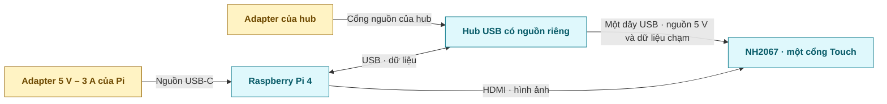

# Hướng dẫn sử dụng màn hình NH2067 với Raspberry Pi 4

**PBL6 · 07/11/2026**

Tài liệu này hướng dẫn nối màn với Pi 4, thử hình ảnh và cảm ứng, rồi kiểm tra lại khi thêm mic hoặc loa. Với bộ đang hoạt động, dùng **cáp HDMI cho hình ảnh**, **một dây USB cho cổng Touch đã thử** và **adapter 5 V – 3 A sẵn có cho Pi**. [BOM PBL6](STT_BOM.md)

## 1. Nhận diện đúng bo và chuẩn bị dây

Trang Nguyễn Hiền dùng mã bán hàng **NH2067** cho màn cảm ứng HDMI 7 inch, **1024 × 600**. Ảnh của bo nhóm đang dùng cho thấy dòng **7inch HDMI Display**, **1024 × 600 Pixel**, **USB Touch** và hai cổng cùng ghi **Touch**. Một cổng gần công tắc ON/OFF, cổng kia gần HDMI. [Trang NH2067](https://www.dientunguyenhien.vn/show/2067)

Ảnh trên trang bán minh họa **Waveshare 7inch HDMI LCD (C) Rev4.1**, có một cổng micro‑USB và một hàng chân hàn. Mẫu **LCDWiki MPI7002** có bố trí hai cổng Touch tương tự bo của nhóm. Tài liệu MPI7002 mô tả mỗi cổng của mẫu đó đều dùng được cho nguồn và dữ liệu chạm, mỗi lần chỉ cần một cổng. <strong style="background-color:#FFF3C4;color:#6E4900;padding:1px 4px;border-radius:3px;">Cần xác minh</strong> mã bo thực tế và cách hai cổng chia sẻ đường 5 V. [Ảnh trên trang bán](https://www.dientunguyenhien.vn/public/images/lcd_7inch_1.jpg) · [Tài liệu Waveshare](https://www.waveshare.com/wiki/7inch_HDMI_LCD_%28C%29#Interface_Introduction) · [Tài liệu MPI7002, trang 7](https://www.lcdwiki.com/res/MPI7002/7inch_MPI7002_datasheet.pdf#page=7)

**Bảng 1.** Dây cần dùng khi nối trực tiếp Pi 4 với màn.

| Dây | Đầu ở Pi 4 | Đầu còn lại | Công dụng |
| --- | --- | --- | --- |
| **Micro‑HDMI → HDMI** | Micro‑HDMI, ưu tiên **HDMI0** khi thử một màn | Cổng HDMI trên màn | Đưa hình từ Pi lên màn |
| **USB‑A → micro‑USB có dữ liệu** | USB‑A | Một cổng **Touch** đã thử | Nguồn qua USB và dữ liệu cảm ứng |
| **Adapter 5 V – 3 A** | Cổng nguồn **USB‑C** | Ổ điện | Cấp điện cho Pi |

Dây sạc chỉ có đường nguồn có thể làm màn sáng, nhưng cần dây USB **có truyền dữ liệu** để Pi nhận thao tác chạm. [Cổng và nguồn Raspberry Pi 4](https://www.raspberrypi.com/documentation/computers/raspberry-pi.html#power-supply)

## 2. Kết nối và kiểm tra

### 2.1. Cắm trực tiếp với adapter sẵn có

1. Nếu Pi đang chạy, tắt qua menu hệ điều hành, chờ tắt hẳn rồi ngắt adapter.
2. Nối **micro‑HDMI trên Pi** với **HDMI trên màn**. Nối **USB‑A trên Pi** với **cổng Touch đã thử** trên màn. Để trống cổng Touch kia.
3. Đặt công tắc màn ở **ON**, cắm lại adapter của Pi và chờ vào desktop. Kiểm tra lên hình, rồi chạm một lần vào một nút.

<strong style="background-color:#FDE7E7;color:#A71F31;padding:1px 4px;border-radius:3px;">Cách đấu cần tránh</strong> Cắm USB từ Pi vào một cổng Touch rồi cắm củ sạc vào cổng Touch thứ hai. Nếu hai cổng dùng chung đường 5 V, cách đấu đó nối hai nguồn song song. Điện áp không cộng thành 10 V, nhưng dòng điện có thể chạy ngược qua USB về Pi và bỏ qua mạch bảo vệ nguồn. [Giải thích cấp ngược nguồn của Raspberry Pi](https://www.raspberrypi.com/documentation/computers/raspberry-pi.html#back-powering)

### 2.2. Dùng hub có nguồn riêng nếu cần

Khi bộ ngoại vi thực tế vượt khả năng cấp nguồn USB của Pi, có thể dùng hub USB có adapter riêng. Chọn hub có truyền dữ liệu và có thiết kế tránh cấp điện ngược về Pi. **Adapter của hub cắm vào cổng nguồn của hub.** Hình 1 cho thấy Pi và hub dùng hai adapter riêng, còn màn dùng một cổng Touch. [Nguồn và thiết bị USB trên Pi](https://www.raspberrypi.com/documentation/computers/raspberry-pi.html#typical-power-requirements)



**Hình 1.** Sơ đồ đề xuất khi dùng hub có nguồn riêng. Mũi tên USB từ hub đến màn chỉ hướng cấp điện. Dữ liệu chạm đi từ màn qua hub về Pi trên cùng dây USB. HDMI vẫn nối thẳng từ Pi đến màn.

Để chuyển cách nối, tắt Pi và ngắt nguồn Pi lẫn hub. Chuyển đầu USB của dây màn từ Pi sang **cổng USB thiết bị trên hub**, rồi nối dây USB của hub về Pi. Cắm adapter của Pi và adapter đúng loại của hub vào cổng nguồn tương ứng, sau đó thử lên hình và chạm. Củ sạc cắm trực tiếp vào Touch chỉ cấp điện. Để cảm ứng điều khiển Pi, dây Touch cần có đường dữ liệu về Pi.

### 2.3. Thử hình ảnh, chạm và bàn phím

1. **Độ phân giải.** Trên **Raspberry Pi OS Trixie Desktop**, vào **Preferences → Control Centre → Screens** và đọc **Resolution** của màn HDMI. Nếu đang ở **1024 × 600**, giữ thiết lập đó. Nếu danh sách có mức này nhưng Pi đang dùng mức khác, chọn **1024 × 600**, bấm **Apply** rồi xác nhận nếu hình hiển thị đúng. Nếu mức này không xuất hiện, ghi lại tên ngõ HDMI và các chế độ hiện có. [Cài đặt màn hình Raspberry Pi OS](https://www.raspberrypi.com/documentation/computers/configuration.html#configure-display-settings)
2. **Cảm ứng.** Chạm một lần vào vài nút ở các vị trí cách xa nhau. Ghi lại nút phản hồi ngay, cần chạm lại hay bị lệch. Thử cuộn một trang dài và ghi riêng kết quả cuộn.
3. **Bàn phím ảo.** Chạm ô nhập trên desktop, gõ thử **“Tôi muốn hỏi giờ làm việc.”** rồi dùng **Xóa / Backspace**. Nếu bàn phím chưa hiện và thanh tác vụ có biểu tượng bàn phím, dùng biểu tượng đó để mở. Khi có bản kiosk, thử lại trong vùng soạn để xác nhận gõ dấu tiếng Việt, nhìn thấy câu đang sửa và chạm được **Gửi** khi bàn phím mở. [Cài đặt bàn phím ảo](https://www.raspberrypi.com/documentation/computers/configuration.html#configure-onscreen-keyboard) · [Bản phác PBL6 khi mở bàn phím](reports/ui_ux_20261107/assets/wireframe-ban-phim-ao.png)

### 2.4. Thử thêm thiết bị và kiểm tra nguồn

Với kiosk trên Pi, thử **Pi + màn** trước, sau đó thêm **webcam Aioneus** và dùng mic tích hợp để thu thử. Dùng tai nghe 3,5 mm đang có để thử phát, rồi thêm loa ở lượt sau. Nếu loa lấy điện từ USB của Pi, tính loa vào tải USB. Loa chủ động có nguồn riêng và ngõ AUX có thể nhận âm thanh qua jack 3,5 mm. Camera nhận dạng ký hiệu gắn vào máy chạy nhận dạng, chẳng hạn laptop. Khi hai dự án được tích hợp, Pi nhận văn bản để hiển thị hoặc đọc. [BOM thiết bị](STT_BOM.md) · [Đặc tả thu âm trên Pi](STT_SYSTEM_SPEC.md) · [Chọn đầu ra âm thanh](https://www.raspberrypi.com/documentation/computers/configuration.html#change-audio-output)

Pi 4 Model B có giới hạn **1,2 A tổng cho thiết bị USB**. Mức **2,5 W ở 5 V** là thông số của mẫu Waveshare tham chiếu. Dòng của bo hai cổng chưa được đo. Khi ứng dụng trên Pi sẵn sàng, thử một lượt **thu → nhận dạng → gửi → phát** với bộ ngoại vi dự định dùng. Quan sát màn có chớp, cảm ứng có ngắt quãng và âm thanh có mất kết nối hay không. [Giới hạn nguồn USB của Pi](https://www.raspberrypi.com/documentation/computers/raspberry-pi.html#typical-power-requirements) · [Thông số mẫu Waveshare](https://www.waveshare.com/wiki/7inch_HDMI_LCD_%28C%29#Specification)

Mở **Terminal trên Pi** và chạy lệnh sau trước và sau lượt thử:

```bash
vcgencmd get_throttled
```

Ghi lại hai kết quả và thiết bị đang cắm. `throttled=0x0` nghĩa là không có cờ cảnh báo trong kết quả đọc. Cờ `0x1` báo Pi đang phát hiện sụt áp, còn `0x10000` báo đã từng phát hiện sụt áp. Các cờ có thể xuất hiện cùng nhau. Lệnh theo dõi tình trạng Pi. Vẫn cần kiểm tra màn và ngoại vi bằng thao tác thực tế. [Giải nghĩa cờ trên Raspberry Pi OS](https://www.raspberrypi.com/documentation/computers/os.html#get_throttled)

### 2.5. Xử lý khi gặp lỗi

**Bảng 2.** Kiểm tra đầu tiên theo triệu chứng.

| Hiện tượng | Kiểm tra trước |
| --- | --- |
| Màn tối khi Pi đã khởi động | Kiểm tra dây USB vào cổng Touch đã thử và công tắc màn ở **ON**. |
| Đèn nền sáng nhưng chưa có hình | Kiểm tra hai đầu HDMI. Thử khởi động với một màn cắm sẵn ở **HDMI0**. |
| Có hình nhưng chưa nhận chạm | Thử dây **USB‑A → micro‑USB có truyền dữ liệu**. |
| Chạm lệch hoặc điều khiển nhầm màn | Thử với riêng NH2067 ở hướng **Normal**. Ghi rõ nếu chỉ lệch khi xoay hoặc gắn thêm màn. |
| Màn chớp hoặc chạm ngắt quãng khi thêm ngoại vi | Thử lại với Pi và màn trước. Thêm từng thiết bị, kiểm tra nguồn Pi và dây USB khi lỗi xuất hiện. |

Nếu đã có hình mà cảm ứng vẫn lỗi, mở **Terminal trên Pi** bằng chuột hoặc bàn phím vật lý và chạy:

```bash
cat /etc/os-release
lsusb
```

Gửi lại phiên bản hệ điều hành, đầu ra `lsusb`, cổng Touch đang cắm và triệu chứng. `lsusb` cho biết Pi nhận thiết bị nào qua USB. Đối chiếu thêm phản hồi khi chạm để kiểm tra điều khiển thực tế.

## 3. Kết quả thử trên Pi 4

<strong style="background-color:#DDF7E9;color:#0B6B45;padding:1px 4px;border-radius:3px;">Đã thử</strong> Theo báo cáo của người dùng ngày **07/11/2026**, màn **lên hình và nhận chạm** khi kết nối với Pi 4. Người dùng thấy cảm giác chạm hơi khác điện thoại. [Ghi nhận trong BOM](STT_BOM.md)

<strong style="background-color:#FFF3C4;color:#6E4900;padding:1px 4px;border-radius:3px;">Cần xác minh</strong> Ghi lại độ phân giải đầu ra thực tế, cổng Touch đang dùng, chạm có đúng vị trí và cuộn có đều hay không. Khi thử trong kiosk, ghi thêm kết quả bàn phím ảo tiếng Việt và thao tác **Gửi**. Sơ đồ hub ở Hình 1 là phương án lắp nếu cần, chưa có kết quả thử trên bộ thiết bị của nhóm.
