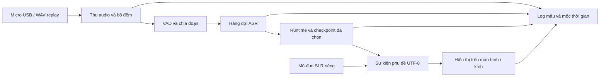

# Đặc tả nghiên cứu ASR tiếng Việt trên Raspberry Pi 4 cho phụ đề kính thông minh

Phiên bản 1.0 — ngày 09/10/2026. Phạm vi thực hiện: **một người, bảy tuần, sử dụng mô hình đã huấn luyện**. Đây là kế hoạch nghiên cứu và tích hợp thử nghiệm; các chỉ số hiệu năng phải được đo trước khi kết luận.

Tài liệu này được viết mới từ các trao đổi về mô hình, dữ liệu, khái niệm ASR, các giai đoạn nghiên cứu và yêu cầu phần cứng hiện tại. Tài liệu `SPEC_STT_SMART_GLASSES.md` được giữ làm lịch sử dự án. Khi có khác biệt, yêu cầu hiện tại và bản đặc tả này định hướng phần STT.

Để bắt đầu triển khai, đọc mục 1–5, 10–12 và lịch ở mục 14. Mục 7–9 giải thích input và phép đo; mục 13, 18–21 là phần đối chiếu kiến thức và nguồn. Việc làm trong buổi đầu được ghi ở mục 22.

## 1. Mục tiêu và phạm vi hoàn thành

Mục tiêu là tìm một cấu hình nhận dạng tiếng nói tiếng Việt có sẵn, đủ tốt để tạo phụ đề trong bản thử nghiệm kính thông minh, và giải thích lựa chọn bằng kết quả thực nghiệm. Người thực hiện cần hiểu cách đưa âm thanh vào mô hình, so sánh chất lượng phiên âm, đo tài nguyên trên Pi và nối kết quả với phần hiển thị. Hoàn thành đề tài không phụ thuộc vào việc tự thiết kế kiến trúc hoặc huấn luyện thêm.

ASR, viết tắt của Automatic Speech Recognition, là nhận dạng tiếng nói thành văn bản; trong tài liệu này, STT chỉ cùng nhiệm vụ đó. Hệ thống phụ đề còn có thu âm, phát hiện tiếng nói, chia đoạn, xếp lịch xử lý và hiển thị. Một mô hình có WER thấp chưa chứng minh toàn bộ hệ thống tạo phụ đề tốt.

Giảng viên hiện ưu tiên tính mới ở phần SLR — nhận dạng ngôn ngữ ký hiệu — và chưa yêu cầu cải tiến STT. Vì vậy, đóng góp STT của đồ án là **khảo sát các lựa chọn hiện nay, so sánh có kiểm soát và xác định giới hạn khi chạy trên thiết bị hạn chế tài nguyên**. Một mô hình công bố năm 2026 là lý do hợp lý để đưa vào khảo sát; kết luận lựa chọn vẫn dựa trên thí nghiệm của đề tài.

Ba kết quả cốt lõi phải bàn giao:

1. Một bộ thí nghiệm tái lập được với Whisper-base, Zipformer-30M và Qwen3-ASR-0.6B, cùng quy tắc đánh giá tiếng Việt thống nhất.
2. Kết quả chạy các ứng viên nhỏ trên Pi 4, gồm độ chính xác, thời gian xử lý, RAM, nhiệt và hành vi khi âm thanh đến liên tục.
3. Một bản thử nghiệm thu âm → phiên âm → hiển thị phụ đề, cùng báo cáo lý do chọn cấu hình và những trường hợp còn thất bại.

Mô hình baseline là cấu hình tham chiếu để so sánh. Nếu baseline đáp ứng mục tiêu, nó có thể là cấu hình cuối cùng. Không đặt fine-tuning, distillation, tự lượng tử hóa, xây tokenizer, mô hình ngôn ngữ bổ sung hoặc thiết kế thuật toán streaming thành điều kiện hoàn thành. Phần mã cần viết chủ yếu là các lớp nối, công cụ đo và quản lý thí nghiệm; việc biên dịch runtime có sẵn không phải huấn luyện mô hình.

Phạm vi sử dụng dự kiến là phụ đề tiếng Việt cho người gặp khó khăn về nghe, trong phòng học hoặc hội thoại gần. Đây là giả định định hướng kịch bản thu âm, chưa phải kết quả nghiên cứu với người sử dụng kính. Bản thử nghiệm không đưa ra tuyên bố về hiệu quả hỗ trợ y tế hoặc khả năng sử dụng trong mọi môi trường.

Luồng cơ bản giả định một người nói chính tại một thời điểm. Nhận dạng người nói, tách tiếng nói chồng, dịch đa ngôn ngữ và nhận lệnh điều khiển kính là các bài toán khác, không thuộc yêu cầu chính. Có thể giữ ví dụ nói chồng trong phân tích lỗi để thể hiện giới hạn.

SLR được phát triển như một mô-đun riêng. Hai mô-đun có thể dùng chung giao diện gửi văn bản đến màn hình; STT không phải nhận video, huấn luyện mô hình ký hiệu hoặc giải quyết toàn bộ luồng SLR trong bảy tuần này.

## 2. Tài nguyên và cách phân vai thiết bị

| Tài nguyên đã xác nhận | Vai trò trong đề tài |
|---|---|
| Raspberry Pi 4B rev 1.5, RAM 8 GB, Raspberry Pi OS 13 Trixie, aarch64 | Thiết bị đích để đo ASR trên CPU, thu âm và chạy bản thử nghiệm |
| Laptop Intel Core i5-7200U, RAM 12 GB, Intel HD Graphics 620 | Quản lý mã và dữ liệu, kiểm tra manifest, phân tích kết quả, điều khiển Pi |
| Colab Pro, người thực hiện có 250 credits và khả năng chọn GPU mạnh như A100 | Chạy mô hình đối chiếu, đặc biệt Qwen3-ASR; không dùng làm máy chủ phụ đề thường trực |
| Google Drive 5 TB | Lưu bản nguồn, checkpoint và kết quả thí nghiệm lâu dài |
| Home server với HDD 1 TB | Giữ bản sao dữ liệu tự thu, manifest, kết quả và tài liệu; cấu hình tính toán chưa xác nhận |
| Micro, màn hình/kính, nguồn và giải pháp tản nhiệt | Chưa chốt; cần kiểm kê trong tuần đầu |

Không lập kế hoạch CUDA trên Intel HD Graphics 620 hoặc Pi 4. Colab hỗ trợ thí nghiệm GPU, nhưng mỗi phiên phải ghi đúng loại GPU được cấp, VRAM, phiên bản CUDA và thời gian sử dụng. A100 là lựa chọn khi phiên đó thực sự được cấp; không cần đợi A100 nếu một GPU khác chạy được batch 1. Nguồn cung tài nguyên Colab thay đổi và ổ đĩa máy ảo không phải nơi lưu lâu dài. [FAQ chính thức của Colab](https://research.google.com/colaboratory/faq.html).

Pi 4 dùng CPU ARM trong cấu hình mặc định. RAM 8 GB giúp chứa mô hình và bộ đệm, nhưng không bảo đảm xử lý kịp tiếng nói. Tốc độ CPU, runtime, độ dài đoạn và nhiệt độ cần đo riêng. Pi không có micro tích hợp; cổng 3,5 mm là đầu ra âm thanh/video, nên cần thiết bị thu âm phù hợp, ưu tiên micro USB hoặc USB sound card sẵn có. [Thông số Pi 4](https://www.raspberrypi.com/products/raspberry-pi-4-model-b/).

Trong tuần đầu, thử nguồn ổn định, thẻ nhớ đủ dung lượng và tản nhiệt đang có trước khi mua thêm. Ghi dung lượng trống, loại bộ nhớ, thiết bị ALSA và vị trí micro. Nếu chưa có kính, dùng màn hình HDMI hoặc cửa sổ hiển thị trên máy tính để hoàn thành giao diện phụ đề, rồi thay bộ nhận văn bản khi phần kính sẵn sàng. Màn hình đặt trên bàn chỉ chứng minh luồng hiển thị; chưa chứng minh hệ quang học của kính đeo.

Pi có thể đặt trên bàn hoặc mang bên người trong bản thử nghiệm. Khối lượng, pin, nhiệt và hệ quang học để đưa cả hệ thống lên gọng kính là công việc phần cứng riêng. Không mở rộng STT thành thiết kế thiết bị đeo hoàn chỉnh.

## 3. Câu hỏi nghiên cứu và yếu tố mới phù hợp đồ án

**RQ1 — Chất lượng tiếng Việt:** Trên cùng tập lời đọc và tập tự thu, Whisper-base, Zipformer-30M INT8 và Qwen3-ASR-0.6B khác nhau thế nào về WER theo khoảng trắng, CER và lỗi ảnh hưởng ý nghĩa? Câu hỏi này kiểm tra mô hình nhỏ, mô hình chuyên tiếng Việt và một hướng ASR hiện đại; chưa giả định mô hình mới nhất sẽ thắng.

**RQ2 — Khả năng chạy trên Pi:** Trong các cấu hình nhỏ, cấu hình nào cho chất lượng chấp nhận được trong khi giữ độ trễ phụ đề, RAM và nhiệt ở mức phù hợp? So sánh trên Pi phải dùng cùng âm thanh, cùng điều kiện thu và cùng cách đo. Tốc độ trên A100 không trả lời câu hỏi này.

**RQ3 — Khoảng cách từ tệp đến hội thoại:** Một cấu hình có kết quả tốt trên WAV có còn hoạt động ổn định khi âm thanh đến đúng tốc độ thực, có khoảng im lặng và có câu nói liên tiếp? Đo thêm hàng đợi, phụ đề lặp, chữ xuất hiện khi không có tiếng nói và lỗi hiển thị dấu tiếng Việt.

Kết quả có giá trị nếu trả lời được cả ba câu hỏi bằng dữ liệu của đồ án. Có thể trình bày đóng góp là: “Đánh giá các mô hình ASR có sẵn, gồm lựa chọn năm 2026, cho phụ đề tiếng Việt trên Raspberry Pi 4; khảo sát đánh đổi giữa chất lượng phiên âm và độ trễ trong điều kiện thu âm thực tế.” Đây là đóng góp thực nghiệm của nhóm, không phải tuyên bố phát minh một thuật toán ASR mới.

Tính mới có ba mức cần phân biệt. Mô hình hoặc gói triển khai mới là **đối tượng khảo sát mới**. Bộ thu âm, giao thức đo và kết quả Pi là **kết quả do đồ án tạo ra**. Thuật toán chưa từng công bố là **đóng góp phương pháp**, hiện không bắt buộc. Không dùng từ “đầu tiên”, “SOTA trên Pi” hoặc “tối ưu nhất” nếu chưa có bằng chứng tương ứng.

Trong tổng quan, giải thích các hướng nổi bật: mô hình tiếng nói gắn với nền tảng đa phương thức, mô hình chuyên ngôn ngữ, transducer nhỏ, lượng tử hóa và runtime cho thiết bị biên. Những hướng này có lịch sử trước năm 2025. Chia cửa sổ, local agreement và điều chỉnh độ trễ đã có trong [Whisper-Streaming](https://aclanthology.org/2023.ijcnlp-demo.3.pdf); [SimulStreaming](https://github.com/ufal/SimulStreaming) tiếp tục phát triển hướng phụ đề trực tiếp. Sử dụng chúng không tự tạo thành phương pháp mới của nhóm.

Một bản đề cương ngắn để trao đổi với thầy trong tuần đầu nên gồm RQ1–RQ3, ba checkpoint, Pi 4, hai loại dữ liệu và các chỉ số sẽ đo. Với thông tin hiện tại, không cần xin chấp thuận thêm để bắt đầu baseline. Nếu tiêu chí học phần thay đổi, cập nhật phạm vi bằng một quyết định có ngày và lý do trước khi mở rộng.

## 4. Danh mục mô hình và quy tắc chọn

### 4.1. Ba ứng viên chính

| Mã | Checkpoint hoặc gói chính xác | Vai trò và môi trường |
|---|---|---|
| C0 | `openai/whisper-base`, bản đa ngôn ngữ; trên Pi dùng bản GGML tương ứng | Baseline trên Colab và ứng viên CPU trên Pi |
| C1 | `hynt/Zipformer-30M-RNNT-6000h`; gói `sherpa-onnx-zipformer-vi-30M-int8-2026-02-09` | Ứng viên chuyên tiếng Việt, khoảng 30M tham số; dùng đúng gói ONNX INT8 trên máy tính và Pi |
| C2 | `Qwen/Qwen3-ASR-0.6B` | Đối chiếu hướng ASR năm 2026 trên Colab; không bắt buộc chuyển lên Pi |

C0 dùng kiến trúc encoder–decoder của Whisper. Chọn bản đa ngôn ngữ và cố định nhiệm vụ phiên âm tiếng Việt; các checkpoint có hậu tố `.en` dành cho tiếng Anh. Runtime [whisper.cpp](https://github.com/ggml-org/whisper.cpp) hỗ trợ CPU và ARM, phù hợp để thử trên Pi; hỗ trợ nền tảng không phải cam kết đạt thời gian thực. [Danh mục mô hình GGML](https://github.com/ggml-org/whisper.cpp/blob/master/models/README.md).

C1 tạo đối chiếu giữa một hệ transducer nhỏ và Whisper. Gói INT8 nêu trên được hướng dẫn trong mục **offline transducer** của sherpa-onnx. Chức năng nhận micro kết hợp VAD có thể mô phỏng xử lý liên tục, nhưng không được gọi checkpoint này là transducer streaming nguyên sinh chỉ vì runtime có API streaming. Ngày 09/02/2026 là ngày của gói triển khai được chọn, không phải bằng chứng Zipformer là kiến trúc mới năm 2026. [Hướng dẫn gói tiếng Việt](https://k2-fsa.github.io/sherpa/onnx/pretrained_models/offline-transducer/zipformer-transducer-models.html), [model card C1](https://huggingface.co/hynt/Zipformer-30M-RNNT-6000h).

C2 được chọn vì thuộc thế hệ ASR công bố năm 2026, có hỗ trợ tiếng Việt và cung cấp trọng số. Dùng backend Transformers của `qwen-asr` cho thí nghiệm tệp; không cần triển khai dịch vụ hoặc vLLM. Theo tài liệu hiện tại, streaming của bộ công cụ dùng backend vLLM, nên chạy inference Transformers trên WAV không tự chứng minh streaming. [Model card C2](https://huggingface.co/Qwen/Qwen3-ASR-0.6B), [kho mã Qwen3-ASR](https://github.com/QwenLM/Qwen3-ASR).

Ba ứng viên khác nhau cả kiến trúc, dữ liệu huấn luyện, kích thước và runtime. Đây là so sánh **các cấu hình có thể sử dụng**, không phải thí nghiệm cô lập tác động của riêng kiến trúc. Không kết luận “RNN-T tốt hơn Transformer” chỉ từ ba checkpoint này.

### 4.2. Dự phòng và mở rộng có giới hạn

`openai/whisper-tiny` đa ngôn ngữ là phương án dự phòng nếu C0 xử lý quá chậm trên Pi. Tiny khoảng 39M tham số, base khoảng 74M; số tham số không thay thế phép đo RAM. Chỉ thêm tiny vào bảng kết quả chính khi thực sự chạy cùng giao thức. Không tạo một hàng có chỉ số lấy từ Internet.

`Qualcomm-AI-Research/PhoASR-whisper-small` là lựa chọn mở rộng ưu tiên: checkpoint tiếng Việt gắn với công trình EACL 2026, dựa trên Whisper-small và dành cho nghiên cứu, giáo dục. Nó giúp kiểm tra lợi ích của một mô hình chuyên tiếng Việt mới hơn. Thêm mô hình này nếu ba ứng viên chính và phép đo Pi đã hoàn tất; hoặc thay C2 nếu môi trường Qwen không chạy được sau thời gian xử lý sự cố đã giới hạn. Không triển khai cả pipeline tạo dữ liệu PhoASR chỉ để sử dụng checkpoint. [Model card PhoASR](https://huggingface.co/Qualcomm-AI-Research/PhoASR-whisper-small), [công trình và mã nguồn](https://github.com/Qualcomm-AI-research/PhoASR).

`vinai/PhoWhisper-base` là tham chiếu chuyên tiếng Việt hữu ích khi học hoặc kiểm tra lỗi, nhưng không bắt buộc thêm vào thí nghiệm. Đó là checkpoint đã được tác giả fine-tune; người thực hiện tải và suy luận, không phải fine-tune lại. [Model card PhoWhisper](https://huggingface.co/vinai/PhoWhisper-base).

`nvidia/parakeet-ctc-0.6b-Vietnamese` là một checkpoint tiếng Việt có nguồn chính thức để đưa vào tổng quan. Nó khác `parakeet-tdt-0.6b-v3`, vốn không liệt kê tiếng Việt trong danh sách ngôn ngữ hỗ trợ. Nếu nghiên cứu thêm, phải ghi đúng checkpoint và kiểm tra phụ thuộc NeMo; không thay bằng tên chung “Parakeet”. [Parakeet tiếng Việt](https://huggingface.co/nvidia/parakeet-ctc-0.6b-Vietnamese), [Parakeet TDT v3](https://huggingface.co/nvidia/parakeet-tdt-0.6b-v3).

Chỉ mở thêm **một** ứng viên nghiên cứu sau bộ chính. Có A100 hoặc nhiều dung lượng lưu trữ không làm tăng số thí nghiệm bắt buộc. Trong bảy tuần, giá trị nằm ở chất lượng giao thức và kết quả Pi, không ở số checkpoint tải về.

### 4.3. Giấy phép và phiên bản

Ghi riêng giấy phép runtime, checkpoint và dữ liệu. Whisper sử dụng giấy phép MIT; Qwen3-ASR-0.6B khai báo Apache-2.0; C1 khai báo CC BY-NC-ND 4.0; PhoASR khai báo BSD 3-Clause Clear cùng điều khoản Qualcomm Responsible AI. Dùng đúng nguồn, giữ thông báo giấy phép và trích dẫn tác giả. Với nguồn có điều khoản ND, ưu tiên gói tác giả cung cấp, không tự chuyển đổi rồi phân phối lại khi chưa xác minh quyền. Các thông tin này cần kiểm tra lại tại revision được tải, không suy từ giấy phép của runtime.

Trước thí nghiệm chính, ghi `model_id`, revision hoặc URL artifact, SHA-256 của tệp trọng số, tokenizer/processor, commit runtime, phiên bản thư viện, precision, decoding và ngôn ngữ. Gói INT8 đã có sẵn vẫn là mô hình pretrained; không cần calibration hoặc training bổ sung. Nếu không có hash công bố, tự tính hash và ghi rõ đó là hash bản đã tải.

## 5. Dữ liệu: vừa đủ để đánh giá, có nguồn gốc rõ ràng

### 5.1. Bộ chính và vai trò từng split

**FLEURS `vi_vn`** là benchmark công khai chính trên lời đọc. Kho hiện có revision `70bb2e84b976b7e960aa89f1c648e09c59f894dd`: train 2.994 bản ghi, dev 361, test 857. Dùng 20–30 bản ghi train để kiểm tra luồng; dùng dev để chọn cấu hình; giữ test cho đánh giá cuối. Không cần huấn luyện trên train hoặc tự chia lại tỷ lệ 70/15/15. Trong Hugging Face, dev thường được gọi `validation`. Nguồn và giấy phép CC BY 4.0 ở [dataset card FLEURS](https://huggingface.co/datasets/google/fleurs).

Số dòng TSV đã được kiểm tra lại ngày 09/10/2026 bằng bộ đọc CSV với dấu tab. Có 4 dòng train và 6 dòng test gồm 6 cột thay vì 7; dev có đủ 7 cột. Trong các dòng 6 cột, trường phiên âm chuẩn hóa và trường biểu diễn ký tự bị nối bằng chuỗi literal `\t`. Không bỏ các dòng này hoặc dịch chuyển cột rồi coi số mẫu là transcript. Giữ nguyên tệp nguồn, lưu danh sách ID bất thường và quy tắc parser trong mã. Có thể dùng trường phiên âm nguyên bản thứ ba cho toàn bộ tập, sau đó áp dụng cùng hàm chuẩn hóa chấm điểm; kiểm tra trường tên tệp, số mẫu và giới tính từ cấu trúc từng dòng. Trường giới tính không phải mã người nói.

FLEURS thuận tiện và tái lập được, nhưng có thể đã xuất hiện trong dữ liệu huấn luyện của một số checkpoint. Model card C1 có liệt kê FLEURS trong nguồn dữ liệu. Không gọi FLEURS-test là “chắc chắn chưa từng thấy” đối với tất cả mô hình. Báo cáo đây là benchmark công khai; tập tự thu cung cấp bằng chứng bổ sung về môi trường của đồ án.

**Tập tự thu** là bộ chính để kiểm tra độ phù hợp với micro, khoảng cách và tiếng ồn thực tế. Đặt tên phiên bản, ví dụ `pbl6_vi_capture_v1`, và ghi rõ đây là tập nhỏ của đồ án. Nó không đại diện cho toàn bộ tiếng Việt hoặc mọi người sử dụng kính.

**VIVOS 1.0** là nguồn dự phòng cho kiểm tra nhanh hoặc một benchmark lời đọc phụ nếu còn thời gian. Giữ split gốc và nguồn học thuật; không cần phục hồi toàn bộ corpus chỉ để có 30 tệp kiểm tra. [Bản nguồn VIVOS](https://zenodo.org/records/7068130). **ViMD** dùng tùy chọn để phân tích giọng vùng miền; corpus phát thanh địa phương không thay thế hội thoại thu qua micro của hệ thống. [Dataset card ViMD](https://huggingface.co/datasets/nguyendv02/ViMD_Dataset).

**VietSuperSpeech** hiện có bản lưu đầy đủ, nhưng nhãn được tạo bằng Zipformer-30M theo nguồn. Không dùng nhãn đó làm ground truth chính để xếp hạng chính Zipformer; điều này chủ yếu đo mức độ giống mô hình tạo nhãn. Với mục tiêu không training, không cần giải nén hơn 60 GB dữ liệu này. [Nguồn VietSuperSpeech](https://huggingface.co/datasets/thanhnew2001/VietSuperSpeech).

### 5.2. Kế hoạch tự thu khả thi cho một người

Thu pilot khoảng 20–30 câu để kiểm tra mức âm, cách gán nhãn và độ dài đoạn. Pilot không thuộc tập test cuối. Sau đó mời 6–8 người tình nguyện, mỗi người khoảng 20 câu/đoạn, tổng 120–160 đoạn. Cố gắng có người nói giọng miền Trung vì môi trường dự án và vì đây là một điều kiện đáng kiểm tra; không hứa cân bằng ba miền nếu không tuyển được.

Mỗi người có thể nói 8 đoạn trong phòng yên, 8 đoạn với một nguồn ồn nền được ghi nhận và 4 đoạn chứa thông tin cần giữ đúng như số, tên riêng hoặc phủ định. Đây là khung thu khả thi, chưa phải thiết kế factorial cân bằng. Ghi độ dài, khoảng cách, loại tiếng ồn và câu tự nhiên/đọc theo đề bài để phân tích sau này. Tránh dùng cùng một bộ câu nguyên văn cho cả dev và test nếu muốn đánh giá tổng quát nội dung mới.

Chia theo **người nói và phiên thu trước khi cắt đoạn**: khoảng 2–3 người cho dev, 4–5 người cho test. Tất cả đoạn của một người và các bản biến đổi của cùng bản ghi đi chung một split. Nếu chỉ có 6 người, có thể chọn 2 dev và 4 test. Chốt danh sách ID trước khi chạy mô hình; không chuyển một người có kết quả xấu sang dev để cải thiện test. Ít người nói làm giới hạn suy rộng, nên báo cáo số người và kết quả từng người cùng với chỉ số tổng.

Thu thêm 10–20 phút không có tiếng nói mục tiêu: im lặng, quạt, bàn phím, tiếng động phòng. Nhãn của các đoạn này là chuỗi rỗng; đo phụ đề sai xuất hiện mỗi phút. Âm thanh có người khác nói được gán nhóm “tiếng nói ngoài mục tiêu”, vì đó là bài toán khác với im lặng. Đừng gán tất cả âm thanh khó thành rỗng.

Chuẩn bị các phiên hội thoại liên tục dài 10–15 phút, gồm đổi lượt, khoảng nghỉ và vài câu nối nhanh. Tối thiểu một phiên dev để chỉnh hệ thống và một phiên test riêng. Bản test dài có thể phát lại ba lần trên Pi để đo ổn định nhiệt và độ trễ; lặp lại cùng bản ghi không tạo thành ba người nói độc lập.

Nếu khó tuyển người, mức tối thiểu là một bộ có người/phiên dev và test tách biệt, đủ các điều kiện cốt lõi; công bố số mẫu thực tế và giới hạn. Không tự tạo tiếng nói tổng hợp rồi gọi đó là đánh giá hội thoại người thật.

### 5.3. Cách tạo nhãn đáng tin

Xin đồng ý ghi âm và sử dụng cho đồ án; dùng mã như `spk01`, không đưa thông tin liên hệ vào manifest công khai. Một người thực hiện có thể nghe và gõ transcript, rồi kiểm tra lại toàn bộ sau một khoảng thời gian hoặc nhờ một người khác kiểm tra phần có số, phủ định và đoạn khó. Sự giúp đỡ gán nhãn không làm thay đổi số người chịu trách nhiệm triển khai.

Ghi những gì thực sự được nói, kể cả từ lặp có nghĩa và từ đệm nghe rõ. Định nghĩa trước cách xử lý tiếng cười, tiếng ho, tiếng nói không nghe rõ và nói chồng. Với đoạn không xác định được toàn bộ lời nói, đánh dấu vùng không rõ và xử lý theo quy tắc công bố; không để một mô hình tự điền rồi coi là nhãn người. Các đoạn khó hợp lệ vẫn cần xuất hiện trong báo cáo.

Có thể dùng ASR để tạo bản nháp trên tập thu, nhưng người gán nhãn phải nghe kiểm chứng và sửa độc lập. Trường `label_origin` phân biệt `human`, `machine_reviewed` và `pseudo`. Tập test chính phải có người kiểm tra. Nếu dùng C1 để tạo nháp rồi đánh giá C1, phải lưu quy trình và kiểm tra kỹ để tránh thiên lệch về cách viết của chính mô hình.

Không cần nhãn phoneme, F0 hoặc mốc từng từ cho mọi mẫu. Để đo độ trễ, chỉ cần thêm mốc bắt đầu/kết thúc tiếng nói thủ công cho một số đoạn đại diện trong phiên dài. Forced alignment có thể trợ giúp sau khi có transcript, nhưng không được dùng mốc của mô hình cần đo làm thời điểm chuẩn duy nhất.

### 5.4. Manifest và kiểm tra chất lượng dữ liệu

Mỗi dòng manifest cần: `sample_id`, `dataset`, `dataset_revision`, `audio_path`, `audio_sha256`, `split`, `speaker_id`, `session_id`, `source_id`, `duration_s`, `sample_rate`, `channels`, `reference_raw`, `label_origin`, `condition`, `distance_m` và `license`. Dùng `null` cho thông tin không biết; không suy speaker ID từ giới tính hoặc giọng nghe được. Với nguồn video, `source_id` giữ quan hệ giữa các đoạn của cùng video.

Kiểm tra file tồn tại, đọc được, thời lượng dương, sample rate thực, số kênh, clipping, bản ghi trùng hash, transcript thiếu và ID trùng. Phân biệt lỗi tệp với điều kiện âm thanh khó. Hỏng container có thể loại với lý do; lời nói ồn nhưng hợp lệ không được loại chỉ vì làm WER xấu. Lưu số mẫu trước và sau kiểm tra cùng danh sách loại.

Dữ liệu gốc bất biến; mọi WAV chuyển đổi nằm trong thư mục dẫn xuất và liên kết về hash nguồn. Khóa manifest split trước khi chọn model. Kiểm tra cùng hash, speaker, session và nguồn không lọt qua dev/test, trong phạm vi metadata cho phép. Những split công khai thiếu speaker metadata phải giữ split chính thức và nêu giới hạn, không tự cam kết speaker-disjoint.

## 6. Lưu trữ, khôi phục và quản lý Colab

Bản nguồn đang có trong kho và Drive được mô tả ở `README.md`. FLEURS nằm tại `data/raw/fleurs/vi_vn/`; các bản lưu Drive gồm `FLEURS_vi_vn_70bb2e84.zip`, `VIVOS_1.0_Zenodo_7068130.zip`, thư mục `ViMD_Dataset_3a5b301` và `VietSuperSpeech_cbf624ae`. Đường dẫn Windows hiện dùng là `G:\My Drive\Seventh Semester\PBL6\dataset`. Đường dẫn mount trong Colab khác Windows và phải xác nhận trong notebook; không sao chép nguyên đường dẫn ổ G vào Linux.

Drive 5 TB là kho lâu dài, còn ổ tạm Colab là nơi làm việc trong một phiên. Chỉ lấy dev/test cần chạy và checkpoint tương ứng vào ổ tạm, ví dụ `/content/pbl6_work`. Tránh inference đọc hàng nghìn WAV nhỏ trực tiếp qua Drive mount; giải nén phần cần dùng trên ổ máy ảo rồi chạy. Trước khi ngắt phiên, lưu predictions, cấu hình, log, checksum và bảng chỉ số ra Drive. Không coi output còn trong RAM hoặc chỉ trong notebook là kết quả đã lưu.

Home server HDD 1 TB giữ bản sao ít nhất của dữ liệu tự thu, manifest đã khóa, mọi kết quả chính, tài liệu và mã. Sao lưu thêm corpus công khai nếu còn chỗ; không bắt buộc nhân đôi toàn bộ dữ liệu hiện có. Chưa có thông số CPU/GPU server nên chưa phân công nó chạy ASR. HDD phù hợp lưu archive; tốc độ I/O của nó không được dùng để giải thích hiệu năng CPU trên Pi nếu không có phép đo.

Giữ checkpoint lớn và dữ liệu thô ngoài Git. Commit mã, cấu hình nhỏ, manifest phù hợp quyền riêng tư, báo cáo và bảng kết quả tổng hợp. Dùng `.gitignore` có chủ đích khi bắt đầu viết mã; hiện `data/` đã bị bỏ qua. Không thêm kết quả chưa đồng ý công khai hoặc audio người tham gia vào remote theo mặc định.

Chỉ định ngân sách vận hành thay vì cố đổi 250 credits thành số giờ A100: ghi credits trước/sau phiên, GPU thực tế và thời gian. Chạy pilot CPU hoặc 20–30 tệp trước, sau đó mới mở lượt GPU đầy đủ. Dừng GPU khi đang gán nhãn hoặc viết báo cáo. Nếu bị ngắt, tiếp tục theo `sample_id` đã hoàn tất, không xóa kết quả hoặc chạy lại toàn bộ chỉ vì notebook mất trạng thái.

Một run chỉ hợp lệ khi có cấu hình, môi trường, danh sách ID, output từng mẫu và trạng thái hoàn thành. Tạo thư mục mới cho run mới; giữ các run lỗi. Có thể dùng seed 42 cho chọn mẫu/replay, nhưng seed không bảo đảm kết quả giống bit giữa mọi GPU và runtime. Hash và cấu hình giúp giải thích sự khác biệt.

## 7. Hợp đồng âm thanh và kiến thức cần áp dụng

### 7.1. Âm thanh số trước khi đưa vào mô hình

Micro thu tín hiệu âm thanh; ADC lấy mẫu và lượng tử hóa. Với PCM 16 bit có dấu, giá trị mã thường từ −32.768 đến 32.767. Đây là mã biên độ, không phải mức dB. Số kênh mô tả tín hiệu lưu trong tệp, không mô tả số người đang nói.

Chuẩn đầu vào dùng chung để so sánh là WAV mono, PCM signed 16 bit, 16.000 Hz. Giữ tệp gốc và ghi công cụ chuyển đổi. Nếu nguồn là MP3/OGG, phải giải mã thực sự; nếu nguồn 48 kHz, phải resample tín hiệu, không chỉ sửa header thành 16 kHz. Với stereo, kiểm tra từng kênh trước khi trộn vì ngược pha có thể làm mất tiếng nói.

Khi đưa waveform vào Python, nhiều processor nhận float với biên độ được quy đổi khoảng [−1, 1]. Dtype float32 tự nó không giới hạn biên độ trong khoảng này. Cần tuân thủ processor của checkpoint; không ép mọi thư viện hoặc mọi tệp âm thanh phải có cùng dtype nội bộ.

dBFS mô tả mức so với full scale của hệ số; dB SPL mô tả áp suất âm với tham chiếu vật lý. Không suy dB SPL chính xác từ WAV nếu micro chưa hiệu chuẩn. Giảm biên độ một nửa tương ứng khoảng −6,02 dB; giảm công suất một nửa khoảng −3,01 dB. Nếu đo ồn bằng biên độ tương đối, ghi đó là mức tương đối; không đặt nhãn “60 dB môi trường” khi chưa đo đúng.

### 7.2. Frontend thuộc checkpoint

Waveform → đặc trưng âm học → encoder → decoder/tokenizer → text là luồng khái niệm chung. Runtime phải thực hiện frontend mà checkpoint yêu cầu. Whisper dùng log-Mel với cấu hình riêng; không tự thay bằng MFCC, Z-score, PCA hoặc đặc trưng F0. Kích thước Mel có thể khác giữa phiên bản mô hình, nên đọc processor thay vì áp một số cố định cho mọi Whisper. [Mã frontend Whisper](https://github.com/openai/whisper/blob/main/whisper/audio.py).

CTC, RNN-T và encoder–decoder có cơ chế giải mã khác nhau. Chọn đúng tokens, decoder và joiner của C1; dùng đúng processor/tokenizer đi kèm C0 và C2. Transcript tham chiếu chỉ được đưa vào bộ chấm điểm, không đưa làm gợi ý cho hàm inference của tập test.

Không áp dụng bộ lọc khử nhiễu hoặc AGC mới chỉ vì nó làm waveform trông đẹp. Bắt đầu bằng chuyển định dạng đúng, kiểm tra mức thu và frontend mặc định. Nếu một phép xử lý bổ sung được thử, đăng ký cấu hình, chọn trên dev và đánh giá cùng một bản audio cho tất cả mô hình. Không làm sạch riêng test đến mức xóa những điều kiện cần nghiên cứu.

### 7.3. VAD, segmentation và streaming

VAD phát hiện vùng có tiếng nói. Nó giúp quyết định bắt đầu, kết thúc và lúc đưa đoạn vào recognizer; nó không tự tạo transcript, không xác định ai nói và không căn chỉnh từng từ. Ưu tiên VAD đã có trong runtime hoặc [Silero VAD](https://github.com/snakers4/silero-vad), giữ cấu hình nhất quán trong phép đo.

Whisper xử lý theo cửa sổ âm thanh. Giới hạn ngữ cảnh khoảng 30 giây không có nghĩa phải chờ đủ 30 giây để hiển thị chữ. Chạy lại cửa sổ ngắn tạo phụ đề tạm là một cách xử lý gần thời gian thực, với chi phí suy luận lặp. Ví dụ `whisper-stream` của runtime là bản minh họa cách lấy mẫu/cửa sổ; không được suy ra rằng mọi cấu hình của nó là hệ phụ đề đã ổn định. [Ví dụ stream của whisper.cpp](https://github.com/ggml-org/whisper.cpp/blob/master/examples/stream/README.md).

Phiên bản đầu chỉ cần phụ đề **final** sau khi VAD đóng đoạn. Sau khi final chạy ổn định mới cân nhắc **partial**, tức văn bản tạm còn có thể sửa. Tần suất cập nhật partial, độ dài cửa sổ và việc giữ ngữ cảnh phải đo tác động đến hàng đợi. Không lấy RTF của một WAV để khẳng định xử lý lặp cửa sổ sẽ theo kịp hội thoại.

## 8. Giao thức đánh giá chất lượng phiên âm

### 8.1. Chuẩn hóa phục vụ chấm điểm

Lưu ba chuỗi riêng: `reference_raw`, `prediction_raw` và bản đã chuẩn hóa để chấm. Phiên bản hàm chuẩn hóa ban đầu là `vi_eval_v1`: đưa Unicode về NFC, chuyển chữ thường, thay dấu câu bằng khoảng trắng, gộp khoảng trắng và bỏ khoảng trắng ở hai đầu. Giữ chữ có dấu và chữ số. Quy tắc dấu câu dùng phân loại Unicode đã công bố; dấu thập phân, gạch nối và apostrophe cũng cần có ví dụ kiểm thử để biết chính xác chúng bị xử lý thế nào.

Ví dụ, “Tôi ở Đà Nẵng.” và “tôi ở đà nẵng” được chấm như nhau. “ma” và “má” vẫn khác nhau. “25” và “hai mươi lăm” còn khác trong phiên bản cơ bản; không che khác biệt trình bày số bằng một từ điển được viết sau khi đọc test. Nếu thêm thước đo chuẩn hóa số, tạo phiên bản riêng, quy định bằng tài liệu và dev, rồi công bố cả điểm cơ bản lẫn điểm bổ sung. Chuẩn hóa chữ để chấm không đồng nghĩa cho phép sửa nội dung phụ đề.

Đặt ngôn ngữ tiếng Việt và nhiệm vụ phiên âm khi runtime hỗ trợ. Không dịch sang tiếng Anh, không dùng prompt chứa transcript, danh sách tên riêng rút từ test hoặc lịch sử câu chuẩn của test. Baseline dùng cấu hình giải mã xác định, tránh sampling; beam/temperature tương ứng từng backend phải được lưu. Không ép một tham số có tên giống nhau vào mọi runtime rồi coi là cùng thuật toán.

### 8.2. WER theo khoảng trắng và CER

Chỉ số chính `WER_ws` là Word Error Rate với đơn vị được tách bằng khoảng trắng:

`WER_ws = (S + D + I) / N`

Trong đó S, D, I lần lượt là số thay thế, xóa và chèn; N là số đơn vị trong nhãn. Do tiếng Việt có nhiều từ gồm nhiều âm tiết cách nhau bằng khoảng trắng, phép tính này thường gần mức âm tiết hơn mức từ ngôn ngữ học. Ghi rõ `WER_ws`, không gọi là WER theo từ đã phân đoạn nếu chưa dùng bộ phân đoạn từ.

CER tính tương tự trên chuỗi ký tự Unicode sau NFC. Trong `vi_eval_v1`, bỏ khoảng trắng trước khi tính CER, giữ dấu tiếng Việt và chữ số; đơn vị là Unicode code point, không tự gọi là grapheme cluster. Có thể dùng [JiWER](https://jitsi.github.io/jiwer/) cho khoảng cách chỉnh sửa và thống kê lỗi, nhưng phải cấu hình đúng phép biến đổi của đề tài.

Tính điểm chính theo tổng số lỗi chia tổng độ dài nhãn của cả tập, gọi là micro average. Không lấy trung bình không trọng số WER từng câu rồi dùng cùng tên cho cả hai phép tính. Báo cáo thêm số câu, thời lượng và số đơn vị nhãn. WER/CER có thể vượt 100% khi có nhiều lỗi chèn; không cắt giá trị về 100%.

Ví dụ kiểm tra tối thiểu: nhãn “tôi đi học”, dự đoán “tôi học” có một lỗi xóa, `WER_ws = 1/3`; dự đoán “tôi đi học hôm nay” có hai lỗi chèn. Với nhãn rỗng, không chia cho N = 0. Tách các đoạn không có tiếng nói mục tiêu để tính tỷ lệ phụ đề sai và số đơn vị chèn; không âm thầm gán WER = 0 cho mọi nhãn rỗng.

Trên tập không có tiếng nói, tính `false_final_captions_per_min = số sự kiện final có text chuẩn hóa không rỗng / tổng số phút`. Ghi thêm số clip có ít nhất một phụ đề sai và số đơn vị chữ được tạo. Nếu bật partial, đo phụ đề tạm sai riêng vì chữ tạm vẫn có thể xuất hiện trước mắt người đọc dù final rỗng. Không gộp tiếng nói ngoài mục tiêu với im lặng trong cùng mẫu số.

### 8.3. Lỗi quan trọng và tính đầy đủ của kết quả

Phân tích riêng các lỗi số, tên riêng, phủ định, từ lặp và đoạn tiếng Việt có dấu. Có thể ghi số câu trong mỗi nhóm có ít nhất một lỗi quan trọng; công bố mẫu số và quy tắc gán nhóm. Đây là chỉ số mô tả của đồ án, không phải thước đo an toàn đã được kiểm định. Không dùng BLEU, độ tương đồng embedding hoặc đánh giá của LLM thay cho WER/CER chính.

Với inference lỗi, OOM hoặc timeout, lưu `status` và nguyên nhân. Nếu audio/nhãn hợp lệ nhưng cấu hình không trả về kết quả, chấm giả thuyết rỗng cho thống kê toàn tập và báo cáo tỷ lệ hoàn tất riêng; nhãn có tiếng nói sẽ bị tính lỗi xóa. Có thể bổ sung điểm trên các mẫu thành công, nhưng không dùng nó để che các mẫu thất bại. Các tệp thật sự hỏng phải được xác định theo quy tắc dữ liệu trước khi chạy model.

So sánh model trên cùng danh sách ID đã khóa. Nếu một run thiếu kết quả, không thu hẹp tập chấm riêng cho run đó. Kiểm tra tổng số predictions bằng số ID dự kiến, ID không trùng và không có test transcript trong thông tin truyền vào model. Log đầu ra không đủ thay cho tệp predictions theo mẫu.

Với replay liên tục, nối các final theo thứ tự âm thanh và đối chiếu transcript đầy đủ của phiên. Phần tiếng nói bị VAD bỏ hoặc mất vì queue vẫn nằm trong reference, nên được tính lỗi xóa; phần lặp bị tính lỗi chèn. Không chỉ chấm các đoạn mà VAD đã phát hiện thành công. Báo WER/CER toàn luồng riêng với WER/CER trên các tệp cắt sẵn để phân biệt lỗi recognizer và lỗi hệ thống.

### 8.4. Thống kê vừa sức và đúng đơn vị độc lập

Trước khi chạy chính, chọn RQ1 và WER_ws làm phân tích chất lượng chính. CER, nhóm điều kiện và lỗi ý nghĩa là phân tích bổ sung. Không thử nhiều cách chuẩn hóa rồi chỉ công bố cách làm model ưa thích thắng.

Trên tập tự thu, so sánh chênh lệch WER_ws theo cặp giữa model trên cùng dữ liệu. Nếu dùng bootstrap, lấy mẫu theo cụm người nói hoặc phiên độc lập, giữ cặp kết quả và tính lại chỉ số tổng cho mỗi lần lấy mẫu. Khoảng 2.000 lượt bootstrap với seed cố định là đủ cho minh họa thăm dò; với 4–5 người test, khoảng tin cậy có thể rất không ổn định. Khi đó, ưu tiên công bố điểm từng người, chênh lệch tuyệt đối và giới hạn hơn là khẳng định ý nghĩa thống kê.

FLEURS thiếu speaker metadata đủ chắc chắn cho mọi mẫu trong manifest hiện tại. Có thể báo bootstrap theo bản ghi với chú thích giả định độc lập ở mức bản ghi; không coi mọi âm tiết là mẫu độc lập hoặc dùng t-test trên từng ký tự. Chênh lệch “2 điểm phần trăm WER” là mức tuyệt đối, khác “giảm 2% tương đối”; ghi rõ cách tính.

## 9. Giao thức đo thời gian, RAM và nhiệt

### 9.1. Các phép đo phải tách biệt

**Thời gian nạp** đo từ lúc khởi tạo runtime/model đến khi sẵn sàng. **Thời gian inference tệp** đo một mẫu khi model đã nạp, batch 1 và output đã được thu đầy đủ. **Độ trễ phụ đề** đo từ một mốc âm thanh đến khi văn bản được vẽ. Chúng trả lời các câu hỏi khác nhau và phải có cột riêng.

RTF của tệp là `elapsed_inference_s / audio_duration_s`. Ghi rõ thời gian có bao gồm đọc/giải mã tệp, frontend và giải mã token hay không. Với phần đo so sánh Pi, thống nhất bao gồm frontend và decoding sau khi âm thanh đã ở dạng đầu vào, loại thời gian tải model; báo thêm thời gian toàn luồng nếu khác. Nếu API trả iterator/generator, phải tiêu thụ hết kết quả trước khi dừng đồng hồ.

Để đo warm inference, dùng API giữ recognizer hoặc CLI xử lý nhiều tệp trong cùng một lần nạp. Nếu gọi một tiến trình CLI mới cho mỗi tệp, wall time gồm startup/nạp model; ghi đúng tên phép đo đó, không lấy nó làm warm inference hoặc trừ một thời gian nạp ước lượng tùy ý.

RTF < 1 là dấu hiệu xử lý một lượt nhanh hơn độ dài tệp, nhưng hệ thống liên tục còn chịu chi phí VAD, cửa sổ lặp và hiển thị. Một đoạn 5 giây được giải mã lại nhiều lần có thể tạo hàng đợi dù từng lượt có RTF < 1. Độ trễ và độ dài hàng đợi mới cho biết phụ đề có theo kịp âm thanh.

Trên GPU, đồng bộ CUDA ở mốc đo inference để tránh chỉ đo thời gian gửi tác vụ. Ghi VRAM peak riêng RAM host. Nếu các model dùng CPU/GPU khác nhau trong Colab, bảng chất lượng vẫn có thể dùng chung khi cùng dữ liệu và scoring, nhưng bảng tốc độ phải ghi rõ môi trường và không xếp hạng tốc độ model như thể điều kiện giống nhau.

### 9.2. Mốc thời gian trong bản thử nghiệm

Trong một tiến trình/máy, dùng đồng hồ monotonic. Mẫu audio có `sample_index` và sample rate để ánh xạ về thời gian thu. Với các đoạn được chọn đo độ trễ, đánh dấu `speech_start` và `speech_end` từ âm thanh thật; VAD có thể phát hiện muộn nên cần phân biệt chúng với `vad_end`.

Log các mốc: `capture_start`, `speech_start`, `speech_end`, `vad_end`, `enqueue`, `infer_start`, `infer_end`, `caption_created` và `rendered`. Từ đó tính thời gian đợi hàng đợi, inference và truyền/hiển thị. `L_final = rendered_final − speech_end` là chỉ số độ trễ cuối câu chính. Nếu có partial, `L_first = rendered_first_partial − speech_start` là chỉ số phụ; với cấu hình chỉ final, để `L_first` trống và không coi đó là lỗi thiếu log.

Nếu ép cắt một câu đang nói do độ dài tối đa, dùng mốc kết thúc phần âm thanh đã đưa vào tác vụ và gắn cờ `forced_split`. Báo độ trễ nhóm này riêng; không gọi tất cả các đoạn đó là câu hoàn chỉnh. Nếu lấy mốc từ VAD, chỉ số phải mang tên “độ trễ từ VAD”, không thay thế độ trễ từ tiếng nói thật.

Acknowledgement từ màn hình cho biết phần mềm đã nhận hoặc vẽ, chưa chắc chứng minh thời điểm ánh sáng thật xuất hiện. Ghi cấp độ đo. Với hai thiết bị, hai đồng hồ monotonic không có cùng gốc; dùng đo vòng từ cùng máy, đồng bộ thời gian có đánh giá sai lệch, hoặc quay video/audio để kiểm tra. Không trừ trực tiếp hai timestamp từ hai máy rồi công bố độ trễ chính xác.

### 9.3. Quy trình Pi tái lập được

Chọn một tập 50 tệp dev cố định, có khoảng độ dài và điều kiện đại diện. Nạp model một lần, warm-up 3 tệp ngoài tập đo, rồi chạy ba lượt. Đổi hoặc ghi thứ tự ứng viên để nhận biết ảnh hưởng nhiệt; giữ vị trí Pi, nguồn và tản nhiệt giống nhau. Báo median, p95 và khoảng dao động thay vì chỉ một số trung bình.

Ghi CPU model, RAM, OS, kernel, commit runtime, số luồng, precision từng thành phần, lượng swap và nhiệt trước/sau. C1 có encoder/joiner INT8 nhưng decoder của gói có thể là float; ghi đúng artifact thay vì gọi mọi phép tính là INT8. Trên Pi, thử số luồng 1, 2, 4 với một phần dev nhỏ nếu cần, rồi khóa một lựa chọn cho đo chính. Không mở lưới beam × thread × VAD × window không giới hạn.

RAM peak dùng RSS của tiến trình và tiến trình con liên quan, đồng thời ghi bộ nhớ/swap toàn hệ thống. Không cộng mù RSS của các tiến trình có bộ nhớ dùng chung. Có thể dùng `/usr/bin/time -v` cho lượt CLI và `psutil` cho tiến trình sống lâu; công cụ đo và chu kỳ lấy mẫu phải được lưu.

Lấy nhiệt và `vcgencmd get_throttled` trước, trong và sau phiên dài; phân biệt cờ đang xảy ra với cờ từng xảy ra kể từ khi khởi động. Một cờ lịch sử không chứng minh run hiện tại gây throttling, nhưng cần được ghi nhận. [Tài liệu phần cứng Raspberry Pi](https://www.raspberrypi.com/documentation/computers/raspberry-pi.html).

Phát bản ghi dài theo **tốc độ thời gian thực**, không đẩy toàn bộ WAV vào hàng đợi ngay. Chạy tối thiểu một phiên dev, rồi ba lượt trên phiên test dài khi cấu hình đã khóa. Đo số tác vụ đợi, số giây audio chưa xử lý, đoạn bị mất, tỷ lệ hoàn tất, nhiệt và p95 độ trễ. Nếu queue tăng liên tục, cấu hình chưa đạt xử lý liên tục dù không crash.

### 9.4. Mục tiêu kỹ thuật ban đầu và cách kết luận

Đây là mục tiêu thiết kế để chọn cấu hình trên dev, không phải kết quả đã đạt: không crash/OOM trong 15 phút; không mất audio vì tràn hàng đợi; RAM ASR và bộ đệm khoảng dưới 4 GB; không có swap kéo dài do ASR; p95 `L_final` khoảng không quá 5 giây đối với đoạn tiếng nói 2–8 giây; hàng đợi không tăng dần trong phiên. Nếu phần cứng đo khác dự kiến, điều chỉnh mục tiêu có lý do trước khi xem test cuối.

Mức chất lượng tham khảo trên tập tự thu là WER_ws ≤ 25% ở điều kiện yên và ≤ 40% ở điều kiện ồn đã mô tả. Các ngưỡng này do đề tài đề xuất, không phải chuẩn phụ đề hoặc ngưỡng chấp nhận đã được xác nhận với người khiếm thính. Dùng pilot/dev để xem chúng hợp lý không; khóa ngưỡng trước đánh giá cuối. Số, phủ định và phụ đề sai khi im lặng phải được phân tích ngay cả khi đạt WER tổng.

Nếu chưa đạt ngưỡng, báo cáo mức đã đo và nguyên nhân; không tự đổi ngưỡng sau khi đọc test để tuyên bố đạt. Đề tài vẫn có kết quả nghiên cứu nếu chỉ ra giới hạn Pi bằng thí nghiệm đúng. Cấu hình cuối được chọn theo chất lượng trước, rồi độ trễ/tài nguyên trong các ứng viên đạt chất lượng; nếu không có ứng viên đạt cả hai, công bố đánh đổi thay vì dựng một điểm tổng có trọng số tùy ý.

## 10. Ma trận thí nghiệm và các cổng quyết định

Mỗi thí nghiệm cần ghi câu hỏi, dữ liệu, cấu hình, chỉ số, tiêu chí dừng và output trước khi chạy. Giữ sáu thí nghiệm chính dưới đây; không cần hàng chục ablation để hoàn thành phần STT.

| ID | Nội dung | Đầu ra để quyết định |
|---|---|---|
| E0 | 20–30 tệp kiểm tra, một runtime mỗi lần; xác minh audio, text, scoring | Parser đúng, transcript đọc được, run có đủ metadata; không dùng làm bảng kết quả chính |
| E1 | C0/C1/C2 trên FLEURS dev và tập tự thu dev | Chất lượng, lỗi theo nhóm; khóa model/config và xử lý giới hạn output |
| E2 | C0/C1 trên Pi, 50 tệp dev × 3 lượt; tiny nếu C0 quá chậm | RTF, RAM, nhiệt, lựa chọn ứng viên và số luồng |
| E3 | VAD + ứng viên Pi + final captions trên phiên dev liên tục | Độ trễ, queue, lỗi cắt đầu/cuối câu, chữ sai khi không có tiếng nói |
| E4 | Các cấu hình đã khóa trên FLEURS test và tập tự thu test | Bảng chất lượng cuối, kết quả từng người/điều kiện, lỗi quan trọng |
| E5 | Cấu hình Pi cuối trên phiên test dài × 3 lượt và bộ không có tiếng nói | Bằng chứng demo hoạt động liên tục, độ trễ, nhiệt, mất audio, phụ đề sai |

E1 chủ yếu chạy trên Colab. C1 dùng đúng gói ONNX đã chọn để kết quả của phiên bản lượng tử hóa có mặt trong bảng; C0 và C2 dùng frontend chuẩn của checkpoint. Không yêu cầu mọi ứng viên dùng cùng backend vì chúng không cùng kiến trúc. Thời gian chuẩn bị môi trường không đưa vào WER hoặc RTF inference.

E4 có hai phần: so sánh chất lượng ba ứng viên trên Colab/máy tính với toàn bộ FLEURS-test và tập tự thu-test; sau đó chạy toàn bộ tập tự thu-test bằng đúng artifact/runtime được chọn trên Pi. Nếu GGML trên Pi khác bản HF, giữ hai hàng kết quả theo backend. Nếu tiny trở thành cấu hình cuối, đánh giá nó theo cùng giao thức trước khi kết luận. E5 thêm WER/CER toàn luồng trên phiên dài, không chỉ đo tốc độ.

Sau E2, nếu C0 và C1 đều đủ nhanh thì giữ cả hai cho đối chiếu, chọn một để demo. Nếu C0 quá chậm, thử tiny với thời gian giới hạn; nếu C1 tốt hơn rõ rệt theo mục tiêu, không cần chuyển Qwen lên Pi. Nếu cả hai không xử lý kịp, giữ kết quả âm tính, thử giảm độ dài đoạn/chi phí runtime trên dev và dùng chế độ nhận từng lượt nói làm bản thử nghiệm tối thiểu.

Sau E3, nếu final đã ổn định và đủ tốt, dừng mở rộng STT. Partial chỉ được thêm khi còn thời gian và có lý do từ trải nghiệm phụ đề. Fine-tuning không phải bước tiếp theo tự động khi WER chưa tốt: kiểm tra nhãn, sample rate, processor, mức thu, VAD và cấu hình trước.

E4 bắt đầu khi model, scoring, VAD nếu có, danh sách mẫu và tiêu chí đã khóa. Đánh giá test là một giai đoạn cuối; việc chạy lại để đo thời gian hoặc khôi phục một lỗi kỹ thuật không biến nó thành dev. Nếu dùng sai frontend hoặc làm hỏng input, ghi lý do run không hợp lệ và sửa công cụ. Nếu thay thuật toán sau khi xem lỗi test, thừa nhận đã dùng test để phát triển hoặc tạo tập test mới; không giữ tuyên bố độc lập như cũ.

WER benchmark của model card chỉ dùng trong tổng quan với nguồn, corpus và giao thức của tác giả. Không đưa số đó vào ô kết quả E4 của đồ án. Những ô chưa chạy ghi `chưa đo` hoặc `null`, không nội suy.

## 11. Kiến trúc bản thử nghiệm



Luồng thu âm không chờ recognizer. Callback chỉ chuyển frame vào bộ đệm; VAD tạo đoạn; worker ASR giữ model đã nạp và xử lý tuần tự; bộ hiển thị nhận sự kiện. Một tiến trình với các worker nhẹ là đủ khi thư viện cho phép. Chỉ tách tiến trình khi cần cô lập runtime hoặc do phép đo cho thấy bị chặn; không dựng microservices cho bản thử nghiệm.

Frame vận chuyển có thể là 20 ms, nhưng VAD cần frame theo API của nó. Ví dụ một VAD nhận 512 mẫu ở 16 kHz cần bộ tích lũy tương ứng; không tự đổi kích thước đó thành 320 mẫu rồi kỳ vọng hành vi giống nhau. Bộ đệm lưu sample index liên tục để biết có mất frame hay không.

Đặt cấu hình ban đầu trên dev: khoảng 200 ms audio trước khi phát hiện tiếng nói, endpoint sau khoảng 600 ms không có tiếng nói và đoạn dài tối đa khoảng 10 giây. Đây là điểm xuất phát cần kiểm tra, không phải giá trị tối ưu đã xác nhận. Phần chồng ở ranh giới phải có ownership theo thời gian để tránh phát final hai lần; không xóa mọi từ lặp vì “rồi rồi” có thể là lời nói thật.

Giữ audio chưa xử lý trong bộ đệm có giới hạn, chẳng hạn 60 giây; ghi rõ giới hạn và phản ứng khi tràn. Tác vụ final không được âm thầm bỏ. Nếu worker không theo kịp, hiển thị trạng thái đang xử lý, ghi gap và chuyển chế độ có kiểm soát. Việc bỏ snapshot partial cũ chỉ có thể chấp nhận khi audio và final tương ứng vẫn được bảo toàn.

### 11.1. Giao diện sự kiện phụ đề

Sự kiện dùng UTF-8, ID ổn định và số thứ tự tăng. Bản mẫu dưới đây mô tả hợp đồng dự kiến, không phải kết quả inference đã đo:

```json
{
  "schema_version": "caption_v1",
  "source": "asr",
  "session_id": "demo01",
  "segment_id": "seg0007",
  "sequence": 7,
  "kind": "final",
  "text": "Tôi đang thử phụ đề tiếng Việt.",
  "audio_start_s": 12.0,
  "audio_end_s": 16.0,
  "caption_created_monotonic_s": null,
  "model_run_id": "example_unmeasured"
}
```

`source` có thể là `asr` hoặc `slr`; SLR không bắt buộc cung cấp mốc audio và có thể để các trường đó `null`. `kind` là `partial`, `final` hoặc `status`. Partial của cùng segment thay phần tạm; final được chốt một lần; sequence/ID giúp bộ nhận bỏ sự kiện trùng hoặc đến muộn. Không trộn partial vào transcript dùng tính WER cuối.

Nếu dùng USB serial, đóng gói mỗi JSON thành một dòng hoặc dùng length prefix; bộ nhận ghép đủ byte trước khi giải mã UTF-8. Một ký tự có dấu có thể bị chia giữa hai lần đọc serial. Nếu màn hình trực tiếp nối Pi, dùng gọi hàm/hàng đợi trong máy; nếu thiết bị nhận ở máy khác, ưu tiên kênh đang có như TCP/WebSocket trong LAN. Không phải triển khai đồng thời BLE, Wi-Fi và serial.

### 11.2. Hiển thị và giới hạn tích hợp kính

Màn hình phải hiển thị đúng font tiếng Việt, dấu và ký tự nhiều byte. Ngắt dòng theo độ rộng pixel và font, không theo số byte. Chọn cỡ chữ và số dòng sau khi biết độ phân giải; không mặc định rằng màn hình ký tự ASCII có thể hiện nguyên văn tiếng Việt.

Giữ phụ đề final gần nhất cùng trạng thái thu âm/xử lý. Khi có partial, đặt phần tạm trong cùng vùng để tránh nhảy toàn bộ màn hình. Dùng khoảng thời gian giữ chữ đủ đọc và để người thử điều chỉnh trong pilot; tiêu chí demo là đọc được, không lặp vô cớ và không mất dấu. Không thêm sửa câu bằng LLM trong luồng chính vì nó tăng độ trễ và có thể thay nghĩa.

Khi phần kính chưa sẵn sàng, bàn giao bộ nhận sự kiện và demo trên màn hình hiện có. Nếu có thiết bị kính thật, thay renderer và ghi thêm độ trễ, font, độ phân giải và kết quả đọc thử. Báo rõ đã kiểm tra phần nào: ASR trên Pi, truyền văn bản, màn hình nhỏ hay kính đeo; không gộp chúng thành một tuyên bố triển khai hoàn chỉnh.

## 12. Phần mã tối thiểu và thiết lập runtime

### 12.1. Cấu trúc dự kiến

Cấu trúc dưới đây là kế hoạch khi bắt đầu triển khai; tại thời điểm viết đặc tả chưa có những script ASR này trong kho:

```text
pbl6/
  configs/                 # Cấu hình từng ứng viên và thí nghiệm
  manifests/               # ID, split, metadata và liên kết audio
  src/asr_backends/         # Lớp nối runtime, không viết lại model
  src/audio_io.py           # Thu âm, chuyển format, sample index
  src/captions.py           # Sự kiện và bộ hiển thị
  scripts/prepare_manifest.py
  scripts/run_asr.py
  scripts/score_asr.py
  scripts/benchmark_pi.py
  scripts/demo_live.py
  notebooks/compare_models.ipynb
  tests/                   # Kiểm tra dữ liệu, scoring và hợp đồng
  reports/                 # Bảng và hình được tạo từ kết quả thật
  data/                    # Ngoài Git: raw, derived, self_recorded
  runs/                    # Output lớn lưu ở Drive/home server
```

Một lớp nối có `load(config)` và `transcribe(audio)` là đủ. Nó trả text, mốc thời gian nếu có, trạng thái và thời gian xử lý; scoring không phụ thuộc loại model. Notebook gọi script/hàm có phiên bản, không sao chép ba phiên bản scorer khác nhau vào ba notebook. Không cần MLflow, Airflow, Kubernetes, dịch vụ cloud hoặc CI phức tạp để có thí nghiệm tái lập.

Mỗi run có `config.json`, `environment.txt`, `manifest.sha256`, `predictions.jsonl`, `metrics.json`, `timing.jsonl` và `run_status.json`. File predictions gồm `sample_id`, text nguyên bản, text chấm điểm, duration, elapsed, status và lỗi nếu có. Tệp cấu hình lưu cả giá trị mặc định thực sự được runtime dùng, không chỉ các cờ gõ trên CLI.

Ví dụ cấu hình khai báo ban đầu; những trường `null` phải được điền trước run chính:

```json
{
  "experiment_id": "E2",
  "candidate": "C1",
  "model_artifact": "sherpa-onnx-zipformer-vi-30M-int8-2026-02-09",
  "model_sha256": null,
  "runtime": "sherpa-onnx",
  "runtime_commit": null,
  "dataset_manifest_sha256": null,
  "scoring_version": "vi_eval_v1",
  "device": "pi4_cpu",
  "num_threads": 2,
  "batch_size": 1,
  "decode": "greedy_search",
  "seed": 42,
  "test_is_locked": false
}
```

### 12.2. Thiết lập trên Pi

Các lệnh Linux sau là điểm bắt đầu theo nguồn chính thức, **chưa được chạy trên Pi của đồ án**. Không chạy chúng trong PowerShell Windows. Chọn tag/commit runtime ở E0, lưu vào cấu hình rồi giữ nguyên cho các run chính; các ví dụ `git clone` chưa ghim phiên bản chỉ dùng bước thử ban đầu.

```bash
uname -m
cat /etc/os-release
free -h
df -h
arecord -l
vcgencmd measure_temp
vcgencmd get_throttled
```

Kiểm tra định dạng thu được của micro trước khi chọn cấu hình ALSA. Nếu nó chỉ hỗ trợ 48 kHz, thu đúng 48 kHz rồi resample; không ép thiết bị vào chế độ không hỗ trợ. Thu một câu, nghe lại và xem clipping. Không chỉnh VAD trước khi biết input đúng.

Whisper.cpp có thể bắt đầu bằng CLI C/C++ trên CPU để tránh phụ thuộc PyTorch trên Pi:

```bash
sudo apt update
sudo apt install -y git cmake build-essential ffmpeg
git clone https://github.com/ggml-org/whisper.cpp.git
cd whisper.cpp
# Checkout tag/commit đã chọn và ghi lại trước khi đo chính.
cmake -B build -DCMAKE_BUILD_TYPE=Release
cmake --build build -j2
bash ./models/download-ggml-model.sh base
./build/bin/whisper-cli --help
./build/bin/whisper-cli -m models/ggml-base.bin -f sample_vi.wav -l vi -t 2
```

Tên `sample_vi.wav` là tệp kiểm tra của người thực hiện; lệnh không tự tạo tệp này. Sau khi chạy được, lưu hash GGML và ghi các cờ decoding thực tế. Nếu dùng tiny, tải bản `tiny` đa ngôn ngữ và tạo run riêng. Không gọi output của một model được chuyển đổi là tương đương bản HF nếu chưa kiểm tra trên 5–10 mẫu.

C1 dùng gói có sẵn. Chọn bản CPU Linux aarch64 hoặc build theo [hướng dẫn cài sherpa-onnx](https://k2-fsa.github.io/sherpa/onnx/install/index.html), xác nhận chạy được `--help`, rồi lưu phiên bản binary. Sau khi đã có binary, chạy từ thư mục chứa binary và model:

```bash
curl -L -o sherpa-onnx-zipformer-vi-30M-int8-2026-02-09.tar.bz2 \
  https://github.com/k2-fsa/sherpa-onnx/releases/download/asr-models/sherpa-onnx-zipformer-vi-30M-int8-2026-02-09.tar.bz2
tar xvf sherpa-onnx-zipformer-vi-30M-int8-2026-02-09.tar.bz2
./build/bin/sherpa-onnx-offline \
  --tokens=./sherpa-onnx-zipformer-vi-30M-int8-2026-02-09/tokens.txt \
  --encoder=./sherpa-onnx-zipformer-vi-30M-int8-2026-02-09/encoder.int8.onnx \
  --decoder=./sherpa-onnx-zipformer-vi-30M-int8-2026-02-09/decoder.onnx \
  --joiner=./sherpa-onnx-zipformer-vi-30M-int8-2026-02-09/joiner.int8.onnx \
  --num-threads=2 \
  sample_vi.wav
```

Hướng dẫn sherpa có ví dụ `sherpa-onnx-vad-microphone-offline-asr` và simulated streaming; thử ví dụ có sẵn trước khi viết lớp nối micro riêng. Một số dòng ví dụ nguồn có khoảng trắng trong tên `30 M`; tên artifact được chọn ở đây là `30M`. Luôn đối chiếu đường dẫn đã giải nén và `--help` của binary đang dùng. Không lấy RTF minh họa trong tài liệu nguồn làm kết quả Pi.

Raspberry Pi OS Trixie và Python/aarch64 có thể có khác biệt wheel với môi trường Colab. Nếu dùng Python, tạo venv và kiểm tra phiên bản hỗ trợ; không ép cài thư viện vào Python hệ thống. Giới hạn mỗi sự cố cài đặt khoảng nửa ngày đến một ngày. Chuyển sang CLI/binary CPU phù hợp nếu việc sửa phụ thuộc không phục vụ câu hỏi nghiên cứu.

### 12.3. Thiết lập trên Colab

Tạo notebook thực nghiệm theo thứ tự: xác nhận GPU → cài runtime → lưu phiên bản → đưa dữ liệu cần dùng lên ổ tạm → chạy pilot → chạy manifest → chấm điểm → lưu kết quả. Dùng runtime tách biệt cho Qwen nếu phụ thuộc xung đột; không thay đổi thư viện giữa một run đang chạy. Lưu notebook là tài liệu điều khiển, còn predictions là bằng chứng kết quả.

Trong một ô Colab thử ban đầu, dùng `%pip install qwen-asr` để cài backend tối thiểu; làm theo yêu cầu khởi động lại kernel nếu có và kiểm tra import. Khi môi trường đã chạy, lưu `pip freeze` và dùng phiên bản đã chọn trong notebook chính. C0 dùng môi trường Transformers có PyTorch/processor tương thích; C1 cần runtime sherpa-onnx CPU. Không gom tất cả backend vào một môi trường nếu phụ thuộc xung đột.

Với Qwen, bắt đầu bằng backend Transformers tối thiểu, batch 1 và không forced aligner. Mẫu sau điều chỉnh từ hướng dẫn chính thức; `sample_vi.wav` phải tồn tại và snapshot checkpoint phải được ghim khi chạy chính:

```python
import torch
from qwen_asr import Qwen3ASRModel

model = Qwen3ASRModel.from_pretrained(
    "Qwen/Qwen3-ASR-0.6B",
    dtype=torch.bfloat16,
    device_map="cuda:0",
    max_inference_batch_size=1,
    max_new_tokens=512,
)
result = model.transcribe(audio="sample_vi.wav", language="Vietnamese")
print(result[0].text)
```

BF16 cần GPU hỗ trợ trong phiên thực tế; dùng dtype được backend hỗ trợ nếu GPU được cấp khác. 512 là giới hạn khởi đầu cho tệp ngắn, kiểm tra truncation trên dev và khóa giới hạn trước test. Không xem output bị cắt là một lỗi ngôn ngữ của model khi chính cấu hình đã đặt giới hạn quá thấp. Không cài FlashAttention/vLLM hoặc thêm forced aligner chỉ để có transcript cơ bản.

C0 có thể dùng Hugging Face Transformers trên Colab với processor đúng và nhiệm vụ `transcribe`, ngôn ngữ `vi`; C1 chạy CPU qua ONNX. Ghi môi trường cho từng candidate. Khi chuyển C0 sang GGML trên Pi, kiểm tra một tập nhỏ đầu ra và WER; kết quả C0 trên Colab không mặc nhiên bằng kết quả GGML trên Pi.

Colab chỉ phục vụ nghiên cứu offline ở phạm vi chính. Không biến notebook thành endpoint luôn mở để nhận micro của kính. Nếu cần minh họa xử lý ngoài Pi, dùng laptop/thiết bị xử lý sẵn có và ghi rõ đó là cấu hình đối chiếu, không phải ASR cục bộ trên Pi.

## 13. Vận dụng đủ năm giai đoạn ML mà không ép phải training

Năm giai đoạn dưới đây giữ ý nghĩa của 35 bước đã thảo luận. Chúng là những loại công việc trong nghiên cứu, còn E0–E5 là thí nghiệm và các tuần là lịch thực hiện. Có thể lặp lại một giai đoạn trên dev; không phải làm mọi bước thành một module phần mềm độc lập.

### Stage 1 — Thu thập và kiểm tra dữ liệu

**01. Data Collection.** Chọn FLEURS, lập kế hoạch tự thu và ghi nguồn/revision/giấy phép. Output là danh mục dữ liệu có vai trò rõ: pilot, dev, test; không phải tải mọi corpus tiếng Việt.

**02. Light Cleaning.** Kiểm tra tệp hỏng, tên đường dẫn, encoding và transcript rỗng ngoài dự kiến. Giữ raw bất biến, ghi lý do loại và tạo dữ liệu dẫn xuất; không xóa đoạn ồn hợp lệ.

**03. Logic Check.** Xác minh audio khớp transcript, ID khớp filename, thời lượng hợp lý, nhãn máy được đánh dấu và cấu trúc FLEURS được đọc đúng. Nhãn rỗng cho im lặng là trường hợp hợp lệ.

**04. Basic Formatting.** Tạo manifest thống nhất và WAV theo hợp đồng input. Output gồm thông số audio, hash nguồn/dẫn xuất và quy tắc parser có phiên bản; chưa tự thêm bước học đặc trưng.

### Stage 2 — Hiểu dữ liệu và giới hạn của nó

**05. Data Overview.** Ghi số mẫu, giờ audio, số người/phiên và điều kiện thu của từng split. Phân biệt số clip, số file trong archive và số người nói.

**06. Summary Statistics.** Tính min/median/p95 độ dài, độ dài nhãn và tỷ lệ lỗi đọc. Các thống kê mô tả toàn bộ corpus được ghi theo split; lựa chọn cấu hình dựa trên pilot/dev.

**07. Distribution Analysis.** Xem phân bố thời lượng, mức tín hiệu tương đối, khoảng cách và điều kiện tiếng ồn. Nếu tập tự thu gần như toàn câu ngắn trong phòng yên, nêu rõ nó chưa kiểm tra hội thoại khó.

**08. Outliers Analysis.** Nghe các mẫu rất ngắn/dài, clipping hoặc tỉ lệ độ dài chữ/âm thanh bất thường trên dev. Phân biệt outlier thật với lỗi nguồn; giữ ví dụ khó làm phân tích mô tả.

**09. Missing Values Analysis.** Phân loại thiếu transcript, thiếu speaker ID, thiếu nhãn vùng và lỗi file. Không tự điền transcript test bằng ASR; thiếu metadata được biểu diễn bằng `null`.

**10. Categorical Analysis.** Thống kê theo split, giọng tự khai báo, loại micro, điều kiện và nguồn. Một nhãn tỉnh không tự chứng minh giọng đại diện cả tỉnh; giới tính không thay speaker ID.

**11. Relationships Analysis.** Xem quan hệ giữa độ dài, mức thu, khoảng cách và tiếng ồn trong dev. Sau E1, đối chiếu với lỗi model để tìm giả thuyết; không biến tương quan này thành tác động nhân quả.

**12. Preliminary Feature Importance.** Với mô hình pretrained, thay việc tính feature importance cổ điển bằng nhận diện yếu tố có thể ảnh hưởng: khoảng cách, ồn, câu dài, số và phủ định. Kiểm chứng bằng phân nhóm hoặc ablation có kiểm soát nếu cần; không dùng SHAP trên waveform chỉ để đủ tên bước.

**13. Patterns & Trends.** Kiểm tra câu trùng, các đoạn cùng nguồn, người nói xuất hiện nhiều lần và thiên lệch cách viết số. Dùng kết quả để ngăn leakage và xác định điều kiện cần thu thêm trước khi khóa test.

**14. Aggregations.** Tổng hợp theo người, phiên và điều kiện, bên cạnh tổng clip. Tách nhãn người với nhãn máy và tách benchmark lời đọc với hội thoại tự thu.

**15. Initial Insights & Documentation.** Viết một trang nhận xét về độ phủ và rủi ro dữ liệu. Chốt phiên bản manifest và các câu hỏi cần trả lời; không chỉ lưu hình histogram mà thiếu kết luận.

### Stage 3 — Đặt giả thuyết và thiết kế phép so sánh

**16. Hypothesis Testing.** Đăng ký trước giả thuyết thực dụng, chẳng hạn C1 có thể phù hợp Pi hơn C0 còn C2 là đối chiếu chất lượng. Chọn phép đo kiểm chứng; không cần tạo p-value trước khi có thí nghiệm.

**17. Relationship Validation.** Thiết kế so sánh theo cặp trên cùng audio. Với tác động tiếng ồn hoặc khoảng cách, giữ người, nội dung và thiết bị gần tương đương khi có thể; nếu không làm được, mô tả yếu tố lẫn.

**18. Significance & Effect Size.** Định nghĩa chênh lệch WER theo điểm phần trăm, độ trễ theo giây và tài nguyên theo MB. Bootstrap theo cụm là tùy chọn; một cải thiện nhỏ nhưng không ổn định không đủ để kết luận thắng.

**19. Assumptions Checking.** Kiểm tra đơn vị độc lập, số người ít, phân bố độ trễ lệch, phạm vi dữ liệu và việc checkpoint có thể từng thấy benchmark. Không mặc định WER từng câu có phân bố chuẩn.

**20. Feature Selection.** Chọn metadata cần thu và chỉ số cần báo cáo, giữ frontend chuẩn của checkpoint. Đây không phải chọn vài chiều Mel rồi bỏ các chiều khác của đầu vào model pretrained.

### Stage 4 — Chuẩn bị thí nghiệm và khóa ranh giới

**21. Data Splitting.** Giữ split chính thức FLEURS; tự thu chia theo người/phiên trước khi cắt hoặc tạo biến thể. Khóa dev/test trước chọn checkpoint, prompt, VAD hoặc chuẩn hóa bổ sung.

**22. Missing Values Handling.** Audio lỗi được ghi trạng thái; metadata thiếu để `null`; mẫu không có lời nói có nhãn rỗng hợp lệ. Inference thất bại không được biến thành mẫu bị xóa khỏi báo cáo.

**23. Outliers Treatment.** Chỉ loại lỗi nguồn theo quy tắc đã định. Đo riêng các câu dài và đoạn khó; nếu cắt câu dài, lưu mốc và ghép đầy đủ khi chấm, không bỏ phần khó.

**24. Feature Preparation.** Chuẩn hóa định dạng audio và gọi processor/runtime đúng. Mọi phép xử lý bổ sung có phiên bản và được áp dụng nhất quán; không fit scaler trên toàn bộ dev/test.

**25. Imbalance Handling.** Với đánh giá, báo độ phủ và điểm từng nhóm; có thể thu thêm nhóm thiếu trước khóa dữ liệu. Không dùng SMOTE để tạo waveform hoặc làm cân bằng test nhằm tô đẹp kết quả.

**26. Dimensionality Reduction.** Không giảm chiều đầu vào ASR bằng PCA trong pipeline chính. Nếu cần minh họa phân bố embedding, đó là phân tích phụ, có ghi nguồn đặc trưng và không ảnh hưởng scorer.

**27. Sklearn Pipeline.** Thay chuỗi fit/predict cổ điển bằng các bước có cấu hình và cùng hợp đồng: manifest → audio → backend → prediction → scorer → report. Không bắt buộc dùng `sklearn.Pipeline` để bọc một runtime ASR khi không phù hợp.

### Stage 5 — Chạy mô hình, đánh giá và chọn cấu hình

**28. Baseline Model.** Chạy C0 trước bằng trọng số có sẵn, lưu output từng mẫu và xác minh scoring. Baseline là mốc đo và có thể là lựa chọn cuối cùng.

**29. Advanced Feature Engineering.** Không tự tạo MFCC/F0 thay frontend. Nếu lỗi thực tế đòi hỏi, thử một thay đổi hệ thống nhỏ như VAD/pre-roll hoặc mức thu; coi đó là cấu hình riêng, không gọi là kiến trúc mới.

**30. Advanced Sampling.** Chọn tập benchmark Pi cố định và có độ dài đại diện trên dev. Resampling thống kê dùng theo cặp/cụm; không cần oversampling train hoặc K-fold training vì không học trọng số.

**31. Multi-Algorithm Modeling.** So sánh C0/C1/C2 có kiểm soát và giới hạn ứng viên mở rộng. Đối tượng là pretrained checkpoint + runtime, không xây ba training loop.

**32. Regularization.** Không chỉnh dropout hoặc weight decay khi chỉ inference. Áp dụng kỷ luật chống chọn quá mức: ít cấu hình dev, khóa scoring, không chọn theo test và không chỉ công bố run thắng.

**33. Model Interpretation.** Phân loại lỗi nhận dạng và lỗi hệ thống bằng audio, reference, prediction và log. Không biến attention map hoặc lời giải thích của LLM thành bằng chứng nguyên nhân duy nhất.

**34. Evaluation.** Thực hiện E4/E5 với cấu hình đã khóa, đủ mẫu, WER_ws/CER, điều kiện và tài nguyên. Tách kết quả pilot, dev, test và kết quả lấy từ công bố của tác giả.

**35. Optimization.** Chỉ tối ưu khi một chỉ số chưa đạt: chọn model nhỏ hơn, runtime/gói có sẵn, số luồng hoặc segmentation trên dev. Nếu baseline đủ tốt, dừng STT ở đó và giữ nguồn lực cho SLR; không mở training theo quán tính.

Workflow khoa học đi xuyên năm stage: đọc tài liệu và xác định câu hỏi trước lựa chọn; thiết kế giao thức trước đo; ghi kết quả trong lúc chạy; phân tích rồi đối chiếu công trình liên quan; viết báo cáo từ đầu. “Thực nghiệm” gồm thu âm, inference và đo hệ thống, không chỉ training. Publication là hướng mở rộng; báo cáo học phần có thể hoàn thành mà không gửi bài báo.

## 14. Lịch bảy tuần và điều kiện chuyển bước

Lịch tính từ ngày bắt đầu triển khai. Một người chịu trách nhiệm toàn bộ STT; kế hoạch ưu tiên có bản thử nghiệm cơ bản ở tuần 4, rồi dành phần còn lại cho kiểm chứng và bàn giao. Khối lượng công việc SLR không nằm trong lịch này, nhưng các phần STT mở rộng phải nhường cho ưu tiên SLR của đồ án.

| Tuần | Việc chính | Sản phẩm và cổng quyết định |
|---|---|---|
| 1 | Chốt RQ, kiểm kê Pi/micro; học audio và scoring; chạy E0; lập kế hoạch thu | Một câu đi qua model; manifest đọc đúng; nguồn/giấy phép và ba ứng viên đã ghi |
| 2 | Chạy E1 trên Colab; thu pilot/dev; xây scorer chung; lưu predictions | Bảng dev, lỗi điển hình, config ứng viên đã chọn; không mở thêm model khi E1 chưa ổn |
| 3 | Chạy E2; thu/kiểm tra nhãn test theo kế hoạch; chọn runtime Pi | Bảng RTF/RAM/nhiệt trên cùng 50 tệp; chọn C0/C1 hoặc tiny dự phòng |
| 4 | Chạy E3, nối thu âm–VAD–ASR–final; hiển thị màn hình đang có | Bản thử nghiệm cơ bản; log liên tục; quyết định có cần partial hoặc sửa hệ thống nhỏ |
| 5 | Hoàn thiện interface cho kính/SLR; kiểm tra toàn bộ nhãn; khóa model/config/split | Commit cấu hình khóa, checklist sẵn sàng test; dừng thêm tính năng |
| 6 | Chạy E4/E5; lưu và sao lưu mọi run; tạo bảng/hình từ output | Kết quả cuối đầy đủ, run lỗi được giải thích; không chọn lại bằng test |
| 7 | Viết báo cáo, quay demo, tái hiện một run từ cấu hình, bàn giao | Báo cáo, notebook/scripts, log, demo và giới hạn được trình bày rõ |

Nếu một runtime chưa chạy được sau tối đa khoảng một ngày sửa môi trường, ghi lỗi và chuyển phương án sẵn có. Nếu Qwen không chạy được sau giới hạn này trên Colab, thử PhoASR-small như ứng viên thay thế trước khi khóa danh sách; công bố sự thay thế. Không dành cả tuần sửa vLLM khi inference tệp qua Transformers đã đủ.

Nếu cuối tuần 3 Pi chưa chạy được tệp, cắt phần partial và model mở rộng. Nếu cuối tuần 4 hệ liên tục quá chậm, chuyển bản thử nghiệm tối thiểu sang “nhận từng lượt nói” và giữ nghiên cứu độ trễ như kết quả giới hạn. Nếu phần kính chưa có ở tuần 5, hoàn thành renderer trên màn hình sẵn có và hợp đồng kết nối; thiết bị kính có thể tích hợp sau.

Không bổ sung fine-tuning vào tuần 6 chỉ vì một model có WER cao. Dữ liệu, nhãn, pipeline và thời gian đánh giá chưa đủ cho một nhánh training mới đáng tin. Phần SLR vẫn là nơi giảng viên yêu cầu đóng góp chính.

## 15. Kiểm thử và tiêu chí bàn giao

Khi bắt đầu viết mã, kiểm thử những ranh giới có thể làm sai kết quả. Không cần mô phỏng một model hoàn hảo để có test xanh; cần kiểm tra scorer, hợp đồng dữ liệu và hành vi hệ thống rồi đo model thật.

| Nhóm | Kiểm tra cần có | Bằng chứng |
|---|---|---|
| Dữ liệu | TSV 6/7 cột; ID/filename; audio đọc được; hash; split không trùng theo metadata | Manifest validation và danh sách ngoại lệ |
| Audio | Mono/stereo, 16/48 kHz, sample count, clipping; lỗi định dạng không bị nuốt | Fixture nhỏ và một bản thu nghe lại |
| Scoring | NFC, dấu tiếng Việt, punctuation, số, chèn/xóa/thay thế, nhãn rỗng | Kết quả tính tay khớp scorer |
| Inference | Một mẫu hợp lệ, lỗi file, timeout/OOM; output không thiếu/trùng ID | Predictions và status có đủ mọi ID |
| Hàng đợi | ASR chậm không chặn thu; final giữ thứ tự; tràn bộ đệm có log/gap | Replay tốc độ thực và log sample index |
| Caption | Partial thay phần tạm; final chốt một lần; UTF-8 phân mảnh vẫn ghép đúng | Kiểm thử hợp đồng và ảnh/video màn hình |
| Tích hợp | Micro → chữ; 15 phút liên tục; tiếng ồn không có lời nói; restart | E3/E5, RAM/nhiệt/latency và ghi nhận lỗi |

Không viết test yêu cầu ASR luôn trả rỗng với mọi im lặng: hành vi đó phải được đo, không giả định. Không dùng test chỉ xác nhận rằng config ghi đúng giá trị vừa hardcode. Một test split cần thực sự bắt được cùng người/nguồn bị đặt vào hai tập, và một test WER cần có đáp án tính tay.

Trước mỗi thay đổi mã hoàn chỉnh, cập nhật tài liệu liên quan, chạy test thích hợp và ghi kết quả rồi commit theo `AGENTS.md`. Với thay đổi chỉ tài liệu như bản đặc tả này, kiểm tra cấu trúc, liên kết, JSON/code mẫu, tính nhất quán và `git diff --check`; không tuyên bố đã kiểm thử phần cứng hoặc inference khi chưa chạy.

Tiêu chí bàn giao học thuật là: giao thức đủ rõ để chạy lại, ba ứng viên được đánh giá hoặc có lý do thay thế/không chạy, phép đo Pi có dữ liệu thật, bản thử nghiệm thể hiện luồng cơ bản và báo cáo không che kết quả thất bại. Mục tiêu kỹ thuật ở mục 9 giúp đánh giá chất lượng bản thử nghiệm; việc chưa đạt một mục tiêu phải được thể hiện trong kết luận, không tự động xóa giá trị nghiên cứu.

## 16. Cách phân tích và trình bày kết quả

Bảng chất lượng cuối cần mỗi hàng tương ứng một candidate, artifact, precision, backend và split. Các cột gồm số mẫu dự kiến/thành công, thời lượng, WER_ws, CER và số lỗi quan trọng đã định nghĩa. Tách FLEURS-test và tập tự thu-test; không gộp hai corpus thành một số duy nhất rồi mất ý nghĩa môi trường.

Bảng Pi cần runtime/model đúng phiên bản, số luồng, số lượt, RTF median/p95, RAM peak, nhiệt, dấu hiệu throttling, độ trễ final median/p95 và số giây audio bị mất. Nếu một ô chưa có phép đo, ghi `chưa đo`; nếu metric không áp dụng, ghi `không áp dụng`. C2 trên A100 không có giá trị đo Pi và không được điền bằng phép ước lượng.

Mẫu bảng sau là khung báo cáo, không chứa kết quả:

| Candidate | WER_ws FLEURS-test | WER_ws tự thu-test | CER tự thu-test | p95 final trên Pi | RAM peak trên Pi |
|---|---|---|---|---|---|
| C0 Whisper-base | chưa đo | chưa đo | chưa đo | chưa đo | chưa đo |
| C1 Zipformer-30M, gói INT8 | chưa đo | chưa đo | chưa đo | chưa đo | chưa đo |
| C2 Qwen3-ASR-0.6B | chưa đo | chưa đo | chưa đo | không thuộc thí nghiệm Pi chính | không thuộc thí nghiệm Pi chính |

Tạo hình khi đã có dữ liệu: chất lượng theo điều kiện; WER–độ trễ của các cấu hình đo trên Pi; nhiệt/hàng đợi theo thời gian; một vài ví dụ lỗi có audio, nhãn và output. Đồ thị đánh đổi phải dùng cùng tập và cùng máy cho các trục có liên quan. Không đặt WER trên Colab của một artifact cạnh latency trên Pi của artifact khác mà thiếu giải thích.

Phân biệt bốn loại lỗi: nhãn/input; recognizer; VAD/segmentation; truyền/renderer. Chẳng hạn bỏ chữ đầu câu có thể do VAD cắt muộn, phụ đề lặp có thể do overlap, còn chữ mất dấu có thể do font hoặc UTF-8. Kiểm tra log và nghe audio trước khi quy toàn bộ về model.

Phân tích error trên dev dùng để sửa và chọn. Phân tích test cuối dùng để mô tả giới hạn; nếu phát triển tiếp từ lỗi test, ghi đó là giai đoạn mới. Không tuyên bố phiên bản sau vẫn được đánh giá trên test chưa dùng để phát triển.

Khung báo cáo học phần gồm: bài toán và phạm vi; công trình liên quan 2025–2026; tài nguyên; dữ liệu/nhãn/quyền sử dụng; giao thức; kết quả chất lượng; kết quả Pi; bản thử nghiệm; giới hạn và lựa chọn cuối. Trích dẫn mô hình/dataset/runtime khi lần đầu giới thiệu và trong tài liệu tham khảo. Số đo lấy từ công trình khác luôn mang nguồn và bối cảnh riêng.

Kết luận tốt có thể là “C1 phù hợp nhất trong các cấu hình đã thử trên điều kiện này”, hoặc “C0 đủ tốt nên giữ baseline”, hoặc “Pi chạy được từng lượt nhưng chưa theo kịp hội thoại liên tục”. Không phải kết luận nào cũng cần có chữ “cải tiến”.

## 17. Mở rộng chỉ khi phép đo chỉ ra nhu cầu

Nếu final đạt mục tiêu, kết thúc phần tối ưu STT. Nếu độ trễ còn lớn, thứ tự xử lý là: kiểm tra queue và thời gian từng bước; bỏ chi phí không cần thiết; thử số luồng; chọn ứng viên nhỏ/gói có sẵn; điều chỉnh segmentation trên dev. Nếu chất lượng còn kém, kiểm tra audio/nhãn/frontend và thử một checkpoint đã chọn trong danh mục mở rộng. Không mặc định thêm training sẽ sửa được mọi vấn đề.

Partial là mở rộng đầu tiên nếu final quá muộn đối với trải nghiệm đọc nhưng xử lý còn dư tài nguyên. So sánh final-only với final+partial trên cùng replay, giữ model/VAD/tản nhiệt, đo độ trễ chữ đầu, số lần sửa chữ, queue và WER final. Việc thêm partial phải có lợi quan sát được; không chỉ tạo cảm giác demo nhiều chữ hơn.

Một hướng xa hơn là giảm tần suất partial khi worker bận và ưu tiên final. Nếu thử, chỉ bỏ snapshot partial cũ, giữ audio và final; không che độ trễ bằng cách bỏ lời nói. Đăng ký một cấu hình cố định và một cấu hình điều chỉnh trên dev, đo đối chiếu. Đây là thử nghiệm hệ thống tùy chọn, chưa phải thuật toán mới và không thuộc yêu cầu hoàn thành hiện tại.

Fine-tuning/distillation chỉ là hướng nghiên cứu sau bảy tuần khi có bằng chứng baseline không đáp ứng, dữ liệu đủ chất lượng, thời gian và yêu cầu học thuật mới. Với yêu cầu hiện tại của thầy, ưu tiên hoàn thành STT ổn định để phục vụ SLR.

## 18. Học có mục đích từ khóa Hugging Face và bài tập lớp

Trong tuần 1, học phần dữ liệu âm thanh: waveform, sample rate, channel, dtype, resampling, spectrogram và pipeline. Sau đó học cách nạp checkpoint/processor và đánh giá ASR ở phần ASR của khóa. Mục tiêu là hiểu một câu đi qua hệ thống và giải thích được các chỉ số. [Khóa Audio Hugging Face](https://huggingface.co/learn/audio-course/chapter0/introduction), [dữ liệu âm thanh](https://huggingface.co/learn/audio-course/chapter1/audio_data), [đánh giá ASR](https://huggingface.co/learn/audio-course/chapter5/evaluation).

Không cần học xong toàn bộ khóa hoặc hoàn tất chương fine-tuning trước E0. Đọc thêm STFT/log-Mel, CTC, RNN-T và encoder–decoder khi chúng giúp giải thích ba ứng viên. Học frontend không đồng nghĩa tự viết lại frontend của runtime.

Bài tập lớp về VAD năng lượng, ngưỡng, ACF/AMDF để tính F0 và phân tích phoneme giúp hiểu xử lý tín hiệu. Nếu bài tập yêu cầu tự cài thuật toán, làm trong project bài tập riêng theo yêu cầu đó. PBL6 dùng VAD có sẵn là hợp lý; không chuyển mọi bài tập thành tính năng bắt buộc của hệ phụ đề.

Praat/Audacity giúp nghe, xem waveform và kiểm tra nhãn. Kết quả F0 dùng MAE/RMSE và kết quả ASR dùng WER/CER là hai bài toán khác nhau. Không dùng độ chính xác phân loại VAD hoặc sai số F0 để kết luận model phiên âm tốt hơn.

## 19. Những dữ liệu đã khảo sát và lý do không dùng hết

Danh mục này giữ sự liên hệ với toàn bộ trao đổi dữ liệu. Các thông tin chi tiết, revision và kiểm tra archive đã có trong `README.md` và chat dữ liệu; danh mục ở đây định hướng lựa chọn, không thay thế một đợt kiểm tra giấy phép mới cho mọi nguồn. Chỉ FLEURS và tập tự thu là bắt buộc trong giao thức chính.

**FLEURS, VIVOS, Common Voice, ViMD và VietMed** cung cấp những dạng dữ liệu khác nhau: lời đọc đa ngôn ngữ, lời đọc nhỏ, đóng góp cộng đồng, phát thanh địa phương và miền y tế. Common Voice cần ghi đúng phiên bản, số clip đã xác thực và chất lượng nhãn; VietMed lệch miền so với hội thoại kính. Dùng thêm một nguồn khi nó trả lời câu hỏi cụ thể, không cộng tổng giờ rồi coi là độ phủ.

**VLSP 2020, VLSP 2021, VLSP 2023 và VLSP 2025** là các nguồn gắn với từng năm/track và điều kiện tiếp cận. Phân biệt dữ liệu cuộc thi, gói phát hành và mirror; không mặc định tất cả tải tự do hoặc có cùng giấy phép. Không đặt đăng ký cấp quyền trở thành blocker của baseline khi đã có FLEURS.

**GigaSpeech 2, VietSuperSpeech, viVoice và Bud500** có giá trị ở quy mô hoặc mục tiêu khác nhau, nhưng nhãn máy và quy trình kiểm tra cần được phân biệt. Dữ liệu train pseudo-labeled không tự trở thành ground truth test. Với GigaSpeech 2, phân biệt dữ liệu thô, tập refined và các split người kiểm tra; không cộng các tập con vào tổng như các nguồn độc lập. Với Bud500, cần xác minh thông tin nhãn và giấy phép nếu dùng; chưa chọn trong giao thức chính.

**PhoAudiobook và VietSpeech/VSV1100** cần kiểm tra phiên bản, nguồn nhãn và cách phân chia trước khi dùng. PhoAudiobook có nội dung audiobook và dữ liệu tăng cường; không cộng bản tăng cường với bản gốc rồi gọi đó là từng giờ thu độc lập. VietSpeech/VSV1100 và VietSuperSpeech là các tên khác nhau, không coi là một corpus chỉ vì đều bắt đầu bằng “Viet”.

**FOSD, InfoRe 1, InfoRe 2, LSVSC và VAIS1000** được giữ trong danh sách khảo sát. Mirror hoặc tên quen thuộc không đủ chứng minh nguồn gốc, quyền sử dụng và split. Chỉ đưa một nguồn vào run khi xác định được audio–nhãn–license và lý do bổ sung; không gán số giờ từ một bản mirror sang bản khác.

**Speech MASSIVE `vie`** còn gắn với intent/slot của bài toán hiểu lời nói; **Bible/MMS TTS** có dữ liệu tổng hợp phục vụ mục tiêu khác; **PhoASR** vừa là công trình/pipeline vừa có checkpoint, không đồng nghĩa có sẵn toàn bộ corpus huấn luyện để tải. Những nguồn này phù hợp tổng quan hoặc hướng mở rộng, chưa cần đưa vào benchmark hội thoại chính.

Những corpus được gán nhãn bằng ASR rồi kiểm tra người phải giữ cả nguồn model tạo nháp và phạm vi kiểm tra. “Human-reviewed” không đồng nghĩa mọi ký tự đã được kiểm tra độc lập; “clean” trong tên gói không đồng nghĩa không có leakage. Kết quả khảo sát nhãn trong chat `labeling` được dùng để đặt các ranh giới này.

## 20. Rà soát danh sách hot trend 2025–2026

Danh sách trend ban đầu là điểm xuất phát tìm hiểu, không phải bảng xếp hạng đã kiểm chứng. Trong đặc tả, Qwen3-ASR và PhoASR có nguồn chính thức và lý do cụ thể để nghiên cứu; Zipformer có gói tiếng Việt năm 2026 phù hợp thử CPU. PhoWhisper và Whisper là các mốc tham chiếu cần thiết dù không phải mới nhất.

**Parakeet** phải gắn với checkpoint: bản TDT v3 đa ngôn ngữ không tự suy ra hỗ trợ tiếng Việt, còn bản CTC Vietnamese có nguồn riêng. **Cohere Transcribe** có công bố hỗ trợ tiếng Việt và mô hình lớn, phù hợp đối chiếu trên máy mạnh nếu mở rộng, nhưng không ưu tiên CPU Pi trong phạm vi này. [Công bố Cohere Labs](https://huggingface.co/blog/CohereLabs/cohere-transcribe-03-2026-release), [tài liệu Transcribe](https://docs.cohere.com/docs/transcribe).

**Kimi-Audio, OLMoASR, VibeVoice-ASR, CrisperWhisper/CrisperWhisper 2, MegaASR và Whistle** được giữ như các tên cần đọc thêm. Chúng có thể khác nhiệm vụ, ngôn ngữ, cách đánh giá hoặc khả năng chạy; không đưa vào ứng viên chính nếu chưa xác nhận checkpoint hỗ trợ tiếng Việt và runtime phù hợp. Một tên mô hình hoặc video giới thiệu không đủ để nhập số WER vào báo cáo. [Kho CrisperWhisper](https://github.com/nyrahealth/CrisperWhisper) là ví dụ cần đọc đúng mục tiêu và phiên bản trước khi so sánh.

Các tên **Phonon 2, R2T2, GPT Realtime Whisper, Gemini 3.5 Transcribe và Typeless** trong trao đổi trước không được coi mặc nhiên là checkpoint ASR tải về, có tên phát hành chính thức, hỗ trợ tiếng Việt hoặc chạy offline trên Pi. Một số tên có thể chỉ công cụ, dịch vụ, cách gọi không chính xác hoặc thông tin chưa xác minh. Không tái sử dụng thông số của chúng làm căn cứ chọn model; nếu nghiên cứu thêm phải tìm nguồn gốc chính thức và ghi rõ loại sản phẩm.

Với mỗi ứng viên mới, chỉ cần trả lời sáu câu: checkpoint nào; phát hành/công trình năm nào; tiếng Việt có được hỗ trợ; trọng số tải được không; runtime chạy ở đâu; dữ liệu đánh giá có phù hợp không. Nếu thiếu một điều kiện quan trọng, giữ trong tổng quan thay vì tăng việc triển khai. “Mới” và “phù hợp Pi” là hai tiêu chí riêng cần bằng chứng.

## 21. Nguồn trao đổi đã dùng và các điều chỉnh so với tài liệu cũ

Các chat tham chiếu đã được đọc qua nội dung task, kết hợp với tài liệu xuất trong workspace và các nguồn chính thức. Chat là bối cảnh học tập; thông số lựa chọn hiện nay được đối chiếu nguồn trước khi đưa vào đặc tả.

| Chat | Nội dung đưa vào bản mới |
|---|---|
| [Trend 2025-2026](thread://01a120be-0e13-73b0-bbfd-204da4ccf480?hostId=local) | Danh mục ứng viên, kiểm tra ngôn ngữ/runtime; chọn Qwen và gói Zipformer, giữ PhoASR mở rộng |
| [Tìm dataset bổ sung cho PBL6](thread://01a0d815-3ad4-7282-afe9-e816fd809f09?hostId=local) | Nguồn, archive, revision, phân biệt nhãn và giới hạn benchmark |
| [Concepts](thread://01a120b6-dfbd-70d3-8f91-3d76b3ce92f0?hostId=local) | Baseline có thể là lựa chọn cuối; inference pretrained, split, frontend và WER/CER |
| [All Stagé](thread://01a120b3-e8d8-7612-8705-2603ebf614d3?hostId=local) | Chuyển đủ năm stage và 35 bước sang nghiên cứu ASR không training |
| [HuggingFace ASR course](thread://01a120b1-1e8b-70e1-b379-c815372479bb?hostId=local) | Lộ trình học audio, processor và evaluation gắn với E0/E1 |
| [Bài tập STT](thread://01a120a8-9b37-7c30-af9e-bb6bdc463349?hostId=local) | Giữ bài tập VAD/F0/phoneme ở phạm vi học tập riêng, không ép vào MVP |
| [Machine learning pipelines and Scientific Workflow](thread://01a120a3-2e3b-7760-b4f4-b3d1cdc6639b?hostId=local) | Câu hỏi, giả thuyết, giao thức, thực nghiệm, phân tích và viết xuyên suốt |
| [labeling](thread://01a12074-b5f9-7503-a0c8-07e1b4ab2bea?hostId=local) | Human/pseudo/human-reviewed, quan hệ nguồn và nguy cơ nhãn máy thiên lệch |
| [Khởi tạo Git và tạo AGENTS.md](thread://01a0d231-273b-7b11-90c1-edd263b027f2?hostId=local) | Lịch sử yêu cầu tiếng Việt, mục tiêu kính và kỷ luật commit; cập nhật thiết bị theo trao đổi mới |

Các nội dung Stage 3–5 và bài tập được nối từ chat cũng đã được đọc: [Stage 3](https://chatgpt.com/share/6ac8e0dc-e0b4-83ec-a5ec-f5baed4bb551), [Stage 4](https://chatgpt.com/share/6ac8e0f6-794c-83ec-9021-26b5d0eadcfc), [Stage 5](https://chatgpt.com/share/6ac8e104-a86c-83ec-95da-5b509663e58c) và [bài tập lớp](https://chatgpt.com/share/6ac8df51-9098-83ec-8b3b-4025349571dc). Hai hình dùng đường dẫn nội bộ trong export Concepts chưa được xác minh riêng; kiến trúc ở mục 11 được mô tả độc lập, không lấy chi tiết từ hình chưa đọc được.

Những thay đổi định hướng quan trọng là: Pi 4 trở thành thiết bị đích đã xác nhận; Colab là môi trường đối chiếu có GPU; một người/bảy tuần giới hạn số ứng viên; trọng số được giữ nguyên; tính mới STT tập trung vào lựa chọn hiện nay và kết quả thực nghiệm; không yêu cầu tự xây phần kính, app điện thoại hay dịch vụ doanh nghiệp để hoàn thành. Các tài liệu cũ vẫn hữu ích để học, nhưng các nhánh training hoặc triển khai lớn không tự trở thành nhiệm vụ bắt buộc.

## 22. Việc làm ngay sau khi nhận đặc tả

Trong buổi đầu, kiểm tra Pi/micro và thu một câu nghe rõ; đọc 20–30 mẫu pilot; chạy một runtime pretrained; tính một WER/CER bằng tay và bằng scorer; lưu run cùng môi trường. Sau đó lập manifest dev/test, chuẩn bị Colab cho ba ứng viên và lên lịch thu âm. Chưa cần tải thêm corpus lớn hoặc mua phần cứng kính trước khi đường audio → text đã đúng.

Từ E0 đến E5, mỗi lần chuyển bước dựa trên output có thể kiểm tra. Khi baseline đủ tốt, chốt nó; khi model mới tốt hơn ở chất lượng nhưng quá nặng cho Pi, giữ nó làm đối chiếu; khi Pi chưa theo kịp, công bố giới hạn và chọn chế độ demo phù hợp. Đó là cách phần STT hỗ trợ đề tài kính và dành được nguồn lực cho đóng góp SLR.
