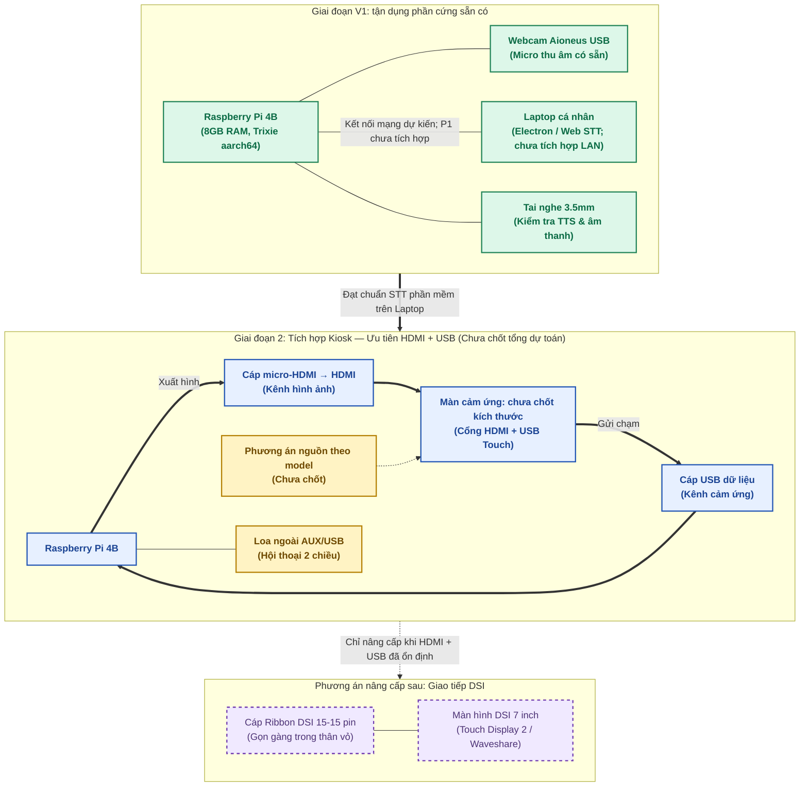

# 📋 BOM Tổng Thể Cho Thiết Bị Giao Tiếp (Speech-to-Text)

> **Cập nhật mới nhất:** 07/11/2026 *(Đã tích hợp quyết định ưu tiên HDMI + USB touch & DSI là khả năng nâng cấp sau)* 
> **Nguyên tắc tài chính:** BOM dùng chung cho các mốc phát triển. Chưa có đơn đặt hàng mới. Không lấy giá trong trao đổi cũ làm giá hiện tại. Tận dụng phần cứng đang đáp ứng yêu cầu; chưa chốt ngân sách và không mặc định chọn rẻ nhất.

---

> [!IMPORTANT]
> **BOM chính của dự án:** dùng bản này để ra quyết định ở phiên mua sắm tiếp theo. Bố cục lấy từ bản highlight người dùng cung cấp; dự toán chưa có nguồn được ghi rõ là nháp. **Chưa đặt hàng; chưa chọn màn HDMI, kích thước, cáp hay nguồn.** P1 mới có Settings, một file và Electron trên Windows; capture Pi, batch và kiosk phần cứng chưa hoàn thành. Xem [bàn giao](START_NEXT_CHAT_STT.md) và [báo cáo P1](reports/stt_v1_p1_20261107/BAO_CAO.md).

> **Liên quan đến chọn màn/vỏ:** đọc [STT_PRODUCT_UI_UX.md](STT_PRODUCT_UI_UX.md) để bàn cách hai người cùng xem và thao tác trong cuộc giao tiếp đa phương thức. Kích thước/hướng màn, bố cục hội thoại và vị trí camera chưa chốt; ghi nhận định hướng ký hiệu/TTS chưa có nghĩa cần mua thêm camera/loa ngay.

## 🎯 Tổng Hợp Tình Trạng Ngân Sách Theo 2 Giai Đoạn

| Giai đoạn triển khai | Dự toán chi phí | Trạng thái thiết bị | Mục tiêu kỹ thuật & Chiến lược phần cứng |
| :--- | :---: | :---: | :--- |
| **Giai đoạn 1: Mốc kiểm thử ban đầu (V1)** | <strong style="background-color:#DDF7E9;color:#0B6B45;padding:3px 8px;border-radius:4px;font-size:1.05em;">Chưa xác định cần mua mới</strong> | TẬN DỤNG PHẦN CỨNG ĐÃ CÓ | P1 đã thử nhận dạng một file qua Deepgram và mở desktop trên laptop. Thu âm webcam Pi và điều khiển qua LAN còn là bước tích hợp tiếp theo; chi phí API/mạng không nằm trong chi phí mua phần cứng. |
| **Giai đoạn 2: Đóng gói Kiosk độc lập** | <strong style="background-color:#FFF3C4;color:#6E4900;padding:3px 8px;border-radius:4px;font-size:1.05em;">Chưa chốt tổng dự toán</strong> | DỰ TRÙ MUA SẮM | **Ưu tiên màn cảm ứng HDMI + USB** cho tích hợp đầu tiên; khung vỏ Kiosk + Electron app toàn màn hình. DSI chỉ là bước nâng cấp sau. |

### 🔍 Chi tiết phân bổ dự toán Giai đoạn 2 (Kiosk độc lập)

* **1. Màn hình cảm ứng (chưa chốt kích thước/model):** Đã có giá niêm yết cho một số mẫu HDMI; cần xác minh USB touch và tổng bộ. Các giá DSI dưới đây chỉ thuộc ứng viên DSI, không dùng làm giá hoặc dự toán màn HDMI.
  * *Phương án tích hợp đầu tiên:* Màn hình cảm ứng giao tiếp **HDMI (hình ảnh) + USB (cảm ứng)** tương thích Linux ARM64 / Pi 4.
  * *Tham khảo ứng viên DSI (nâng cấp sau; giá khảo sát 06/11/2026, chưa kiểm tra lại lúc mua):*
    * **Cytron: Raspberry Pi Touch Display 2 (7")** — <strong style="background-color:#E7F0FF;color:#1B4494;padding:1px 5px;border-radius:3px;">2.052.000 VNĐ</strong> *(Đã gồm VAT, kèm cáp DSI 15-15 pin & dây nguồn).*
    * **Raspberrypi.vn: Waveshare DSI 7" (1024×600, kèm case)** — <strong style="background-color:#E7F0FF;color:#1B4494;padding:1px 5px;border-radius:3px;">1.900.000 VNĐ</strong> *(Chưa VAT & ship, kèm sẵn vỏ case).*
* **2. Phụ kiện & âm thanh dự phòng (nếu phát sinh):** Ước tính nháp trong bản highlight: 200.000 – 400.000 VNĐ, chưa xác minh và chưa chốt
  * *Bộ dây kết nối:* Cáp micro-HDMI sang HDMI (đúng chuẩn đầu cắm màn), cáp USB truyền data cảm ứng, phương án nguồn theo model màn (có thể riêng hoặc chung với USB touch).
  * *Loa chủ động AUX / USB audio:* Ưu tiên tận dụng/mượn; chỉ mua mới nếu cần người đối diện nghe rõ hoặc phục vụ bài đo chống vọng âm (AEC).
  * *Nguồn riêng:* Cấp nguồn ngoài nếu tải USB của màn hình + webcam làm sụt áp nguồn 5V-3A của Pi 4.

---

## 🗺️ Lộ Trình Phát Triển & Kiến Trúc Kết Nối

---

## 🔌 HDMI + USB: Phương Án Tích Hợp Màn Hình Đầu Tiên

> [!IMPORTANT]
> **Quyết định cốt lõi:** Sau kiểm thử phần mềm trên laptop, ưu tiên màn cảm ứng HDMI + USB trên Pi 4. DSI chỉ là khả năng nâng cấp sau khi phương án này đã chạy ổn định. 
> Đã chốt hướng kết nối cho bước tích hợp đầu tiên; việc dùng laptop trước nhằm đảm bảo tính sẵn sàng của pipeline STT, không có nghĩa bỏ màn cảm ứng của sản phẩm Kiosk cuối.

### Bảng 1. Bộ linh kiện cần xác định cho phương án HDMI + USB *(Dự kiến cho 1 thiết bị)*

| Hạng mục | Số lượng | Công dụng và trạng thái kỹ thuật |
| :--- | :---: | :--- |
| **Màn hình cảm ứng có đầu vào HDMI và đường USB touch** | 1 cái | Màn hình chính cho ứng dụng Electron Kiosk; hỗ trợ Pi 4 / OS đang dùng. Chưa chọn kích thước/model cụ thể, chưa chốt đơn vị bán hoặc giá. |
| **Cáp micro-HDMI từ Pi 4 tới đầu HDMI đúng loại của màn** | 1 sợi | **Truyền hình ảnh.** Phải kiểm tra chính xác chuẩn đầu cắm phía màn (HDMI tiêu chuẩn / mini-HDMI), độ dài dây và phụ kiện kèm màn trước khi mua. |
| **Cáp USB dữ liệu từ Pi tới cổng touch của màn** | 1 sợi | **Truyền tín hiệu chạm về Pi.** Chọn đúng chuẩn đầu cắm (micro-USB / Type-C) phía màn. Lưu ý: Cáp sạc đơn thuần (không có dây data) sẽ không nhận được cảm ứng! |
| **Bộ nguồn / cáp cấp nguồn cho màn theo model** | 1 bộ | Phương án nguồn riêng hoặc chung USB touch theo model. Xác minh điện áp, dòng tiêu thụ và cổng nguồn đi riêng hay chung với cổng USB touch. Chưa mặc định Pi cấp đủ nguồn. |

#### 🔄 Luồng kết nối chuẩn:
* **Hiển thị hình ảnh:** `Pi 4` $\rightarrow$ `micro-HDMI sang HDMI` $\rightarrow$ `Màn hình`.
* **Nhận diện cảm ứng:** `Màn hình` $\rightarrow$ `Cáp USB dữ liệu` $\rightarrow$ `Pi 4`.
* **Cảnh báo kỹ thuật:** Cảm ứng không được xác nhận chỉ từ việc đã xuất hiện hình ảnh. Cần thử nghiệm cử chỉ chạm, kéo và xoay màn hình trên phần cứng thực tế. Xem [ví dụ tham khảo kết nối HDMI + USB touch của Waveshare](https://docs.waveshare.com/7inch_1080x1080_LCD/User-Guide-Rpi) *(lưu ý: đây là tài liệu tham khảo kỹ thuật, không phải model đã chốt mua)*.

---

## 🛒 Ứng viên HDMI do người dùng bổ sung — kiểm tra trang ngày 07/11/2026

**Giá trong bảng là giá niêm yết.** Cần xác nhận giá trọn bộ, tồn kho, cổng hình và cổng cảm ứng của đúng biến thể đang bán. Chưa chốt mua hoặc thử nghiệm các mẫu này trên Pi 4/Trixie/Electron.

| Nguồn / ứng viên | Giá và thông tin trang | Điểm thuận lợi | Còn thiếu để quyết định |
| :--- | :--- | :--- | :--- |
| **[Điện tử Nguyễn Hiền — NH2067](https://www.dientunguyenhien.vn/show/2067)** | **1.090.000 VNĐ**; 7 inch, 1024×600; trang hiển thị tồn 8 | Nhà bán ở Đà Nẵng, thuận tiện hỏi khả năng xem/thử trực tiếp | Chưa rõ loại touch/đường kết nối, model/hãng/board revision, nguồn, cáp kèm, VAT và bảo hành. Giá trang khác mức khoảng 1 triệu người dùng nêu; xác nhận lại tại cửa hàng. |
| **[Điện tử Tuyết Nga — màn điện dung 7 inch HDMI Raspberry Pi](https://dientutuyetnga.com/products/man-hinh-cam-ung-dien-dung-7-inch-hdmi-raspberry-pi)** | **820.000 VNĐ**; 1024×600; mô tả hỗ trợ Pi 3/4 | Giá niêm yết thấp hơn NH2067 **270.000 VNĐ** | Nhà bán ở TP.HCM; cần phí/ngày giao Đà Nẵng, tồn kho, VAT, bảo hành, mã board, USB touch/nguồn/cáp. Trang tự lưu ý tồn kho có thể chưa cập nhật; mô tả khác nhau về số điểm chạm theo OS, cần thử đúng OS. |
| **[Viện Máy Tính — Waveshare 7inch HDMI LCD (C)](https://vienmaytinh.com/products/man-hinh-waveshare-7-inch-hdmi-capacitive-touch-screen-lcd-c)** | **625.000 VNĐ** giá online, chưa gồm công thay. Trang ghi IPS 7 inch 1024×600, HDMI, USB touch điện dung và nguồn 5 V | [Waveshare](https://www.waveshare.com/7inch-HDMI-LCD-C.htm) ghi mã **11199** cho mẫu này. [Tài liệu hãng về cổng](https://www.waveshare.com/wiki/7inch_HDMI_LCD_%28C%29) ghi HDMI chuẩn cho hình và micro-USB dùng chung cho touch và nguồn | Shop ghi micro-USB hoặc USB-C, kèm cáp HDMI, cáp USB và chân đế acrylic. Xác nhận mã/revision và ảnh cổng của hàng thực, cáp/đầu chuyển micro-HDMI cho Pi 4, đủ chân đế, cách cấp nguồn và dòng yêu cầu. Hỏi giá có VAT, phí/ngày giao Đà Nẵng, tồn kho và đổi trả |
| **[Điện tử Á Châu — LCD HDMI 7 inch 1024×600](https://dientuachau.com/lcd-hdmi-7-inch-1024-x-600)** | **630.000 VNĐ**. Trang ghi ngõ HDMI và điện áp hoạt động 5–12 V DC. Ô loại cảm ứng để trống | Có thể khảo sát như mẫu HDMI để đối chiếu hình ảnh | Cần xác nhận có tấm cảm ứng và USB data hay chỉ có LCD. Hỏi mã board, điện áp đúng của bộ hàng, đầu nguồn, phụ kiện, tồn kho, VAT, giao Đà Nẵng và bảo hành |
| **[Shopee — bộ số hóa cảm ứng USB nhiều kích cỡ](https://shopee.vn/product/1382786553/24637236048?extraParams=%7B%22display_model_id%22%3A207890570047%2C%22model_selection_logic%22%3A3%7D)** | Tiêu đề trong link nêu bộ số hóa/điều khiển cảm ứng điện dung USB, nhiều kích cỡ. Chưa đọc được trang để xác nhận biến thể hoặc giá | Có thể khảo sát riêng như linh kiện cảm ứng nếu cần | Hỏi biến thể được chọn có kèm LCD và bo HDMI hay chỉ gồm kính touch và bo USB. Nếu chỉ có touch, xác nhận kích thước kính và khả năng ghép với panel trước khi so giá với màn trọn bộ |
| **[Shop Shopee tuandinh241 — link người dùng gửi](https://shopee.vn/tuandinh241?categoryId=100644&entryPoint=ShopByPDP&itemId=42836315614)** | **Người dùng báo:** đồ cũ, hết HDMI, chỉ còn DSI; chưa có giá/model xác minh | Có thể khảo sát thêm cho phương án DSI về sau | Công cụ không mở được trang; chưa tự xác minh biến thể, giá, tình trạng panel/touch, dây kèm, tương thích, bảo hành và giao hàng. Không xếp vào hàng HDMI còn sẵn. |

**So sánh còn có điều kiện:** nếu Nguyễn Hiền cho thử đúng Pi/OS và touch trước mua, lợi thế kiểm tra trực tiếp đáng cân nhắc cùng chênh lệch giá. Đối chiếu báo giá trọn bộ từ Tuyết Nga và Viện Máy Tính sau khi xác nhận đúng biến thể, nguồn và phụ kiện. Chỉ đưa Á Châu và listing bộ số hóa Shopee vào so giá màn cảm ứng hoàn chỉnh khi có đủ thông tin về LCD, HDMI và touch.

**Nội dung để người dùng hỏi nhà bán khi muốn chốt:**

1. Mã model, hãng và revision board; ảnh rõ mặt sau/các cổng và tài liệu đúng model.
2. Cảm ứng điện dung hay điện trở? Dữ liệu chạm đi bằng **USB, GPIO/SPI hay I2C**? Nếu USB, cổng nào là data touch, cổng nào chỉ cấp nguồn?
3. Đã chạy Pi 4 và OS/kernel nào? Có cần driver/overlay không? Cho thử chạm, kéo, xoay màn và bàn phím ảo trên OS đang dùng được không?
4. Nguồn bao nhiêu V/A, cấp riêng hay dùng chung đường touch? Bộ kèm dây gì, đầu HDMI phía màn là loại nào? Cần cáp micro-HDMI phía Pi 4.
5. Giá đủ VAT, cáp/nguồn, vỏ/giá đỡ nếu cần, phí và ngày nhận; chính sách bảo hành/đổi khi touch không chạy đúng cấu hình đã thống nhất.

Nhóm cần thử wireframe hội thoại, chữ và bàn phím ảo ở **1024×600** trước khi chốt màn 7 inch; mức giá mới không tự chốt kích thước. Chưa liên hệ nhà bán hoặc đặt hàng từ cập nhật tài liệu này.

## 🔎 Vì sao SPI chưa được ưu tiên làm màn chính?

**SPI (Serial Peripheral Interface)** là bus nối tiếp dùng cho ngoại vi, trong đó có màn hình, qua các chân GPIO trên Pi; xem [tài liệu Raspberry Pi](https://www.raspberrypi.com/documentation/computers/raspberry-pi.html#gpio-pin-inputs-outputs-and-communication-protocols). Nó là một phương án có thật; phần so sánh trước chưa giải thích lý do không đưa vào nhánh ưu tiên.

[Hướng dẫn chọn màn của Waveshare](https://www.waveshare.com/rpi_lcd_selection_guide) mô tả nhóm SPI của họ có lợi thế giá, nhưng hạn chế độ phân giải/tần số cập nhật và cần chú ý tương thích hệ thống. Đây là nhận xét về các dòng màn được liệt kê, không phải định luật cho mọi màn SPI.

**Đánh giá cho sản phẩm này:** màn chính cần hội thoại cuộn, chữ dễ đọc, bàn phím ảo và có thể có preview camera; vì vậy ưu tiên đường hiển thị phù hợp giao diện desktop trước. Một màn SPI nhỏ, độ phân giải thấp có thể làm chật bố cục và hạn chế cập nhật hình. Driver/overlay và khả năng xuất giao diện Electron trên đúng OS cũng cần kiểm chứng theo model. Chưa benchmark màn SPI trên Pi của nhóm; không gán một mức FPS chung hoặc khẳng định SPI không chạy được Electron.

**Giao tiếp hình ảnh và giao tiếp cảm ứng là hai thông tin khác nhau.** Ví dụ [Waveshare 3.5 inch RPi LCD (F)](https://www.waveshare.com/wiki/3.5inch_RPi_LCD_%28F%29) dùng SPI cho hình và I2C cho cảm ứng điện dung. Do đó màn SPI không đồng nghĩa luôn cảm ứng điện trở; màn ghi HDMI cũng chưa chứng minh touch qua USB.

**Hướng hiện tại:** giữ HDMI + USB touch là mục tiêu tích hợp đầu tiên; DSI là khả năng sau khi HDMI ổn định. SPI có thể xét cho màn trạng thái phụ/giao diện đơn giản, hoặc khi có model cụ thể chứng minh đáp ứng màn chính; chưa thêm một món phải mua hay thay thứ tự tích hợp.

---

## 📦 Danh Mục Thiết Bị Chi Tiết (BOM Toàn Diện)

| Hạng mục phần cứng | Số lượng / Trạng thái | Chi phí phần cứng bổ sung | Vai trò và điều kiện sử dụng / mua sắm |
| :--- | :---: | :---: | :--- |
| **Raspberry Pi 4B rev 1.5, RAM 8 GB** | 1, ĐÃ CÓ | 0 VNĐ | Máy biên xử lý chính; Trixie aarch64 theo thông tin người dùng; cần kiểm tra bản phân phối/kernel/firmware thực tế. Cần phiên truy cập kiểm tra trước khi triển khai sâu. |
| **Thẻ nhớ microSD 32 GB** | 1, ĐÃ CÓ | 0 VNĐ | Lưu hệ điều hành (OS), môi trường runtime và cấu hình. Kiểm tra dung lượng trống thực tế trước khi cài đặt. |
| **Bộ nguồn Adapter DC 5 V – 3 A** | 1, ĐÃ CÓ | 0 VNĐ | Cấp nguồn riêng cho Pi; nhãn 3A chưa chứng minh không sụt áp dưới mọi tải ngoại vi. Cần kiểm tra nhiệt độ và điện áp khi chạy tải đầy đủ. |
| **Webcam Aioneus USB 1080p (tích hợp mic)** | 1, ĐÃ THỬ THU/PHÁT | 0 VNĐ | Dùng micro hiện có trước. Lệnh ALSA và người dùng đã xác nhận nghe lại được bản thu; đây chưa phải kiểm chứng chất lượng STT ở khoảng cách sử dụng. Không mua micro mới khi chưa có nhu cầu thực tế. |
| **Laptop & mạng nội bộ** | ĐÃ CÓ SẴN | 0 VNĐ | Môi trường lập trình, build code và mở giao diện Web STT của Pi. Deepgram cần Internet; P1 chưa có điều khiển Pi qua LAN. |
| **Tai nghe Jack 3,5 mm** | 1, ĐÃ THỬ PHÁT | 0 VNĐ | Dùng phát triển và test âm thanh Text-to-Speech (TTS). Không thay thế loa ngoài khi cần kiểm thử giao tiếp thực tế hoặc đo tiếng vọng. |
| **Màn hình ngoài hiện có** | ĐÃ CÓ TRONG KHO | 0 VNĐ | Chưa rõ chuẩn cổng/cáp. Mốc V1 tận dụng màn hình laptop qua Web; không mua touchscreen làm tắc nghẽn tiến độ. |
| **ESP32 DevKit V1, nút/LED/điện trở/dây/testboard** | CÓ TRONG KHO NHÓM | 0 VNĐ | Nhánh firmware phụ trợ; chưa có xác nhận bài nút/LED/Serial đã chạy. Không bắt buộc cho luồng STT ban đầu. |
| **STM32 / ESP8266 / UNO & dụng cụ kho** | CÓ THỂ TẬN DỤNG | 0 VNĐ | Thiết bị dự phòng trong kho, không mua thêm board mới khi chưa có nhiệm vụ cụ thể. |
| **Quạt tản nhiệt 2 dây** | ĐÃ CÓ SẴN | 0 VNĐ | Kiểm tra định mức điện áp/dòng và vị trí tản nhiệt trước khi cắm chân GPIO. Không tự suy là quạt điều tốc PWM. |
| **Loa chủ động AUX hoặc USB Audio** | CHƯA XÁC NHẬN SẴN | Nháp ~150k–250k; chưa xác minh | Cần cho thử nghiệm hội thoại 2 chiều qua loa ngoài. Ưu tiên mượn/tận dụng; nếu mua phải xác minh cổng kết nối, công suất và nguồn nuôi. |
| **Micro USB thay thế** | CHỜ KIỂM CHỨNG | Chưa phát sinh | Chỉ mua nếu mic webcam không đáp ứng bài test nhận dạng giọng nói thực tế (thu gần như sử dụng tại bàn, ghi khoảng cách đo thực tế; ưu tiên giọng Đà Nẵng). |
| **Mạch Mic–Loa tích hợp AEC (chống vọng)** | ĐÁNH GIÁ SAU | Chưa phát sinh | Đánh giá sau khi thử nghiệm loa ngoài bị lọt tiếng vào mic gây vòng lặp vọng âm. So sánh phương án phần mềm/phần cứng khi có nhu cầu thực tế; chưa chốt giải pháp AEC. |
| **Màn cảm ứng HDMI + USB — phương án đầu** | GIAI ĐOẠN KIOSK | Xem giá niêm yết theo mẫu ở bảng khảo sát; chưa chốt bộ | **Ưu tiên HDMI + USB touch cho tích hợp đầu tiên.** Cảm ứng + Electron Kiosk là yêu cầu sản phẩm cuối. Chưa chọn model cụ thể; kiểm thử phần mềm trên laptop trước. |
| **Cáp micro-HDMI sang HDMI cho phương án đầu** | 1 ĐƯỜNG HÌNH ẢNH | Nháp ~50k–100k; chưa xác minh | Truyền hình ảnh cho phương án đầu. Kiểm tra cáp/adapter sẵn có và bộ phụ kiện kèm màn hình trước khi mua. Không dùng để đưa desktop Pi lên laptop qua VNC/web. |
| **Cáp USB touch + Dây nguồn màn hình** | ĐI ĐƯỜNG RIÊNG | Nháp ~50k–100k; chưa xác minh | Là các đường riêng biệt với cáp HDMI. Phải đúng model màn. Không giả định Pi cấp đủ nguồn tải cho màn. |
| **Bộ chia cổng USB có nguồn (Powered USB Hub)** | CHỜ ĐO TẢI THỰC TẾ | Nháp ~150k; chưa xác minh | Chỉ thêm nếu thiếu cổng hoặc nguồn ngoại vi từ Pi không đáp ứng (tránh sụt áp khi cắm đồng thời webcam + mic + touch + loa). |

> [!NOTE]
> **Đợt đầu:** Chưa xác định món bắt buộc phải mua mới để bắt đầu STT. Có thể làm kiểm thử phần mềm và thu bằng webcam đã có. Thử vọng âm thực tế còn phụ thuộc loa; không ghi là đã đạt chỉ từ bản thu webcam hoặc tai nghe.

---

## 🖥️ Quyết Định Màn Hình Sản Phẩm Cuối — 06/11/2026

* **Hình thái thiết bị:** Sản phẩm cuối dùng màn hình cảm ứng và chế độ Kiosk. Khi bật thiết bị, Pi tự mở giao diện STT toàn màn hình; người dùng thao tác trực tiếp bằng chạm.
* **Chiến lược tích hợp:** Tiếp tục dùng laptop để phát triển và kiểm thử V1 trước. **Đã chọn HDMI + USB touch cho tích hợp đầu tiên;** chưa chọn kích thước, model, loại đầu cáp phía màn hoặc nguồn; kiểm thử cảm ứng và khởi động kiosk trên phần cứng thực tế ở bước tích hợp thiết bị.
* **Phần mềm màn hình cảm ứng (Chốt 07/11/2026):**
  * Ứng dụng dùng React + TypeScript + Tailwind CSS, Next.js / Node.js và Electron.
  * Trên thiết bị cuối, Pi chạy backend và Electron mở giao diện STT ở kiosk mode. Tiếp tục dùng laptop cho phát triển/kiểm thử ban đầu; **ổn định HDMI + USB touch trước DSI**.
  * Lựa chọn stack không thay đổi cáp/nguồn cần mua theo đúng model màn. Kiểm thử cảm ứng, bàn phím ảo và khởi động kiosk với bản Linux ARM64 thực tế; chưa có kết quả chạy thiết bị.

---

## 🔬 DSI Là Phương Án Nâng Cấp Sau HDMI + USB — Khảo Sát 06/11/2026

> [!WARNING]
> **Thứ tự ưu tiên:** Ổn định HDMI + USB cảm ứng trước; chỉ cân nhắc DSI sau đó. Đây là thứ tự tích hợp đã được xác nhận, chưa phải báo cáo HDMI đã chạy ổn định hay quyết định mua màn DSI. Tiếp tục kiểm thử V1 trên laptop trước bước tích hợp màn thiết bị.

**Khảo sát nhà cung cấp DSI ngày 06/11/2026:** giá/tồn kho dưới đây là ảnh chụp trạng thái website của lượt khảo sát cũ, chưa kiểm tra lại lúc mua. Có cơ sở đặt giao Đà Nẵng; chưa xác nhận bán trực tiếp tại Nguyễn Hiền/SPIDER/BKM.

| Ứng viên DSI cho Pi 4 | Giá hiển thị | Trạng thái trên trang và điểm cần kiểm tra |
| :--- | :---: | :--- |
| **[Cytron: Raspberry Pi Touch Display 2, 7 inch](https://www.cytrontech.vn/p-raspberry-pi-7-inch-touch-screen-display-2)** | <strong style="background-color:#E7F0FF;color:#1B4494;padding:2px 6px;border-radius:4px;">2.052.000 VNĐ</strong> *(Đã gồm VAT)* | Trang ghi 5 sản phẩm; nêu hỗ trợ Pi 4, kèm cáp DSI 15–15 chân và dây nguồn. Kiểm tra đúng biến thể 7 inch, phụ kiện và phí giao tại thời điểm đặt. |
| **[Raspberrypi.vn: Waveshare DSI 7 inch (1024×600, MPN 20430, kèm case)](https://raspberrypi.vn/san-pham/man-hinh-cam-ung-dien-dung-7inch-ips-ket-noi-dsi-do-phan-giai-1024x600)** | <strong style="background-color:#E7F0FF;color:#1B4494;padding:2px 6px;border-radius:4px;">1.900.000 VNĐ</strong> *(Chưa VAT & ship)* | Trang ghi còn hàng, hỗ trợ Pi 4; case dành cho Pi 4. Cần xác nhận đủ dây và cấu hình đúng model/OS; đây không phải Touch Display 2. |

*Cytron công bố [giao toàn quốc](https://www.cytrontech.vn/delivery-information), nhưng trang chính sách cập nhật 2023 và thông tin kho chưa nhất quán. Không xem địa chỉ kho là điểm mua trực tiếp tại Đà Nẵng hoặc cam kết ngày giao.*

**Công sức chuyển đổi DSI (đánh giá chưa đo):** giữ ứng dụng web/backend và luồng STT độc lập với cổng màn; đổi dây/nguồn/vỏ và kiểm tra lại display, touch, xoay màn, bàn phím ảo, kiosk. Dự kiến thấp–vừa với Touch Display 2 7 inch trên Raspberry Pi OS được hỗ trợ; tổ hợp màn/OS khác chưa xác định. Trixie aarch64 chưa đủ chứng minh tương thích. Không hứa số giờ và không coi mọi màn DSI chỉ cần một cáp cho cả hình/cảm ứng. Giữ cấu hình HDMI đã đạt để quay lại.

### 🛠️ Điều kiện nghiệm thu chuyển đổi sang DSI:
1. **Lưu bản cấu hình HDMI đã đạt chuẩn** trước khi chuyển.
2. Thử khởi động nguội vào kiosk thành công.
3. Hình ảnh và chữ dễ đọc; cảm ứng chuẩn xác sau khi xoay màn hình.
4. Thao tác Record / Stop và Settings mượt mà bằng chạm; nhập liệu tốt bằng bàn phím ảo.
5. Một phiên hội thoại STT chạy thực tế đạt yêu cầu và bộ nguồn chịu tải tốt.
*Chỉ nhận cấu hình DSI khi toàn bộ các bước trên đạt; luôn giữ đường lùi (fallback) về cấu hình HDMI.*

---

## ⚖️ Ma Trận So Sánh Các Phương Án Phần Cứng & Khuyến Nghị

| Phương án | Lợi ích | Hạn chế / Việc phải thử | Chi phí bổ sung hiện biết | Khuyến nghị hành động |
| :--- | :--- | :--- | :---: | :--- |
| **1. Webcam đang có + Màn hình laptop** | Thu âm đã thử trên Pi; bắt đầu được ngay. | Chưa đo chất lượng giọng miền Trung tại khoảng cách sử dụng thực tế. | <strong style="background-color:#DDF7E9;color:#0B6B45;padding:2px 6px;border-radius:4px;">0 đồng mua thêm</strong> | DÙNG TRƯỚC (V1) |
| **2. Micro USB riêng + Laptop** | Có thể chọn vị trí và hướng thu thuận tiện hơn. | Phải chọn model, thử Linux, chất lượng và ngày nhận; không mặc định tốt hơn webcam. | Chưa chọn model / giá | Chỉ xét nếu phép thu bằng webcam cho thấy vấn đề. |
| **3. Mic–loa tích hợp AEC** | Có thể giảm công việc định tuyến tham chiếu loa khi cần chống vọng. | Cần thử đúng Pi/OS; quảng cáo lọc ồn không chứng minh AEC; chưa có nhu cầu mua đã xác nhận. | Chưa có báo giá kiểm tra | Để sau thử vọng âm. |
| **4. Loa riêng để thử + Micro hiện có** | Kiểm tra tình huống loa phát trong lúc thu âm. | Tùy bố trí có thể thu lẫn tiếng loa; chưa phải giải pháp AEC hoàn chỉnh. | <strong style="background-color:#DDF7E9;color:#0B6B45;padding:2px 6px;border-radius:4px;">0 đồng (nếu mượn)</strong> hoặc mức nháp ~150k–200k chưa xác minh | Tận dụng khi đến bài thử playback. |
| **5. Màn cảm ứng HDMI + USB và bộ cáp/nguồn** | **Thiết bị cảm ứng độc lập, chạy Electron kiosk.** | Cần chọn model và thử trên Pi; phát triển phần mềm bằng laptop trước. | <strong style="background-color:#FFF3C4;color:#6E4900;padding:2px 6px;border-radius:4px;">Chưa chốt tổng giá HDMI/cáp/nguồn</strong> | PHƯƠNG ÁN TÍCH HỢP ĐẦU TIÊN *(DSI xem xét sau)* |

---

## ✅ Các Mục Cần Chốt Ở Phiên Mua Sắm Tiếp Theo

| Quyết định | Trạng thái / cách chốt |
| :--- | :--- |
| Kích thước và model màn HDMI + USB cảm ứng | Chưa chốt; so khả năng đọc phụ đề, chạm nút, độ phân giải, tương thích Pi 4 và OS. 7 inch mới là một khả năng, không phải yêu cầu cố định. |
| Đầu cáp HDMI/USB, chiều dài và phụ kiện kèm | Chọn sau model màn, kiểm tra bộ sẵn có trước mua; USB touch cần truyền dữ liệu. |
| Nguồn màn và tổng tải Pi + ngoại vi | Theo thông số đúng model; không mặc định cần nguồn riêng hoặc Pi đủ tải. |
| Vỏ/giá đỡ và chỗ cho dây, quạt | Chưa chốt; chọn theo kích thước/cổng của màn và Pi. |
| Loa phục vụ thử playback | Kiểm tra có thể tận dụng/mượn không; nếu mua, so cổng âm thanh, nguồn, mức nghe thực tế. |
| Nhà bán, tổng giá và cách nhận hàng tại Đà Nẵng | Khảo sát model cụ thể: VAT, ship, phụ kiện, bảo hành, tồn kho và ngày nhận có xác nhận. Chưa có quyền đặt hàng từ BOM này. |
| DSI, micro thay thế, AEC và powered hub | Giữ là phương án có điều kiện; DSI chỉ xét sau HDMI ổn định. Không tự thêm vào đơn mua bắt buộc. |

**Các mức nháp trong bản highlight gốc chưa phải báo giá hoặc ngân sách đã duyệt.** Chưa dự toán tổng kiosk vì còn phải xác nhận model, phụ kiện, VAT và phí giao. Các mức giá trong mục khảo sát là giá niêm yết theo từng trang. Phần cứng có sẵn ghi 0 đồng là chi phí mua thêm dự kiến, không phải giá trị mua ban đầu và không bao gồm phí API hoặc Internet.

## 📌 Ghi Chú Mua Sắm & Logistics

* **Quan điểm ngân sách:** Người dùng muốn xem so sánh trước, chưa chốt số tiền và không bắt buộc chọn cấu hình rẻ nhất. Đánh giá giá trị và thời gian nhận trước khi yêu cầu quyết định mua. Không tự hiểu việc chưa có trần ngân sách là quyền chi tiêu không giới hạn.
* **Địa bàn mua sắm:** Ưu tiên khảo sát mua trực tiếp tại **Đà Nẵng** (*Nguyễn Hiền, SPIDER, BKM*) hoặc **Shopee** khi phát sinh món cần mua thực tế.
* **Nguồn tham chiếu:**
  * File tồn kho & xác nhận thu/phát: `C:\Users\LAPTOP T&T\Downloads\iot-communication-support-system.md`
  * Tài liệu nguồn Raspberry Pi 4 (5V – 3A): https://www.raspberrypi.com/documentation/computers/getting-started.html
  * Tài liệu Touch Display 2: https://www.raspberrypi.com/documentation/accessories/touch-display-2.html
  * Wiki Waveshare: https://www.waveshare.com/wiki/7inch_DSI_LCD_%28C%29
