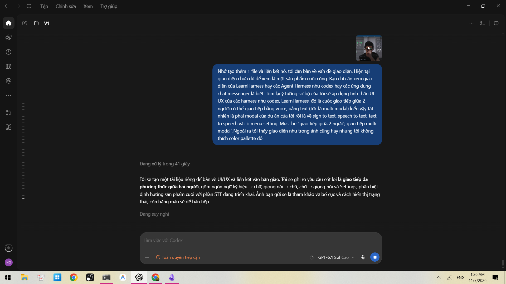
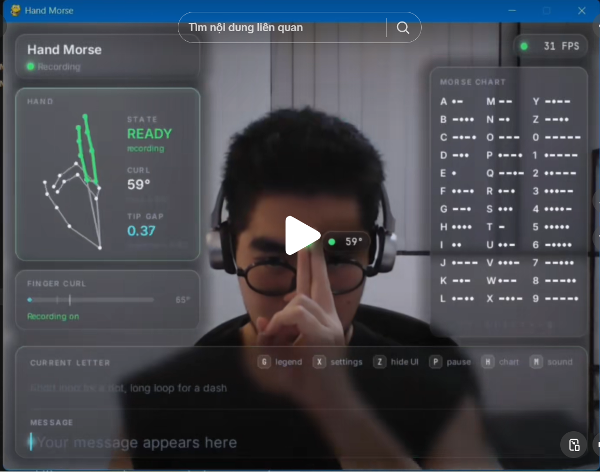

# UI/UX sản phẩm — giao tiếp đa phương thức giữa hai người

Cập nhật 10/11/2026. Tài liệu ghi các quyết định thiết kế, những điểm đang thảo luận và kịch bản cần duyệt trên bản phác. Kết quả triển khai P1 được ghi riêng trong [báo cáo P1](reports/stt_v1_p1_20261107/BAO_CAO.md).

> **Yêu cầu cốt lõi của người dùng: “giao tiếp giữa 2 người, giao tiếp multi modal”.**
>
> Hai người dùng chung màn hình để trao đổi. PBL6 phụ trách chuyển giọng nói thành chữ, đọc chữ thành tiếng và Settings. Chữ để đọc có thể đến từ luồng khác, chẳng hạn kết quả của dự án nhận dạng ký hiệu.

Đọc mục 1–3 để nắm phạm vi, luồng thu và quy tắc Lịch sử. Mục 4 ghi các tham chiếu. Mục 5–6 hướng dẫn duyệt một lượt STT trên bản phác. [Bàn giao phiên tiếp theo](START_NEXT_CHAT_STT.md) · [Đặc tả STT hiện tại](STT_SYSTEM_SPEC.md) · [BOM](STT_BOM.md)

## 1. Những gì đã xác nhận

**Hai người dùng một vùng soạn chung trên một màn hình.** Ai cũng có thể nhập vào vùng này. Người dùng tự chọn cách đặt, cầm hoặc xoay thiết bị để xem, tương tự cách đưa màn hình điện thoại cho người khác đọc. Giá đỡ là phụ kiện, còn kiểu giá đỡ và cách lắp sẽ bàn riêng. [Khảo sát vùng soạn và tình huống dùng một màn hình](reports/NGHIEN_CUU_COMPOSER_ANTIGRAVITY.md)

| Phương thức | Vai trò trong cuộc giao tiếp | Trạng thái |
| :--- | :--- | :--- |
| **Nhận dạng giọng nói (STT)** | Một người nói, xem và sửa chữ nhận được rồi gửi cho người kia đọc. | P1 nhận dạng một file và trả chữ cuối. Thu và dừng bằng mic trên Pi thuộc phần V1 còn lại. |
| **Nhập chữ** | Có thể gõ trực tiếp vào cùng vùng soạn rồi gửi. | Vùng soạn hội thoại thuộc thiết kế đang duyệt. Việc gõ chữ để phát thành tiếng sẽ bàn cùng TTS. |
| **Đọc chữ thành tiếng (TTS)** | **Đọc to** là thao tác riêng với **Gửi**. | Tạm hoãn chốt vị trí nút loa, phần chữ được đọc và bộ tạo giọng. Giải pháp PBL6 phải hoạt động độc lập với gói đăng ký ChatGPT. |
| **Văn bản từ luồng khác** | PBL6 có thể nhận chữ có sẵn, ví dụ đầu ra của dự án nhận dạng ký hiệu. | Mô hình nhận dạng ký hiệu và camera phục vụ mô hình thuộc phần tích hợp riêng. Cách đưa chữ vào PBL6 còn để bàn. |
| **Settings** | Có mục **Xóa lịch sử** theo quy tắc ở mục 3. | P1 đã có cài đặt key Deepgram tại máy. Các mục còn lại sẽ chốt theo từng luồng. |

- **Sản phẩm đích.** Thiết bị để bàn có màn cảm ứng và Electron ở chế độ kiosk. Stack đã chốt là React + TypeScript + Tailwind CSS, Next.js/Node.js và Electron.
- **Màu sắc.** Ảnh tham khảo dùng để xem bố cục. Bảng màu thay thế, theme sáng hoặc tối, font và bộ icon còn để duyệt.
- **Mốc phần mềm.** Hoàn thành V1 STT trước V2 và V3. Duyệt giao diện là một bước riêng trước khi người dùng yêu cầu triển khai.

## 2. Thu, sửa và gửi trong vùng soạn chung

Chạm biểu tượng **mic** để bắt đầu thu. Vùng soạn vẫn hiện phía trên thanh báo thu và nút mic đổi thành **hình vuông** ngay tại chỗ. Chạm hình vuông để dừng. Trong lúc nhận dạng, nút hiện **vòng xoay**. Khi có chữ cuối, biểu tượng mic trở lại và ứng dụng đưa chữ vào vùng soạn để người dùng đọc lại. Nếu câu đã đúng, có thể bấm **Gửi** ngay.

Chạm vùng soạn để mở **bàn phím ảo** khi cần nhập hoặc sửa. Dùng **Backspace** trên bàn phím để xóa chữ. Việc nhận dạng xong giữ bàn phím ở trạng thái đóng nếu người dùng chưa chạm vào vùng soạn. Người dùng cũng có thể gõ trực tiếp. Chỉ thao tác **Gửi** mới đưa chữ vào hội thoại. Nếu bàn phím đang mở, ứng dụng tự đóng bàn phím sau khi gửi thành công.

Trong V1, ứng dụng nhận dạng sau khi dừng thu và đưa chữ cuối vào vùng soạn. Nếu nhận dạng thất bại, vòng xoay kết thúc, biểu tượng **mic** trở lại và chữ đang soạn được giữ. Giao diện dùng **một vị trí cạnh mic** để hiện thông báo lỗi dành cho người dùng do API PBL6 trả về. Người dùng chạm mic để thu một lượt mới. V2 gửi âm thanh trong lúc thu và vẫn hiển thị chữ cuối. V3 bổ sung chữ tạm cập nhật trong lúc nói. Khi laptop điều khiển Pi, nguồn thu là thiết bị đã chọn trên Pi. [Đối chiếu cách xử lý khi nhận dạng thất bại](reports/NGHIEN_CUU_VUNG_SOAN_VA_BAN_PHIM_AO.md#khi-nhận-dạng-giọng-nói-thất-bại)

**Bản nháp.** Theo LearnHarness, chữ chưa gửi chỉ tồn tại trong vùng soạn của hội thoại đang mở. Chuyển hội thoại hoặc đóng ứng dụng sẽ bỏ bản nháp. Nếu gửi lỗi khi hội thoại vẫn đang mở, ứng dụng giữ chữ để người dùng sửa hoặc thử gửi lại. [Khảo sát cách giữ bản nháp](reports/NGHIEN_CUU_BAN_NHAP_HOI_THOAI.md)

**Chèn chữ theo Antigravity.** Người dùng có thể sửa bản nháp và di chuyển con trỏ trong lúc thu hoặc chờ kết quả. Khi có chữ nhận dạng đầu tiên để hiển thị, ứng dụng chèn vào bản nháp tại vị trí con trỏ lúc đó. Nếu ô soạn đang mất tiêu điểm, dùng vị trí gần nhất ô soạn còn giữ. Nếu chưa có vị trí, chèn vào cuối bản nháp.

- **V1 và V2.** Chữ đầu tiên đưa vào vùng soạn là chữ cuối sau khi dừng thu. Ứng dụng chèn chữ một lần theo quy tắc trên.
- **V3.** Chữ đầu tiên có thể là chữ tạm, hiển thị mờ trong vùng soạn. Kết quả tiếp theo cập nhật chính đoạn chữ tạm, kể cả khi người dùng đã dời con trỏ. Người dùng vẫn có thể sửa phần bản nháp xung quanh. **Backspace** và **Delete** chỉ bị chặn khi thao tác sẽ xóa chữ tạm. Khi có kết quả cuối, đoạn chữ tạm chuyển thành chữ thường tại chỗ.

Phương án tệp thu tạm của V1 và cách phát triển dần sang V2, V3 được ghi trong bản khảo sát âm thanh. [Khảo sát con trỏ khi soạn bằng giọng nói](reports/NGHIEN_CUU_COMPOSER_ANTIGRAVITY.md) · [Khảo sát tệp thu tạm và lộ trình V1–V3](reports/NGHIEN_CUU_AM_THANH_TAM_STT.md)

### Cách hình dung “harness bao quanh model”

*Harness* là cách hình dung lớp ứng dụng tổ chức phiên, thiết bị đầu vào và trạng thái thu, xử lý hoặc phát. Một bộ kết nối có thể chuyển yêu cầu tới dịch vụ hoặc bộ xử lý chạy tại máy rồi trả kết quả về đúng lượt. Đây là một cách phân chia đang bàn.

Đổi bộ xử lý qua bộ kết nối và cho cài plugin lúc chạy là hai quyết định riêng. Cordis, cơ chế plugin và cách các luồng trao đổi dữ liệu vẫn là chủ đề thảo luận. [Bản so sánh Cordis](comparision_everything_is_a_plugin.md) · [Ghi chú Everything is a Plugin](everything_is_a_plugin_cordis.md)

## 3. Bố cục, Lịch sử và Settings

| Vùng giao diện | Nội dung đã xác định | Việc cần duyệt trên bản phác |
| :--- | :--- | :--- |
| Điều hướng | Hội thoại, Lịch sử và Settings. | Cách mở và thu gọn Lịch sử trên màn nhỏ. |
| Vùng hội thoại | Hiển thị các tin đã gửi. Sau khi gửi thành công, vùng hội thoại tự cuộn đến tin vừa gửi. Tin này dùng cùng kiểu và cỡ chữ với các tin khác trong hội thoại. | Kiểm tra cỡ chữ chung trên màn 7 inch, bố cục từng tin và việc có cần nhãn nguồn nhập. |
| Vùng soạn | Một vùng soạn chung có mic và **Gửi**. Khi chạm vào vùng soạn, bàn phím mở dưới cùng. Vùng soạn và **Gửi** ở ngay phía trên. Vùng hội thoại dùng phần chiều cao còn lại và có thể cuộn. | Kiểm tra độ dễ nhận ra khi mic sẵn sàng, đang thu và đang chờ nhận dạng. |
| Settings | Cài đặt Deepgram đã có ở P1. **Nguồn mic trên Pi** và **Xóa lịch sử** đã chốt ở mức thiết kế. | Cách bố trí các mục hiển thị. Đầu ra âm thanh sẽ bàn cùng TTS. |

Khi triển khai bàn phím, cập nhật vùng soạn và trạng thái nút **Gửi** theo từng phím. [Khảo sát vùng soạn và bàn phím ảo](reports/NGHIEN_CUU_VUNG_SOAN_VA_BAN_PHIM_AO.md)

### Chọn nguồn mic trên Pi

Khi chưa có lựa chọn đã lưu và Pi chỉ phát hiện một mic, V1 dùng ngay mic đó và hiện tên trong **Settings**. Nếu Pi phát hiện nhiều mic khi chưa có lựa chọn, người dùng chọn một mic trong **Settings** trước khi thu. Nguồn thu thuộc Pi cả khi người dùng mở giao diện từ laptop.

Nếu mic đang được dùng đã bị rút, lần chạm nút mic tiếp theo báo nguồn thu mất kết nối ở vị trí báo lỗi chung cạnh mic. Người dùng có thể kết nối lại nguồn thu hoặc chọn mic khác trong **Settings**.

### Quy tắc Lịch sử đã chốt

**Lịch sử lưu các hội thoại**, gồm tên hội thoại và các tin đã gửi. Hội thoại xuất hiện trong **Lịch sử** sau khi gửi thành công tin đầu tiên. Sau khi đóng và mở ứng dụng, người dùng có thể mở lại hội thoại đã lưu, đọc các tin trước, soạn và gửi tiếp vào cùng hội thoại đó.

**Mỗi lần mở ứng dụng, màn chính hiện một hội thoại mới.** Người dùng cũng có thể bấm **+ Hội thoại mới** trong lúc ứng dụng đang mở. Bản phác đặt nút này trong bảng Lịch sử.

**Thứ tự trong Lịch sử.** Dùng quy tắc **Last updated** của DeepSeek Harness theo thời điểm gửi thành công tin nhắn gần nhất. Gửi thêm tin đưa hội thoại lên đầu. Mở để xem, đổi tên hoặc bấm **Đọc to** giữ nguyên vị trí. [Nghiên cứu cách sắp xếp Lịch sử](reports/NGHIEN_CUU_SAP_XEP_LICH_SU.md)

**Tên ban đầu.** Dùng nội dung tin đầu tiên được gửi thành công theo cách của LearnHarness. Gộp khoảng trắng và rút gọn câu dài ở ranh giới từ. ID hội thoại tách với tên hiển thị. Người dùng có thể đổi tên sau. [Nghiên cứu cách đặt và đổi tên](reports/NGHIEN_CUU_DAT_TEN_HOI_THOAI.md)

**Đổi tên hội thoại đã lưu.** Trên màn cảm ứng, chạm tiêu đề của hội thoại đang mở để sửa tại chỗ. Khi dùng chuột, nhấn chuột phải vào mục trong **Lịch sử** rồi chọn **Đổi tên**. Chạm một lần vào mục trong **Lịch sử** để mở hội thoại.

**Xóa lịch sử trong Settings.** Người dùng chọn hội thoại cần xóa trong danh sách đã lưu. Bấm **Delete** để xóa ngay các hội thoại đã chọn.

### Phương án đang thảo luận

**Các điểm còn mở.** Tìm kiếm hoặc xuất Lịch sử và chính sách giữ nội dung.

**Nhận dạng file.** Batch là chạy nhận dạng trên danh sách file. Tách batch khỏi vùng soạn của hội thoại. Nhóm đã có đường chạy thí nghiệm theo danh sách bản thu trong `experiments/` và màn một file để kiểm tra tích hợp ở P1. Kế hoạch cũ có mục batch cho V1. Phạm vi sản phẩm đang được xem lại giữa hai phương án là giữ công cụ file riêng trong Settings nếu có tình huống sử dụng, hoặc dùng công cụ thí nghiệm và kiểm thử bên ngoài giao diện sản phẩm. [Bằng chứng thí nghiệm](experiments/inventory_20261102/README.md) · [Phạm vi P1](stt-app/README.md)

## 4. Ghi nhận ảnh tham khảo người dùng gửi

### Codex và LearnHarness — ảnh bổ sung ngày 07/11/2026

**Quan sát từ ảnh Codex:** thanh điều hướng icon bên trái, tiêu đề cuộc trao đổi phía trên, nội dung hội thoại ở vùng trung tâm và vùng nhập ở phía dưới với các điều khiển kèm theo. Ảnh cho thấy bố cục của một cuộc trao đổi; không đủ để xác nhận toàn bộ cơ chế lưu/chuyển phiên.

**Quan sát từ ảnh LearnHarness:** sidebar có danh sách SESSIONS, ô tìm kiếm, mục được chọn; vùng nội dung có tiêu đề và vùng nhập/điều khiển phía dưới; Settings ở cuối sidebar. Các chế độ teaching/practice thuộc mục đích của nền tảng tham khảo, chưa phải yêu cầu sản phẩm này.

**DeepSeek Harness.** Đã khảo sát bản `0.2.1-rc.5` trên máy cùng Codex Desktop và LearnHarness `0.5.0`. Kết quả được lưu riêng theo chủ đề [đặt và đổi tên](reports/NGHIEN_CUU_DAT_TEN_HOI_THOAI.md), [sắp xếp Lịch sử](reports/NGHIEN_CUU_SAP_XEP_LICH_SU.md) và [nút Đọc to](reports/NGHIEN_CUU_DOC_TO_CAC_HARNESS.md).

Các ảnh dùng để đối chiếu bố cục và cách tổ chức hội thoại. Kiểu hiển thị, màu sắc và cách lưu dữ liệu của PBL6 được quyết định theo nhu cầu của nhóm.

### Hand Morse — ảnh tham khảo trước đó

**Quan sát từ ảnh tĩnh:** vùng camera lớn ở giữa, các panel trạng thái/đo bàn tay, bảng Morse bên phải, vùng message phía dưới và các gợi ý phím tắt. Chưa kiểm chứng cách ứng dụng trong ảnh thực sự hoạt động; lớp nút Play/tìm kiếm có thể thuộc trình xem video và không dùng làm yêu cầu sản phẩm.

Ảnh Hand Morse được giữ làm tham chiếu bố cục từ phạm vi thảo luận ban đầu. Camera và mô hình nhận dạng ký hiệu thuộc phần tích hợp riêng. Lượt duyệt STT dùng mic và vùng soạn chung.

## 5. Kịch bản duyệt trong phiên tiếp theo

Mở bản phác Pencil và xem các khung **Trao đổi**, **Bàn phím mở** và **Mở lịch sử**. Duyệt một người chạm mic, dừng thu và đợi câu xuất hiện trong vùng soạn. Người đó đọc lại, chạm vào vùng soạn để sửa nếu cần, rồi bấm **Gửi**. Sau đó đối chiếu cách tin hiển thị và hội thoại xuất hiện trong Lịch sử. [Bản phác Pencil 1024 × 600](reports/ui_ux_20261107/assets/wireframe-hoi-thoai-1024x600.pen)

Duyệt một lượt nói, đọc và đáp trên cùng màn hình. Sau khi một người gửi, đối chiếu vị trí của tin vừa gửi trong vùng hội thoại và xem người kia có đọc được câu ở cỡ chữ chung trên màn 7 inch trước khi đáp hay không.

Nếu có điểm chưa rõ, bàn từng điểm trực tiếp trên kịch bản này. Nút **Chọn file** trong bản phác ghi lại một bố trí cũ để tham khảo. Kịch bản hội thoại dùng mic và vùng soạn. Khi quay lại TTS, xem các phương án vị trí, phần chữ cần đọc và cách tạo giọng cho nút **Đọc**. [Khảo sát nút Đọc to](reports/NGHIEN_CUU_DOC_TO_CAC_HARNESS.md)

## 6. Tiêu chí duyệt bản phác

- Biểu tượng cho biết lúc nào mic sẵn sàng, đang thu hoặc đang chờ nhận dạng.
- Khi chưa có lựa chọn đã lưu, Pi có một mic thì thu ngay bằng mic đó và **Settings** hiện tên mic. Pi có nhiều mic thì chọn nguồn trong **Settings** trước khi thu. Nếu rút mic đang dùng rồi chạm nút mic, thông báo mất kết nối xuất hiện cạnh nút.
- Khi nhận dạng đoạn vừa thu thất bại, vòng xoay kết thúc, biểu tượng mic trở lại và thông báo xuất hiện ở vị trí chung cạnh mic. Chữ đang soạn vẫn còn. Lần chạm mic kế tiếp bắt đầu một lượt thu mới.
- Phân biệt được chữ đang soạn và tin đã gửi. Chạm vùng soạn mở bàn phím và vẫn nhìn thấy câu đang sửa cùng nút **Gửi**.
- Sửa chữ và di chuyển con trỏ trong lúc đang thu, rồi lặp lại khi vòng xoay đang hiện. Vùng soạn nhận thao tác ở cả hai giai đoạn và giữ các chỉnh sửa khi kết quả về.
- Với V1, bắt đầu thu câu “hẹn gặp” khi con trỏ ở cuối “Tôi muốn vào sáng mai.” Trong lúc chờ, chuyển con trỏ đến giữa “Tôi muốn” và “vào sáng mai.” Khi có kết quả, vùng soạn hiện “Tôi muốn hẹn gặp vào sáng mai.” Chạm nút dừng làm ô soạn mất tiêu điểm thì vị trí gần nhất vẫn dùng được.
- Với V3, chèn chữ tạm rồi chuyển con trỏ sang phần khác của bản nháp. Chữ tạm tiếp tục cập nhật tại đoạn đã chèn, rồi chuyển thành chữ thường tại đó khi có kết quả cuối. Vẫn sửa được phần chữ xung quanh, và Backspace hoặc Delete chỉ bị chặn khi thao tác sẽ xóa chữ tạm.
- Nếu gửi thành công khi bàn phím đang mở, bàn phím tự đóng để dành thêm chỗ cho tin vừa gửi.
- Trong một hội thoại dài, cuộn lên xem tin cũ rồi gửi một tin mới. Khi gửi thành công, vùng hội thoại tự cuộn để đưa tin vừa gửi vào tầm nhìn.
- Gửi lỗi thì chữ vẫn nằm trong vùng soạn khi hội thoại còn mở. Chuyển sang hội thoại khác rồi quay lại, hoặc đóng rồi mở lại ứng dụng, sẽ thấy vùng soạn trống.
- Người dùng có thể thao tác chính bằng một lần chạm trên vùng điều khiển. Người nhận dễ tìm và đọc câu vừa gửi trên màn 7 inch.
- Tin đầu tiên được gửi thành công thì hội thoại xuất hiện trong **Lịch sử**. Sau khi đóng và mở ứng dụng, màn chính hiện cuộc mới và người dùng có thể mở lại cuộc đã lưu.

Đây là tiêu chí duyệt thiết kế. Lượt thử trên phần cứng sẽ đối chiếu thêm độ phân giải, vị trí chạm, vuốt và bàn phím tiếng Việt theo [hướng dẫn NH2067](HUONG_DAN_NH2067_PI4.md).
