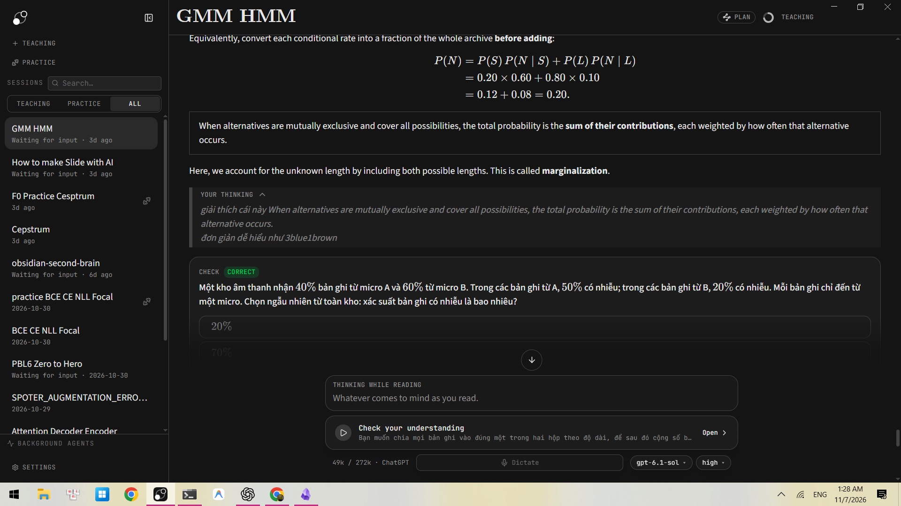

# UI/UX sản phẩm — giao tiếp đa phương thức giữa hai người

Cập nhật 10/11/2026. Tài liệu ghi các quyết định thiết kế, những điểm đang thảo luận và kịch bản cần duyệt trên bản phác. Kết quả triển khai P1 được ghi riêng trong [báo cáo P1](reports/stt_v1_p1_20261107/BAO_CAO.md).

> **Yêu cầu cốt lõi của người dùng: “giao tiếp giữa 2 người, giao tiếp multi modal”.**
>
> Hai người dùng chung màn hình để trao đổi. PBL6 phụ trách chuyển giọng nói thành chữ, đọc chữ thành tiếng và Settings. Chữ để đọc có thể đến từ luồng khác, chẳng hạn kết quả của dự án nhận dạng ký hiệu.

Đọc mục 1–3 để nắm phạm vi, luồng thu và quy tắc Lịch sử. Mục 4 ghi các tham chiếu. Mục 5–6 hướng dẫn duyệt một lượt STT trên bản phác. [Bàn giao phiên tiếp theo](START_NEXT_CHAT_STT.md) · [Đặc tả STT hiện tại](STT_SYSTEM_SPEC.md) · [BOM](STT_BOM.md)

## 1. Những gì đã xác nhận

**Hai người dùng một vùng soạn chung trên một màn hình.** Ai cũng có thể nhập vào vùng này. Người dùng tự chọn cách đặt, cầm hoặc xoay thiết bị để xem, tương tự cách đưa màn hình điện thoại cho người khác đọc. Giá đỡ là phụ kiện, còn kiểu giá đỡ và cách lắp sẽ bàn riêng. [Khảo sát vùng soạn và tình huống dùng một màn hình](reports/NGHIEN_CUU_COMPOSER_ANTIGRAVITY.md)

| Phương thức | Vai trò trong cuộc giao tiếp | Trạng thái |
| :--- | :--- | :--- |
| **Nhận dạng giọng nói (STT)** | Một người nói, xem và sửa chữ nhận được rồi gửi cho người kia đọc. | P1 nhận dạng một file và trả chữ cuối. Thu và dừng bằng mic trên Pi thuộc phần V1 còn lại. |
| **Nhập chữ** | Có thể gõ trực tiếp vào cùng vùng soạn rồi gửi. | Vùng soạn hội thoại thuộc thiết kế đang duyệt. Việc gõ chữ để phát thành tiếng sẽ bàn cùng TTS. |
| **Đọc chữ thành tiếng (TTS)** | **Đọc to** áp dụng cho từng tin đã gửi và là thao tác riêng với **Gửi**. Chạm loa của tin khác thì dừng tin đang phát ngay và chuyển sang tin vừa chọn. | Vị trí và cách hiển thị nút loa, bộ tạo giọng và đầu ra âm thanh còn để duyệt. Giải pháp PBL6 phải hoạt động độc lập với gói đăng ký ChatGPT. |
| **Văn bản từ luồng khác** | PBL6 có thể nhận chữ có sẵn, ví dụ đầu ra của dự án nhận dạng ký hiệu. | Mô hình nhận dạng ký hiệu và camera phục vụ mô hình thuộc phần tích hợp riêng. Cách đưa chữ vào PBL6 còn để bàn. |
| **Settings** | Có mục **Xóa lịch sử** theo quy tắc ở mục 3. | P1 đã có cài đặt key Deepgram tại máy. Các mục còn lại sẽ chốt theo từng luồng. |

- **Sản phẩm đích.** Thiết bị để bàn có màn cảm ứng và Electron ở chế độ kiosk. Stack đã chốt là React + TypeScript + Tailwind CSS, Next.js/Node.js và Electron.
- **Màu sắc.** Ảnh tham khảo dùng để xem bố cục. Bảng màu thay thế, theme sáng hoặc tối, font và bộ icon còn để duyệt.
- **Mốc phần mềm.** Hoàn thành STT theo thứ tự V1, V2 rồi V3. Sau khi hoàn thành STT V3 mới quay lại chọn công nghệ TTS. Duyệt giao diện là một bước riêng trước khi người dùng yêu cầu triển khai.

## 2. Thu, sửa và gửi trong vùng soạn chung

Chạm biểu tượng **mic** để bắt đầu thu. Vùng soạn vẫn hiện phía trên thanh báo thu và nút mic đổi thành **hình vuông** ngay tại chỗ. Chạm hình vuông để dừng. Trong lúc nhận dạng, nút hiện **vòng xoay**. Khi có chữ cuối, biểu tượng mic trở lại và ứng dụng đưa chữ vào vùng soạn để người dùng đọc lại. Nếu câu đã đúng, có thể bấm **Gửi** ngay.

**Bấm Gửi khi đang thu hoặc chờ nhận dạng.** Nếu đang thu, ứng dụng dừng mic và đợi chữ cuối. Nếu đã dừng, ứng dụng đợi kết quả của cùng lượt thu. Khi nhận dạng thành công, ứng dụng chèn chữ vào bản nháp theo vị trí con trỏ đã chốt rồi gửi toàn bộ câu đã ghép đúng một lần. Trong lúc chờ, người dùng vẫn sửa được bản nháp và di chuyển con trỏ. Nếu nhận dạng lỗi, ứng dụng bỏ yêu cầu gửi đang chờ và giữ bản nháp. [Khảo sát nút Gửi khi đang thu](reports/NGHIEN_CUU_GUI_KHI_DANG_THU.md)

**Trạng thái nút Gửi khi chờ chữ.** Nếu chỉ bấm hình vuông, **Gửi** vẫn bấm được. Sau khi người dùng bấm **Gửi**, nút giữ nguyên chữ **Gửi**, làm mờ và tạm khóa. Nút mic tiếp tục hiện vòng xoay trong lúc đợi chữ.

**Khi nhận dạng xong mà không có chữ.** Với kết quả `completed_empty`, vòng xoay kết thúc và biểu tượng mic trở lại. Ứng dụng giữ bản nháp, bỏ yêu cầu tự gửi nếu có và đưa nút **Gửi** về trạng thái theo nội dung ô soạn. Người dùng có thể thu lại hoặc chủ động gửi phần chữ đang có. Giao diện chỉ hiện lại mic cho trường hợp này.

**Khi lượt thu chạm giới hạn thời lượng.** Mục **Thời lượng thu tối đa (giây)** trong **Settings** mặc định **120 giây** và cho người dùng chỉnh. Khi chạm mốc đã đặt, ứng dụng tự dừng mic và nhận dạng phần đã thu như khi bấm hình vuông. Chữ nhận được vào vùng soạn để người dùng xem lại. Tự dừng vì hết giờ không tạo yêu cầu **Gửi**. [Khảo sát giới hạn thời lượng thu](reports/NGHIEN_CUU_AM_THANH_TAM_STT.md#giới-hạn-thời-lượng-thu)

Chạm vùng soạn để mở **bàn phím ảo** khi cần nhập hoặc sửa. Dùng **Backspace** trên bàn phím để xóa chữ. Việc nhận dạng xong giữ bàn phím ở trạng thái đóng nếu người dùng chưa chạm vào vùng soạn. Người dùng cũng có thể gõ trực tiếp. Chỉ thao tác **Gửi** mới đưa chữ vào hội thoại. Nếu bàn phím đang mở, ứng dụng tự đóng bàn phím sau khi gửi thành công.

**Câu dài trong vùng soạn.** Khi bàn phím mở, phương án đã duyệt trên bản phác 1024 × 600 cho ô soạn hiện ba dòng. Khi nội dung dài hơn, vùng chữ bên trong ô soạn cuộn và đưa dòng có con trỏ vào tầm nhìn khi người dùng sửa. Mic và **Gửi** vẫn ở cạnh ô soạn, phía trên bàn phím khi bàn phím mở. Cần đối chiếu với bàn phím Squeekboard thực tế trên Pi.

**Bàn phím V1 · 11/11/2026.** V1 dùng bàn phím ảo hệ thống **Squeekboard** trên **Raspberry Pi OS Bookworm**. Ứng dụng không tự làm bàn phím hoặc bộ gõ Telex. Người dùng sẽ xác nhận trên thiết bị thật khi đến bước thử: (1) chạm ô nhập và kiểm tra bàn phím tự bật, (2) gõ một câu có dấu và kiểm tra kết quả đúng, (3) kiểm tra bàn phím không che nút **Gửi**. Nếu cả ba bước đạt, V1 dùng Squeekboard. Nếu một bước không đạt, ghi lại và báo bước đó để xem xét. Hiện chưa tính phương án bàn phím tùy chỉnh. Kết quả ba bước còn chờ thử trên Pi.

Trong V1, ứng dụng nhận dạng sau khi dừng thu và đưa chữ cuối vào vùng soạn. Nếu nhận dạng thất bại, vòng xoay kết thúc, biểu tượng **mic** trở lại và chữ đang soạn được giữ. Giao diện dùng **một vị trí cạnh mic** để hiện thông báo lỗi dành cho người dùng do API PBL6 trả về. Người dùng chạm mic để thu một lượt mới. V2 gửi âm thanh trong lúc thu và vẫn hiển thị chữ cuối. V3 bổ sung chữ tạm cập nhật trong lúc nói. Khi laptop điều khiển Pi, nguồn thu là thiết bị đã chọn trên Pi. [Đối chiếu cách xử lý khi nhận dạng thất bại](reports/NGHIEN_CUU_VUNG_SOAN_VA_BAN_PHIM_AO.md#khi-nhận-dạng-giọng-nói-thất-bại)

**Bản nháp.** Theo LearnHarness, chữ chưa gửi chỉ tồn tại trong vùng soạn của hội thoại đang mở. Chuyển hội thoại hoặc đóng ứng dụng sẽ bỏ bản nháp. Nếu gửi lỗi khi hội thoại vẫn đang mở, ứng dụng giữ chữ để người dùng sửa hoặc thử gửi lại. [Khảo sát cách giữ bản nháp](reports/NGHIEN_CUU_BAN_NHAP_HOI_THOAI.md)

**Chuyển hội thoại khi đang thu hoặc chờ chữ.** Khi người dùng mở hội thoại khác hoặc tạo hội thoại mới, ứng dụng hủy lượt thu hoặc lượt nhận dạng đang chờ, bỏ yêu cầu **Gửi** nếu có và bỏ qua kết quả trả về muộn. Mở bảng **Lịch sử** để xem danh sách vẫn giữ lượt hiện tại.

**Chèn chữ theo Antigravity.** Người dùng có thể sửa bản nháp và di chuyển con trỏ trong lúc thu hoặc chờ kết quả. Khi có chữ nhận dạng đầu tiên để hiển thị, ứng dụng chèn vào bản nháp tại vị trí con trỏ lúc đó. Nếu ô soạn đang mất tiêu điểm, dùng vị trí gần nhất ô soạn còn giữ. Nếu chưa có vị trí, chèn vào cuối bản nháp.

- **V1 và V2.** Chữ đầu tiên đưa vào vùng soạn là chữ cuối sau khi dừng thu. Ứng dụng chèn chữ một lần theo quy tắc trên.
- **V3.** Chữ đầu tiên có thể là chữ tạm, hiển thị mờ trong vùng soạn. Kết quả tiếp theo cập nhật chính đoạn chữ tạm, kể cả khi người dùng đã dời con trỏ. Người dùng vẫn có thể sửa phần bản nháp xung quanh. **Backspace** và **Delete** chỉ bị chặn khi thao tác sẽ xóa chữ tạm. Khi có kết quả cuối, đoạn chữ tạm chuyển thành chữ thường tại chỗ.

Phương án tệp thu tạm của V1 và cách phát triển dần sang V2, V3 được ghi trong bản khảo sát âm thanh. [Khảo sát con trỏ khi soạn bằng giọng nói](reports/NGHIEN_CUU_COMPOSER_ANTIGRAVITY.md) · [Khảo sát tệp thu tạm và lộ trình V1–V3](reports/NGHIEN_CUU_AM_THANH_TAM_STT.md)

### Cách hình dung “harness bao quanh model”

*Harness* là cách hình dung lớp ứng dụng tổ chức phiên, thiết bị đầu vào và trạng thái thu, xử lý hoặc phát. Một bộ kết nối có thể chuyển yêu cầu tới dịch vụ hoặc bộ xử lý chạy tại máy rồi trả kết quả về đúng lượt. Đây là một cách phân chia đang bàn.

Đổi bộ xử lý qua bộ kết nối và cho cài plugin lúc chạy là hai quyết định riêng. Cordis, cơ chế plugin và cách các luồng trao đổi dữ liệu vẫn là chủ đề thảo luận. [Bản so sánh Cordis](comparision_everything_is_a_plugin.md) · [Ghi chú Everything is a Plugin](everything_is_a_plugin_cordis.md)

## 3. Bố cục, Lịch sử và Settings

| Vùng giao diện | Nội dung đã xác định | Việc cần duyệt trên bản phác |
| :--- | :--- | :--- |
| Điều hướng | Hội thoại, Lịch sử và Settings. | Cách mở và thu gọn Lịch sử trên màn nhỏ. |
| Vùng hội thoại | Hiển thị các tin đã gửi. Sau khi gửi thành công, vùng hội thoại tự cuộn đến tin vừa gửi. Tin này dùng cùng kiểu và cỡ chữ với các tin khác trong hội thoại. | Kiểm tra cỡ chữ chung trên màn 7 inch, bố cục từng tin và việc có cần nhãn nguồn nhập. |
| Vùng soạn | Một vùng soạn chung có nút mic ngay bên trái **Gửi**, cùng hàng với ô nhập. Khi chạm vào vùng soạn, bàn phím mở dưới cùng. Vùng soạn, mic và **Gửi** ở ngay phía trên. Vùng hội thoại dùng phần chiều cao còn lại và có thể cuộn. | Kiểm tra độ dễ nhận ra khi mic sẵn sàng, đang thu và đang chờ nhận dạng. |
| Settings | Cài đặt Deepgram đã có ở P1. **Nguồn mic trên Pi**, **Thời lượng thu tối đa (giây)** và **Xóa lịch sử** đã chốt ở mức thiết kế. | Cách bố trí các mục hiển thị. Đầu ra âm thanh sẽ bàn cùng TTS. |

**Tin dài đã gửi.** Nội dung tin tự xuống dòng theo chiều rộng màn hình. Khi gửi thành công một tin dài hơn vùng hội thoại đang thấy, ứng dụng cuộn đến **cuối tin vừa gửi**. Người đọc vuốt vùng hội thoại để xem toàn bộ tin. Nút **Đọc** đi cùng tin đó, vị trí cụ thể sẽ được duyệt khi quay lại TTS.

Khi triển khai bàn phím, cập nhật vùng soạn và trạng thái nút **Gửi** theo từng phím. [Khảo sát vùng soạn và bàn phím ảo](reports/NGHIEN_CUU_VUNG_SOAN_VA_BAN_PHIM_AO.md)

### Chọn nguồn mic trên Pi

Khi khởi động, nếu chưa có lựa chọn đã lưu, V1 dùng mic mặc định của hệ điều hành Pi (**PipeWire default source**) và hiện tên mic đang dùng trong **Settings**. Người dùng có thể đổi mic trong **Settings**; lựa chọn đó được lưu qua các lần mở ứng dụng và được ưu tiên khi còn khả dụng. Mỗi lần chạm nút mic, ứng dụng bắt đầu thu bằng nguồn đang dùng mà không yêu cầu chọn lại. Nguồn thu thuộc Pi cả khi người dùng mở giao diện từ laptop.

Nếu Pi chưa phát hiện mic nào khi người dùng chạm nút mic, ứng dụng hiện cạnh nút: **“Không tìm thấy mic. Hãy kết nối mic rồi thử lại.”** Sau khi kết nối, người dùng chạm mic lần nữa để bắt đầu thu theo quy tắc chọn nguồn.

Nếu mic đã lưu không còn khả dụng, ứng dụng tạm dùng mic mặc định khả dụng của hệ điều hành và giữ nguyên lựa chọn đã lưu. Nếu không có mic khả dụng, ứng dụng hiện thông báo không tìm thấy mic cạnh nút khi người dùng chạm mic.

Khi mic đã lưu kết nối lại và sẵn sàng, ứng dụng tự khôi phục nguồn đó cho lượt thu tiếp theo. Nếu đang thu bằng mic dự phòng, giữ nguồn đó đến hết lượt thu. Nếu người dùng đã chọn một mic khác trong **Settings**, lựa chọn mới được lưu và có hiệu lực theo cùng quy tắc. Việc kết nối lại mic không tự bắt đầu thu. **Settings** hiển thị rõ mic người dùng đã chọn và mic thực tế đang dùng, kể cả khi hai mic khác nhau trong lúc dùng nguồn dự phòng.

**Mic bị ngắt trong lúc thu.** Khi phát hiện mic của lượt thu bị ngắt, ứng dụng dừng lượt thu và báo cạnh nút mic: **“Mic bị ngắt kết nối. Đang nhận dạng phần đã thu.”** Nếu có âm thanh đã thu, ứng dụng nhận dạng phần đó và đưa chữ vào vùng soạn để người dùng xem, sửa và chủ động gửi. Hủy yêu cầu **Gửi** đang chờ nếu có. Nếu không thu được âm thanh hoặc nhận dạng thất bại, giữ bản nháp hiện có và báo lỗi. Lượt thu tiếp theo dùng nguồn theo quy tắc chọn mic; kết nối lại không tự bắt đầu thu. Cơ chế phát hiện và kết quả thu dở cần kiểm tra trên Pi thật.

Khi cắm thêm mic, ứng dụng tiếp tục dùng mic đã chọn nếu mic đó còn khả dụng. Khi ứng dụng đang dùng nguồn mặc định của hệ điều hành, nguồn này có thể đổi theo mic mặc định của hệ điều hành. Trong cả hai trường hợp, ứng dụng không yêu cầu người dùng chọn mic khi bắt đầu lượt thu.

### Quy tắc Lịch sử đã chốt

**Lịch sử lưu các hội thoại**, gồm tên hội thoại và các tin đã gửi. Hội thoại xuất hiện trong **Lịch sử** sau khi gửi thành công tin đầu tiên. Sau khi đóng và mở ứng dụng, người dùng có thể mở lại hội thoại đã lưu, đọc các tin trước, soạn và gửi tiếp vào cùng hội thoại đó.

Khi mở lại một hội thoại, vùng hội thoại hiện **cuối hội thoại**. Nếu tin cuối dài hơn vùng nhìn thấy, màn hình hiện cuối tin đó. Người dùng có thể vuốt lên để đọc các phần trước.

**Thời gian lưu.** V1 giữ các hội thoại đã lưu cho đến khi người dùng chủ động xóa. Bộ lọc thời gian giúp tìm hội thoại để chọn xóa.

**Mỗi lần mở ứng dụng, màn chính hiện một hội thoại mới.** Người dùng cũng có thể bấm **+ Hội thoại mới** trong lúc ứng dụng đang mở. Bản phác đặt nút này trong bảng Lịch sử.

**Thứ tự trong Lịch sử.** Dùng quy tắc **Last updated** của DeepSeek Harness theo thời điểm gửi thành công tin nhắn gần nhất. Gửi thêm tin đưa hội thoại lên đầu. Mở để xem, đổi tên hoặc bấm **Đọc to** giữ nguyên vị trí. [Nghiên cứu cách sắp xếp Lịch sử](reports/NGHIEN_CUU_SAP_XEP_LICH_SU.md)

**Tên ban đầu.** Dùng nội dung tin đầu tiên được gửi thành công theo cách của LearnHarness. Gộp khoảng trắng và rút gọn câu dài ở ranh giới từ. ID hội thoại tách với tên hiển thị. Người dùng có thể đổi tên sau. [Nghiên cứu cách đặt và đổi tên](reports/NGHIEN_CUU_DAT_TEN_HOI_THOAI.md)

**Đổi tên hội thoại đã lưu.** Trên màn cảm ứng, chạm tiêu đề của hội thoại đang mở để sửa tại chỗ. Khi dùng chuột, nhấn chuột phải vào mục trong **Lịch sử** rồi chọn **Đổi tên**. Chạm một lần vào mục trong **Lịch sử** để mở hội thoại.

**Xóa lịch sử trong Settings.** Đặt ô **Tìm theo tên** và bộ lọc **Thời gian** trên danh sách hội thoại đã lưu. Bộ lọc dùng thời điểm gửi tin thành công gần nhất. Khi đang tìm hoặc lọc, **Chọn N kết quả** chọn tất cả hội thoại khớp điều kiện, kể cả dòng nằm ngoài vùng nhìn thấy. Người dùng có thể bỏ chọn từng dòng. Đổi điều kiện tìm hoặc lọc sẽ bỏ toàn bộ lựa chọn trước đó. Chỉ danh sách cuộn. Ô tìm, bộ lọc và nút **Xóa N hội thoại** luôn trong tầm nhìn khi cuộn danh sách. Bấm **Xóa N hội thoại** để xóa ngay các hội thoại đang được chọn. [Nghiên cứu tìm, lọc và xóa hội thoại](reports/NGHIEN_CUU_TIM_LOC_VA_XOA_LICH_SU.md)

Nếu các hội thoại được xóa có hội thoại đang mở, ứng dụng chuyển sang một hội thoại mới, trống và bỏ bản nháp của hội thoại vừa xóa. Khi người dùng rời Cài đặt để quay lại **Hội thoại**, màn chính hiện cuộc mới.

### Phương án đang thảo luận

**Các điểm tạm hoãn.** Tìm kiếm trong bảng Lịch sử để mở lại hội thoại và xuất Lịch sử hiện chưa cần cho V1. Tìm kiếm trong **Cài đặt → Lịch sử** để chọn hội thoại cần xóa đã được duyệt.

**Nhận dạng file.** Nhóm chạy batch trong bộ thí nghiệm `experiments/` và dùng đường một file của P1 để kiểm tra tích hợp khi cần. Tiêu chí hoàn thành V1 tập trung vào lượt giao tiếp dùng mic trên Pi. Việc đưa công cụ nhận dạng file vào Settings có thể xem lại khi có nhu cầu sử dụng riêng. [Bằng chứng thí nghiệm](experiments/inventory_20261102/README.md) · [Phạm vi P1](stt-app/README.md)

## 4. Ghi nhận ảnh tham khảo người dùng gửi

### Codex và LearnHarness — ảnh bổ sung ngày 07/11/2026

**Quan sát từ ảnh Codex:** thanh điều hướng icon bên trái, tiêu đề cuộc trao đổi phía trên, nội dung hội thoại ở vùng trung tâm và vùng nhập ở phía dưới với các điều khiển kèm theo. Ảnh cho thấy bố cục của một cuộc trao đổi; không đủ để xác nhận toàn bộ cơ chế lưu/chuyển phiên.

**Quan sát từ ảnh LearnHarness:** sidebar có danh sách SESSIONS, ô tìm kiếm, mục được chọn; vùng nội dung có tiêu đề và vùng nhập/điều khiển phía dưới; Settings ở cuối sidebar. Các chế độ teaching/practice thuộc mục đích của nền tảng tham khảo, chưa phải yêu cầu sản phẩm này.

**DeepSeek Harness.** Đã khảo sát bản `0.2.1-rc.5` trên máy cùng Codex Desktop và LearnHarness `0.5.0`. Kết quả được lưu riêng theo chủ đề [đặt và đổi tên](reports/NGHIEN_CUU_DAT_TEN_HOI_THOAI.md), [sắp xếp Lịch sử](reports/NGHIEN_CUU_SAP_XEP_LICH_SU.md) và [nút Đọc to](reports/NGHIEN_CUU_DOC_TO_CAC_HARNESS.md).

Các ảnh dùng để đối chiếu bố cục và cách tổ chức hội thoại. Kiểu hiển thị, màu sắc và cách lưu dữ liệu của PBL6 được quyết định theo nhu cầu của nhóm.

### Hand Morse — ảnh tham khảo trước đó

**Quan sát từ ảnh tĩnh:** vùng camera lớn ở giữa, các panel trạng thái/đo bàn tay, bảng Morse bên phải, vùng message phía dưới và các gợi ý phím tắt. Chưa kiểm chứng cách ứng dụng trong ảnh thực sự hoạt động; lớp nút Play/tìm kiếm có thể thuộc trình xem video và không dùng làm yêu cầu sản phẩm.

Ảnh Hand Morse được giữ làm tham chiếu bố cục từ phạm vi thảo luận ban đầu. Camera và mô hình nhận dạng ký hiệu thuộc phần tích hợp riêng. Lượt duyệt STT dùng mic và vùng soạn chung.

## 5. Kịch bản V1 trên bản phác

Các khung **Trao đổi**, **Mở lịch sử** và **Bàn phím mở** đặt nút biểu tượng mic ngay bên trái **Gửi**. Các khung **Đang thu**, **Chờ nhận dạng** và **Lỗi nhận dạng** dùng cùng vị trí đó cho hình vuông dừng, vòng xoay và biểu tượng mic trở lại. Khung lỗi đặt thông báo ngay phía trên nút mic. Khung **Đã bấm Gửi, chờ chữ** minh họa nút **Gửi** đã mờ trong lúc vòng xoay vẫn hiện. [Bản phác Pencil 1024 × 600](reports/ui_ux_20261107/assets/wireframe-hoi-thoai-1024x600.pen)

Khung **11 · Vùng soạn ba dòng** minh họa phương án đã duyệt khi bàn phím mở. Ô soạn hiện ba dòng, mic và **Gửi** nằm phía trên bàn phím, còn một tin đã gửi phía trên. Bàn phím là hình minh họa, kích thước thực tế của Squeekboard cần kiểm tra trên Pi. [Ảnh dựng khung 11](reports/ui_ux_20261107/assets/xMqX3.png)

Khung **08 · Cài đặt giọng nói** minh họa một panel **Giọng nói thành chữ**. Nhãn ở bên trái, giá trị ở bên phải. Hai phần **Thu âm** và **Nhận dạng** luôn hiện trong cùng panel. Bản phác đặt mic và giới hạn thu mặc định **120 giây** cạnh cấu hình Deepgram, gồm khóa API, mô hình và giới hạn chờ nhận dạng hiện mặc định **60 giây** ở P1. Đã xem ảnh dựng trong Pencil để kiểm tra cả năm dòng và nút **Lưu cài đặt** đều vừa khung 1024 × 600. Tên mic và các điều khiển trong khung dùng để minh họa bố cục.

Khung **09 · Cài đặt theo nhóm** phác cách mở rộng menu. Thanh bên liệt kê **Giọng nói thành chữ** và **Lịch sử**. Chọn một nhóm sẽ đổi nội dung bên phải. Hai nhãn **Thu âm** và **Nhận dạng** vẫn nằm trong một panel và luôn hiện. Khung 09 minh họa trạng thái đang chọn **Giọng nói thành chữ**. Ảnh dựng đã được kiểm tra ở 1024 × 600. Đây là phương án điều hướng đang xem xét.

Khung **10 · Cài đặt Lịch sử** minh họa luồng đã duyệt ở mục 3. Ô **Tìm theo tên**, bộ lọc **Cũ hơn 30 ngày** và nút **Chọn 12 kết quả** nằm trên vùng cuộn riêng của danh sách. Bốn trong 12 dòng xuất hiện trong khung, gồm hai dòng đã bỏ chọn và hai dòng vẫn được chọn. Tám dòng còn lại được tính trong lựa chọn và nằm dưới vùng nhìn thấy. Nút **Xóa 10 hội thoại** nằm dưới danh sách. Đã kiểm tra ảnh dựng ở 1024 × 600, thứ tự các vùng và số lượng trong ví dụ. Khung Pencil minh họa trạng thái giao diện bằng dữ liệu mẫu.

Dùng bản phác làm tham chiếu khi triển khai một lượt nói, đọc và đáp trên cùng màn hình. Thử cả cách bấm hình vuông để dừng và xem lại chữ trước khi gửi, và cách bấm **Gửi** khi đang thu để app đợi chữ rồi gửi câu đã ghép. Khi kiểm tra trên thiết bị, đối chiếu vị trí của tin vừa gửi, cỡ chữ chung và cách mở lại hội thoại từ **Lịch sử**.

Khi duyệt nút **Đọc**, dùng ba trạng thái loa, vòng xoay và nút dừng của Codex Desktop làm tham chiếu. Cách hiển thị trên màn cảm ứng và bộ tạo giọng vẫn để bàn. [Khảo sát nút Đọc to](reports/NGHIEN_CUU_DOC_TO_CAC_HARNESS.md)

**Ứng viên TTS để xem lại sau khi hoàn thành STT V3 (10/11/2026).** Deepgram Flux TTS có hai giọng tiếng Việt ở Early Access là Hoa (`flux-hoa-vi`) và Minh (`flux-minh-vi`). Deepgram chưa tự chuyển số, ngày giờ và chữ viết tắt sang cách đọc tiếng Việt. Khi quay lại, nghe thử câu có giờ như “Quầy đóng lúc 17:30” và kiểm tra quyền gọi TTS của khóa đang dùng ở P1. Hiện mới xác minh bằng tài liệu. [Danh mục giọng Flux TTS](https://developers.deepgram.com/docs/flux-tts/voices#vietnamese-early-access)

## 6. Tiêu chí duyệt bản phác

- Nút bên trái **Gửi** hiển thị biểu tượng mic khi sẵn sàng, hình vuông khi đang thu và vòng xoay khi chờ nhận dạng. Nút vẫn nằm cạnh **Gửi** khi bàn phím mở.
- Gõ “Tôi muốn”, đặt con trỏ cuối câu, thu “hẹn gặp vào sáng mai” và bấm **Gửi** khi đang thu. Ứng dụng dừng, đợi nhận dạng và gửi “Tôi muốn hẹn gặp vào sáng mai” đúng một lần. Thử lại bằng cách bấm hình vuông trước, rồi bấm **Gửi** khi vòng xoay đang hiện. Nếu nhận dạng thất bại sau khi bấm **Gửi**, bản nháp vẫn còn và không xuất hiện tin mới.
- Gõ “Tôi muốn”, bắt đầu thu rồi bấm **Gửi**. Giả lập Deepgram trả về `completed_empty`. Biểu tượng mic trở lại, “Tôi muốn” vẫn trong vùng soạn, nút **Gửi** bấm lại được và hội thoại không có tin mới. Với ô soạn trống, mic vẫn trở lại và **Gửi** ở trạng thái dành cho bản nháp trống.
- Kiểm tra **Thời lượng thu tối đa** mặc định là 120 giây. Đổi sang 10 giây rồi thu một lượt. Mic tự dừng ở mốc đã đặt, chữ nhận được vào vùng soạn và hội thoại không có tin mới cho đến khi người dùng bấm **Gửi**.
- Khi vòng xoay xuất hiện sau khi bấm hình vuông, **Gửi** vẫn bấm được. Sau lần bấm **Gửi** đầu tiên, nhãn nút vẫn là **Gửi**, nút mờ và lần bấm tiếp theo không tạo yêu cầu mới. Ô soạn vẫn sửa được trong lúc chờ chữ.
- Trong hội thoại A, mở bảng **Lịch sử** khi đang thu và kiểm tra lượt thu vẫn tiếp tục. Chọn hội thoại B để hủy lượt thu. Lặp lại bằng cách bấm **Gửi** ở A rồi chuyển sang B khi còn chờ chữ. Kết quả về muộn không chèn chữ vào vùng soạn và không tạo tin ở A hay B.
- Khi chưa có lựa chọn đã lưu, khởi động ứng dụng với nhiều mic và kiểm tra nguồn đang dùng là mic mặc định của PipeWire. Chạm mic nhiều lần qua các lượt thu và kiểm tra ứng dụng dùng nguồn đó mà không yêu cầu chọn lại.
- Đổi mic trong **Settings**, khởi động lại ứng dụng và kiểm tra các lượt thu dùng mic đã lưu. Khi mic đã lưu không còn khả dụng, kiểm tra lượt thu dùng mic mặc định khả dụng của hệ điều hành và tên nguồn đang dùng hiện trong **Settings**.
- Chọn mic USB, ngắt kết nối và kiểm tra **Settings** vẫn hiện lựa chọn USB cùng mic dự phòng thực tế. Đang thu bằng mic dự phòng thì kết nối lại USB và kiểm tra nguồn thu giữ nguyên đến hết lượt. Lượt thu tiếp theo dùng USB, và kết nối lại không tự bắt đầu thu. Lặp lại sau khi người dùng chọn mic khác trong **Settings**, kiểm tra lựa chọn mới được giữ khi USB cũ kết nối lại.
- Ngắt mic trong lúc thu sau khi đã nói một phần. Kiểm tra thông báo gián đoạn, phần đã thu được nhận dạng và đưa vào vùng soạn, bản nháp được giữ, và không có tin mới cho đến khi người dùng chủ động gửi. Kiểm tra cả trường hợp có yêu cầu **Gửi** đang chờ, không thu được âm thanh và nhận dạng thất bại. Sau đó kiểm tra lựa chọn nguồn cho lượt thu tiếp theo.
- Cắm thêm mic khi mic đã chọn vẫn khả dụng và kiểm tra lượt thu tiếp tục dùng mic đã chọn. Khi dùng nguồn mặc định của hệ điều hành, đổi mic mặc định rồi kiểm tra nguồn dùng cho lượt thu tiếp theo.
- Khi Pi chưa phát hiện mic, chạm nút mic và kiểm tra thông báo **“Không tìm thấy mic. Hãy kết nối mic rồi thử lại.”** xuất hiện cạnh nút. Kết nối một mic rồi chạm lại và kiểm tra lượt thu bắt đầu theo quy tắc chọn nguồn.
- Trong **Cài đặt → Lịch sử**, dùng bộ lọc có 12 kết quả, gồm cả dòng nằm ngoài vùng nhìn thấy. Bấm **Chọn 12 kết quả**, bỏ chọn hai dòng và cuộn danh sách. Ô tìm, bộ lọc và nút **Xóa 10 hội thoại** vẫn trong tầm nhìn. Bấm xóa và kiểm tra chỉ mười hội thoại đã chọn biến mất. Đổi điều kiện tìm hoặc lọc sau khi chọn ở một lượt kiểm tra khác và kiểm tra lựa chọn cũ đã được bỏ.
- Mở một hội thoại đã lưu, nhập bản nháp rồi vào **Cài đặt → Lịch sử** và xóa hội thoại đó. Khi quay lại **Hội thoại**, kiểm tra màn chính hiện cuộc mới, vùng soạn trống và hội thoại đã xóa không còn trong danh sách.
- Khi nhận dạng đoạn vừa thu thất bại, vòng xoay kết thúc, biểu tượng mic trở lại và thông báo xuất hiện ở vị trí chung cạnh mic. Chữ đang soạn vẫn còn. Lần chạm mic kế tiếp bắt đầu một lượt thu mới.
- Trong lúc tin A đang đọc, chạm **Đọc** ở tin B. Âm thanh A dừng ngay khi chạm, kể cả khi B còn chờ âm thanh. Khi B sẵn sàng, chỉ phát B.
- Phân biệt được chữ đang soạn và tin đã gửi. Chạm vùng soạn mở bàn phím và vẫn nhìn thấy câu đang sửa cùng nút **Gửi**.
- Nhập một câu dài vượt chiều cao ô soạn, mở bàn phím và chạm vào giữa câu để sửa. Kiểm tra dòng có con trỏ hiện trong vùng nhìn thấy, nội dung ô soạn cuộn được và mic cùng **Gửi** vẫn chạm được phía trên bàn phím.
- Sửa chữ và di chuyển con trỏ trong lúc đang thu, rồi lặp lại khi vòng xoay đang hiện. Vùng soạn nhận thao tác ở cả hai giai đoạn và giữ các chỉnh sửa khi kết quả về.
- Với V1, bắt đầu thu câu “hẹn gặp” khi con trỏ ở cuối “Tôi muốn vào sáng mai.” Trong lúc chờ, chuyển con trỏ đến giữa “Tôi muốn” và “vào sáng mai.” Khi có kết quả, vùng soạn hiện “Tôi muốn hẹn gặp vào sáng mai.” Chạm nút dừng làm ô soạn mất tiêu điểm thì vị trí gần nhất vẫn dùng được.
- Với V3, chèn chữ tạm rồi chuyển con trỏ sang phần khác của bản nháp. Chữ tạm tiếp tục cập nhật tại đoạn đã chèn, rồi chuyển thành chữ thường tại đó khi có kết quả cuối. Vẫn sửa được phần chữ xung quanh, và Backspace hoặc Delete chỉ bị chặn khi thao tác sẽ xóa chữ tạm.
- Nếu gửi thành công khi bàn phím đang mở, bàn phím tự đóng để dành thêm chỗ cho tin vừa gửi.
- Trong một hội thoại dài, cuộn lên xem tin cũ rồi gửi một tin mới. Khi gửi thành công, vùng hội thoại tự cuộn để đưa tin vừa gửi vào tầm nhìn.
- Gửi một tin dài hơn vùng hội thoại và kiểm tra nội dung tự xuống dòng, màn hình hiển thị cuối tin sau khi gửi thành công, người dùng có thể vuốt vùng hội thoại để đọc toàn bộ tin.
- Gửi lỗi thì chữ vẫn nằm trong vùng soạn khi hội thoại còn mở. Chuyển sang hội thoại khác rồi quay lại, hoặc đóng rồi mở lại ứng dụng, sẽ thấy vùng soạn trống.
- Người dùng có thể thao tác chính bằng một lần chạm trên vùng điều khiển. Người nhận dễ tìm và đọc câu vừa gửi trên màn 7 inch.
- Tin đầu tiên được gửi thành công thì hội thoại xuất hiện trong **Lịch sử**. Sau khi đóng và mở ứng dụng, màn chính hiện cuộc mới và người dùng có thể mở lại cuộc đã lưu.
- Mở lại một hội thoại dài và kiểm tra vùng hội thoại hiện cuối cuộc. Lặp lại với tin cuối dài hơn vùng nhìn thấy, kiểm tra màn hình hiện cuối tin và người dùng vuốt lên đọc được các phần trước.
- Với hội thoại đã lưu có lần gửi thành công gần nhất cũ hơn 30 ngày, kiểm tra hội thoại vẫn mở lại được và vẫn còn sau khi dùng bộ lọc **Cũ hơn 30 ngày**, cho đến khi người dùng chọn xóa.

Đây là tiêu chí duyệt thiết kế. Lượt thử trên phần cứng sẽ đối chiếu thêm độ phân giải, vị trí chạm, vuốt và bàn phím tiếng Việt theo [hướng dẫn NH2067](HUONG_DAN_NH2067_PI4.md).
