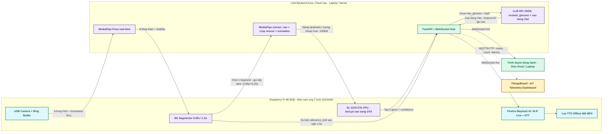
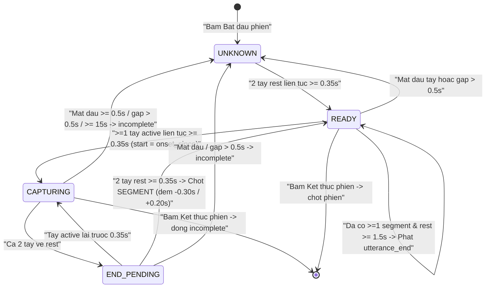
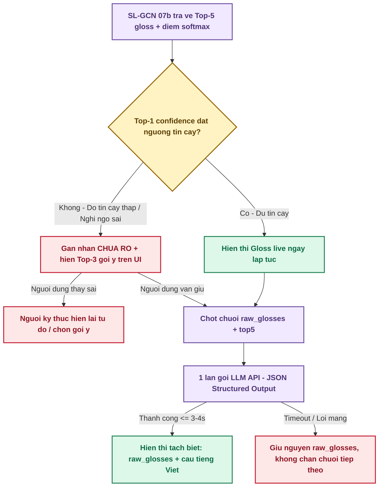

# PBL6 — Chốt Quyết Định Kiến Trúc & Lộ Trình Thực Thi (M2 → M3)

> [!IMPORTANT]
> **Mục đích tài liệu này:** Ghi nhớ cố định mọi quyết định kỹ thuật, phân ranh giới ĐÃ CÓ với DỰ KIẾN, và khóa hàng đợi Todo từng bước để không trôi ngữ cảnh giữa các phiên làm việc.
> **Mức độ kỹ thuật mục tiêu:** Demo / MVP ổn định cho bảo vệ PBL6 — áp dụng tuyệt đối **YAGNI** (không overengineer lên production).
> *(Bản hướng dẫn cài đặt & thao tác nhanh hàng ngày cho đồng đội nằm ở [../HANDOFF_TEAMMATE_M2_PI.md](../HANDOFF_TEAMMATE_M2_PI.md).)*

---

## 1. Năm Quyết Định Đã Chốt (`1A, 2A, 3A, 4A, 5B` — Ngày 19/11/2026)

| # | Vấn đề | Quyết định đã chốt | Lý do thực tế (YAGNI + Yêu cầu của cô) |
| :-: | :--- | :--- | :--- |
| **1A** | **Pi 4B chạy gì vs LAN Backend chạy gì?** | **Pi chạy Camera + UI + Segmenter + SL-GCN** **LAN Backend chạy MediaPipe + LLM** | Đáp ứng yêu cầu của cô (*Pi không chỉ thu hình/hiển thị*), sẵn đường cho **OTA cập nhật file `best.pt`** sau này. MediaPipe nặng (chiếm ~97% thời gian) đặt trên Laptop LAN. **Triển khai 2 bước:** M2.1 chạy thông trên Laptop trước → M2.2 tách SL-GCN lên Pi 4B đo thực tế *(giữ công tắc fallback về Backend nếu Pi > 1.5s)*. |
| **2A** | **Gói bàn giao M1 dùng để làm gì?** | **Chỉ lấy lõi code + checkpoint, KHÔNG dựng lại UI M1** | `M1-handoff.zip` đã có đủ `segmenter.py`, `extraction/*`, `preprocessing/*` và `07b_bone_seed42/best.pt`. Chạy kiểm tra nhanh `preflight` + `test_segmenter` trên Windows rồi nhúng thẳng vào `slr-m2/`. |
| **3A** | **Giao diện cuối cùng & Trình duyệt đồng hành** | **1 Web App duy nhất trên nền `stt-app` (Next.js :3100)** | Tận dụng `stt-app` đã xong lõi STT, thêm màn hình **SLR Live** tối ưu cảm ứng **7 inch (`1024×600`)**. Pi mở trình duyệt trực tiếp; điện thoại/laptop mở **cùng URL `/companion`** để xem live + lịch sử qua WebSocket. |
| **4A** | **Chiều ngược Speech → Sign & Yêu cầu IoT** | **Giữ Speech → Text** + **ThingsBoard tối giản (~50 dòng)** | Speech → Sign bằng ML bất khả thi ở giai đoạn cuối → chốt phạm vi *người khiếm thính đọc được tiếng Việt cơ bản*. IoT: chỉ đẩy `online`, `session_count`, `gloss_count`, `latency_ms` lên **ThingsBoard** để có sẵn dashboard *(không tự code dashboard, không cảm biến xoay, không remote control)*. |
| **5B** | **Tạo câu tiếng Việt & Khi Top-5 sai toàn bộ** | **1 lần gọi LLM JSON + Cờ `CHƯA RÕ` + Nhánh thử nghiệm VLM sau MVP** | Lõi M2/M3 dùng 1 lời gọi LLM JSON tách `revised_glosses` và `vietnamese_sentence` + gắn cờ **`CHƯA RÕ`** khi độ tin cậy thấp. Sau khi xong MVP, mở **Bước 8** chạy thử nghiệm gửi clip low-confidence cho Cloud VLM để đo thực tế độ chính xác trên VSL400. |

---

## 2. Sơ Đồ Kiến Trúc & Cơ Chế Kỹ Thuật (Diagram-First)

### Sơ đồ 1 — Kiến trúc mục tiêu M2.2 → M3 (Phân bổ tải Pi 4B 8GB ↔ LAN Backend)

> [!NOTE]
> **Lưu ý kỹ thuật quan trọng từ `M1/inference.py`:** Hiện tại M1 chạy 2 lượt MediaPipe: lượt 1 chạy `Pose` theo từng frame để phân đoạn (`replay.py`), lượt 2 chạy `extract_raw` + `rescue_candidates` trên clip đã cắt (`inference.py`). Khi tách lên Pi (M2.2), **LAN Backend** chịu toàn bộ MediaPipe và trả về mảng landmark/xương đã chuẩn hóa (`~15–100 KB`), còn **Pi 4B** chạy `Segmenter` + `SL-GCN 07b` + Web UI.

---

### Sơ đồ 2 — State Machine thực tế của `Segmenter` ([segmenter.py](../slr-m2/deployment/m1/segmenter.py))

**Phiên (`Session`)** bấm tay 1 lần ở đầu và cuối (`Bắt đầu ký` / `Kết thúc ký`); **từng Ký hiệu (`Segment`)** và **chốt Chuỗi (`Utterance`)** chạy tự động theo máy trạng thái bên dưới:

---

### Sơ đồ 3 — Xử lý khi Top-1 / Top-5 độ tin cậy thấp (`CHƯA RÕ`)

---

## 3. Bảng Bằng Chứng Hiện Trạng (Đã Chạy Thật vs Chưa Triển Khai)

| Hạng mục | Trạng thái thực tế | Căn cứ xác minh |
| :--- | :--- | :--- |
| **App STT & UI chung (`stt-app/`)** | **ĐÃ CHẠY THẬT TRÊN PI 4B** | Next.js 16 standalone (`:3100`), Deepgram Nova-3 STT tiếng Việt với mic USB tích hợp Webcam, `Squeekboard` OSK + `Fcitx5` Wayland, nút `Bắt đầu ký`, `/companion`. |
| **Lõi phân đoạn & model M1 (`slr-m2/`)** | **ĐÃ CHẠY SẠCH WINDOWS & PI** | `test_segmenter`, `test_m2`, `test_m2_split` đều PASS; checkpoint `07b_bone_seed42/best.pt` xác minh SHA-256 `7934805b...`. |
| **Kho âm thanh TTS Offline** | **ĐÃ CÓ 400/400 MP3** | `slr-app/MVP/local_data/tts/0.mp3..399.mp3` (`2.97 MB`), phát qua `/api/tts/{id}.mp3`. |
| **SLR Live M2.2 Split (`slr-m2/deployment/m2/`)** | **ĐÃ CHẠY LIVE TRÊN PI + VNC** | Thử nghiệm live trước webcam thật (`Wed Camera 32e6:9221`) + `WayVNC :5900` đạt `Dài (99.6%)`, `Khăn quàng cổ (98.8%–99.8%)`, `Xin (99.8%)`, `Bơi lội (95.5%)`, `Cái quần (95.1%)` với `incomplete = 0`. *(Cần tối ưu thêm FPS đọc camera `5–7 FPS -> 15–20 FPS` & giữ nóng MediaPipe để giảm trễ trước khi sang Bước 6.)* |
| **LLM M3 & ThingsBoard** | **CHƯA TRIỂN KHAI** | Đợi hoàn tất tối ưu độ mượt SLR + chốt phương án chốt câu tự động (**Phương án A** vs **Phương án B**) rồi triển khai **Bước 6**. |
| **Ngoài phạm vi (KHÔNG làm)** | **LOẠI BỎ (YAGNI)** | Offline MediaPipe trên Pi, nâng cấp camera CSI, cảm biến xoay hướng người dùng, remote control phần cứng, AI Agent OS, Speech → Sign bằng ML. |

---

## 4. Hàng Đợi Todo Từng Bước

- [x] **Bước 1:** Tổng hợp bằng chứng, chốt 5 quyết định (`1A, 2A, 3A, 4A, 5B`) & vẽ sơ đồ kỹ thuật.
- [x] **Bước 2:** Giải nén M1 vào `slr-m2/`, chạy `preflight` + `test_segmenter` + suy luận mẫu `014159.mp4` (`Dài` `98.14%`).
- [x] **Bước 3 (M2.1):** Xây `slr-m2/deployment/m2/` (`classifier.py`, `pipeline.py`, `server.py`, `test_m2.py`).
- [x] **Bước 4:** Ghép `SlrDock` + `LiveSigningCard` + `speakOutput()` + `/companion` + `/api/tts/{id}.mp3` vào `stt-app/`.
- [x] **Bước 5 (M2.2 + Vận hành thực tế trên Pi 4B):** Tách `VisionExtractor` (`vision_backend.py`) ↔ `BoneClassifier` (`remote_clients.py` auto-fallback), triển khai `deploy_to_pi.ps1` / `pi_bootstrap.sh` / `pi_start.sh` (`uv` Python 3.11 + `torch==2.3.1`, Node 22 ARM64, Firefox Wayland `--new-window`, Squeekboard, `WayVNC :5900` tự hồi phục khi tắt màn HDMI), chạy live thành công trên Pi 4B thật.
- [ ] **Bước 5.5 (Đang chờ duyệt làm ngay trước Bước 6):** Tách luồng đọc webcam trên Pi lên `15–20 FPS` độc lập với HTTP Pose (`320px`) + giữ nóng (warm) MediaPipe Extractor trên Laptop để giảm trễ từ `10–23s/từ` xuống nhanh & chính xác hơn.
- [ ] **Bước 6 (M3 + IoT tối giản):** Chốt cơ chế chốt câu (Phương án A vs B) + gắn 1 lần gọi LLM API (JSON) tạo câu tiếng Việt + gửi telemetry tối giản lên ThingsBoard.
- [ ] **Bước 7:** Kiểm thử tích hợp toàn trình (SLR + STT + Companion + ThingsBoard) và review độc lập.
- [ ] **Bước 8 (Thử nghiệm phụ 5B — sau MVP):** Đánh giá VLM trên 20 clip VSL400 low-confidence.
