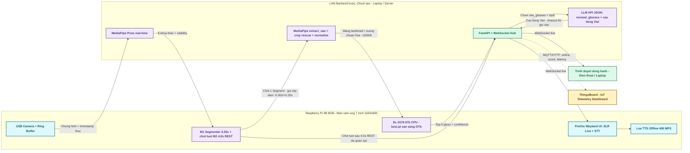
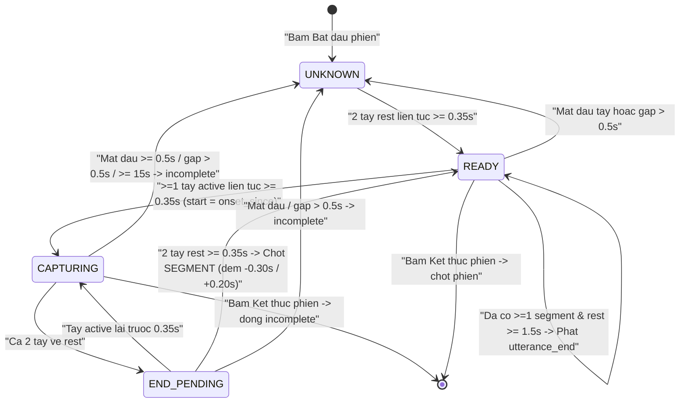
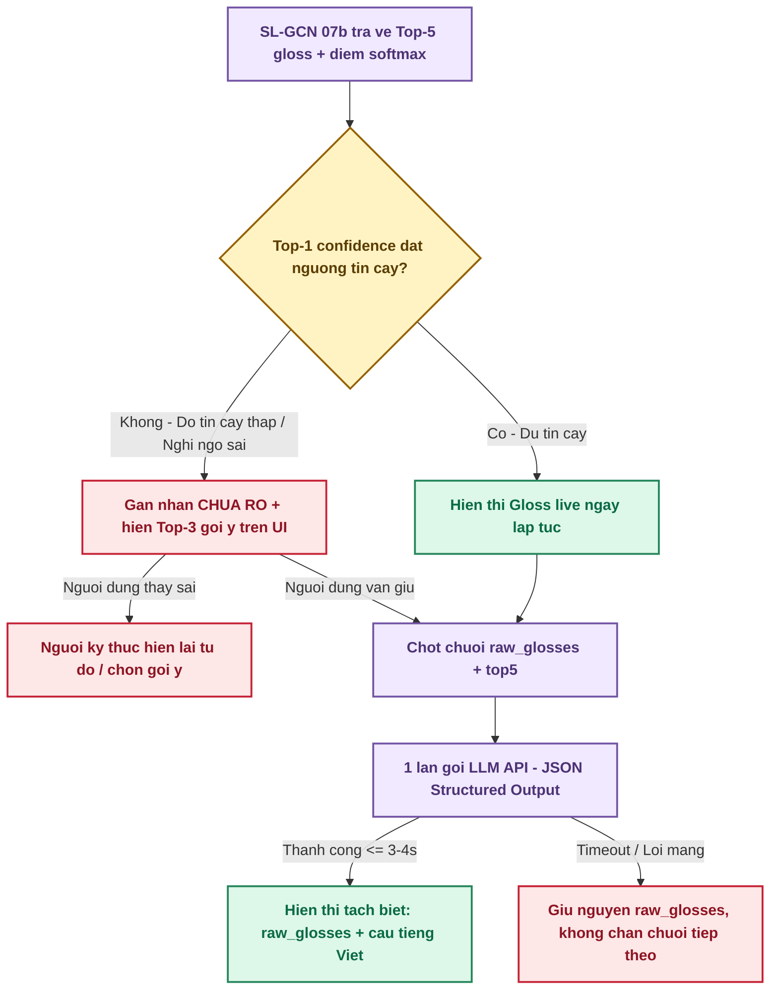

# PBL6 — Chốt Quyết Định Kiến Trúc & Lộ Trình Thực Thi (M2 → M3)

> [!IMPORTANT]
> **Mục đích tài liệu này:** Ghi nhớ cố định mọi quyết định kỹ thuật, phân ranh giới ĐÃ CÓ với DỰ KIẾN, và khóa hàng đợi Todo từng bước để không trôi ngữ cảnh giữa các phiên làm việc.
> **Mức độ kỹ thuật mục tiêu:** Demo / MVP ổn định cho bảo vệ PBL6 — áp dụng tuyệt đối **YAGNI** (không overengineer lên production).
> *(Bản hướng dẫn cài đặt & thao tác nhanh hàng ngày cho đồng đội nằm ở [../HANDOFF_TEAMMATE_M2_PI.md](../HANDOFF_TEAMMATE_M2_PI.md).)*

---

## 1. Năm Quyết Định Đã Chốt (`1A, 2A, 3A, 4A, 5B` — Ngày 19/11/2026)

| # | Vấn đề | Quyết định đã chốt | Lý do thực tế (YAGNI + Yêu cầu của cô) |
| :-: | :--- | :--- | :--- |
| **1A** | **Pi 4B chạy gì vs LAN Backend chạy gì?** | **Pi chạy Camera + UI + Segmenter + SL-GCN** **LAN Backend chạy MediaPipe + LLM** | Đáp ứng yêu cầu của cô (*Pi không chỉ thu hình/hiển thị*), sẵn đường cho **OTA cập nhật file `best.pt`** sau này. MediaPipe nặng (chiếm ~97% thời gian) đặt trên Laptop LAN. **Triển khai 2 bước:** M2.1 chạy thông trên Laptop trước → M2.2 tách SL-GCN lên Pi 4B đo thực tế *(giữ công tắc fallback về Backend nếu Pi > 1.5s)*. |
| **2A** | **Gói bàn giao M1 dùng để làm gì?** | **Chỉ lấy lõi code + checkpoint, KHÔNG dựng lại UI M1** | `M1-handoff.zip` đã có đủ `segmenter.py`, `extraction/*`, `preprocessing/*` và `07b_bone_seed42/best.pt`. Chạy kiểm tra nhanh `preflight` + `test_segmenter` trên Windows rồi nhúng thẳng vào `slr-m2/`. |
| **3A** | **Giao diện cuối cùng & Trình duyệt đồng hành** | **1 Web App duy nhất trên nền `stt-app` (Next.js :3100)** | Tận dụng `stt-app` đã xong lõi STT, thêm màn hình **SLR Live** tối ưu cảm ứng **7 inch (`1024×600`)**. Pi mở trình duyệt trực tiếp; điện thoại/laptop mở **cùng URL `/companion`** để xem live + lịch sử qua WebSocket. |
| **4A** | **Chiều ngược Speech → Sign & Yêu cầu IoT** | **Giữ Speech → Text** + **ThingsBoard tối giản (~50 dòng)** | Speech → Sign bằng ML bất khả thi ở giai đoạn cuối → chốt phạm vi *người khiếm thính đọc được tiếng Việt cơ bản*. IoT: chỉ đẩy `online`, `session_count`, `gloss_count`, `latency_ms` lên **ThingsBoard** để có sẵn dashboard *(không tự code dashboard, không cảm biến xoay, không remote control)*. |
| **5B** | **Tạo câu tiếng Việt & Khi Top-5 sai toàn bộ** | **1 lần gọi LLM JSON + Cờ `CHƯA RÕ` + Nhánh thử nghiệm VLM sau MVP** | Lõi M2/M3 dùng 1 lời gọi LLM JSON tách `revised_glosses` và `vietnamese_sentence` + gắn cờ **`CHƯA RÕ`** khi độ tin cậy thấp. Sau khi xong MVP, mở **Bước 8** chạy thử nghiệm gửi clip low-confidence cho Cloud VLM để đo thực tế độ chính xác trên VSL400. |

---

## 2. Sơ Đồ Kiến Trúc & Cơ Chế Kỹ Thuật (Diagram-First)

### Sơ đồ 1 — Kiến trúc mục tiêu M2.2 → M3 (Phân bổ tải Pi 4B 8GB ↔ LAN Backend)

> [!NOTE]
> **Lưu ý kỹ thuật quan trọng từ `M1/inference.py`:** Hiện tại M1 chạy 2 lượt MediaPipe: lượt 1 chạy `Pose` theo từng frame để phân đoạn (`replay.py`), lượt 2 chạy `extract_raw` + `rescue_candidates` trên clip đã cắt (`inference.py`). Khi tách lên Pi (M2.2), **LAN Backend** chịu toàn bộ MediaPipe và trả về mảng landmark/xương đã chuẩn hóa (`~15–100 KB`), còn **Pi 4B** chạy `Segmenter` + `SL-GCN 07b` + Web UI.

---

### Sơ đồ 2 — State Machine thực tế của `Segmenter` ([segmenter.py](../slr-m2/deployment/m1/segmenter.py))

**Phiên (`Session`)** bấm tay 1 lần ở đầu và cuối (`Bắt đầu ký` / `Kết thúc ký`); **từng Ký hiệu (`Segment`)** và **chốt Chuỗi (`Utterance`)** chạy tự động theo máy trạng thái bên dưới:

---

### Sơ đồ 3 — Xử lý khi Top-1 / Top-5 độ tin cậy thấp (`CHƯA RÕ`)

---

## 3. Bảng Bằng Chứng Hiện Trạng (Đã Chạy Thật vs Chưa Triển Khai)

| Hạng mục | Trạng thái thực tế | Căn cứ xác minh |
| :--- | :--- | :--- |
| **App STT & UI chung (`stt-app/`)** | **ĐÃ CHẠY THẬT TRÊN PI 4B** | Next.js 16 standalone (`:3100`), Deepgram Nova-3 STT tiếng Việt với mic USB tích hợp Webcam, `Squeekboard` OSK + `Fcitx5` Wayland, nút `Bắt đầu ký`, `/companion`. |
| **Lõi phân đoạn & model M1 (`slr-m2/`)** | **ĐÃ CHẠY SẠCH WINDOWS & PI** | `test_segmenter`, `test_m2`, `test_m2_split` đều PASS; checkpoint `07b_bone_seed42/best.pt` xác minh SHA-256 `7934805b...`. |
| **Kho âm thanh TTS Offline** | **ĐÃ CÓ 400/400 MP3** | `slr-app/MVP/local_data/tts/0.mp3..399.mp3` (`2.97 MB`), phát qua `/api/tts/{id}.mp3`. |
| **SLR Live M2.2 Split (`slr-m2/deployment/m2/`)** | **ĐÃ CHẠY LIVE + STREAMING 1 LUỒNG + ONNX (`perf/streaming-onnx`)** | Trên nhánh `perf/streaming-onnx`: xuất `slgcn_07b.onnx` dùng chung cho Pi & Laptop Fallback (đo độc lập trên Pi 4B giảm từ `4.94s` PyTorch xuống **`0.741s` median / `0.760s` p95**, khớp `Dài 98.14%`); hợp nhất thành **1 luồng Streaming Extraction `640×480` + `SessionStreamBuffer` + Smart Gating `run_hands`** (giảm chờ trích xuất sau khi hạ tay trên `014159.mp4` từ `3.960s` xuống **`0.335s`**; phiên live `live-91a0955bb5` trên Pi đạt **`0.49s–0.77s`** ở các từ không dính `crop_rescue`, `queue_depth = 0`, `incomplete = 0`); UI `stt-app` đã gắn cố định tiền tố `http://` trong cài đặt SLR. |
| **LLM M3 & ThingsBoard** | **CHƯA TRIỂN KHAI** | Xử lý nốt 3 điểm tinh chỉnh nhỏ phát hiện từ phiên live `live-91a0955bb5` (Bước 5.6) rồi mới gắn **Bước 6**. *(Ghi chú UX tùy chọn: có thể thêm nút mềm **Tạm dừng (Pause)** nếu cần.)* |
| **Ngoài phạm vi (KHÔNG làm)** | **LOẠI BỎ (YAGNI)** | Offline MediaPipe trên Pi, nâng cấp camera CSI, cảm biến xoay hướng người dùng, remote control phần cứng, AI Agent OS, Speech → Sign bằng ML. |

---

## 4. Hàng Đợi Todo Từng Bước

- [x] **Bước 1:** Tổng hợp bằng chứng, chốt 5 quyết định (`1A, 2A, 3A, 4A, 5B`) & vẽ sơ đồ kỹ thuật.
- [x] **Bước 2:** Giải nén M1 vào `slr-m2/`, chạy `preflight` + `test_segmenter` + suy luận mẫu `014159.mp4` (`Dài` `98.14%`).
- [x] **Bước 3 (M2.1):** Xây `slr-m2/deployment/m2/` (`classifier.py`, `pipeline.py`, `server.py`, `test_m2.py`).
- [x] **Bước 4:** Ghép `SlrDock` + `LiveSigningCard` + `speakOutput()` + `/companion` + `/api/tts/{id}.mp3` vào `stt-app/`.
- [x] **Bước 5 (M2.2 + Vận hành thực tế trên Pi 4B):** Tách `VisionExtractor` (`vision_backend.py`) ↔ `BoneClassifier` (`remote_clients.py` auto-fallback), triển khai `deploy_to_pi.ps1` / `pi_bootstrap.sh` / `pi_start.sh` (`uv` Python 3.11 + `torch==2.3.1`, Node 22 ARM64, Firefox Wayland `--new-window`, Squeekboard, `WayVNC :5900` tự hồi phục khi tắt màn HDMI), chạy live thành công trên Pi 4B thật.
- [x] **Bước 5.5 (Gói 1 + Phương án A `4.0s` trên `main` → Pha 1 ONNX + Pha 2 Streaming 1 luồng trên `perf/streaming-onnx`):**
  - Đã xuất `slgcn_07b.onnx` (`1.91e-5` max logit diff vs `best.pt`, chạy `0.741s` median trên Pi 4B ARM64 so với `4.94s` PyTorch).
  - Đã hợp 1 luồng Streaming Extraction `640×480` + `SessionStreamBuffer` + Smart Gating `run_hands` + chạy bù `Hands` cho `-0.30s` `leading` (đạt `0.49s–0.77s/từ` trong phiên live `live-91a0955bb5` khi không dính `crop_rescue`, `26/26` Python tests & `124/124` TS tests PASS).
  - Đã gắn cố định tiền tố `http://` ở menu cài đặt SLR trên `stt-app`.
- [x] **Bước 5.6 — hoàn tất danh sách kiểm tra theo phạm vi người dùng chọn ngày 22/11/2026 (mục 2 và 3 Done — Skip):** Mã mới mặc định tắt crop rescue và tắt tự chuyển suy luận sang laptop. Luồng pose gửi từng frame theo thứ tự thu, với tối đa 32 frame chờ. Bộ đếm M2 chốt sau 4 giây REST, giữ phần đã đếm khi mất dấu tối đa 0,5 giây. Đã triển khai runtime/UI mới lên Pi theo phê duyệt tiếp tục của người dùng; chưa kiểm thử ký live.
  - [x] **Mục 1 — Done, đã đối chiếu phiên bản và triển khai bản mới sau khi được duyệt:** Laptop ở commit `cd6d091730e0394b819610df6506c8f4dfbd4325` trên `perf/streaming-onnx`. Kiểm tra ban đầu tại `pi@192.168.1.8` cho thấy bốn file lõi khớp bản cũ `259c6724` và tiến trình dùng fallback `1.5`. Sau khi người dùng duyệt, đã sao lưu vào `/home/pi/PBL6/backups/deploy-20261122-cd6d0917/`, đồng bộ sáu file `classifier.py`, `pipeline.py`, `remote_clients.py`, `server.py`, `vision_backend.py`, `pi_start.sh` và gói UI standalone rồi khởi động lại SLR/UI. SHA-256 của năm file Python khớp nội dung LF tại `cd6d0917`; `pi_start.sh` khớp bản cục bộ có chỉnh sửa VNC do hệ điều hành quản lý mà người dùng đã duyệt. BUILD_ID trên Pi khớp bản build laptop `4pOKRnSbuJIzu2T2rVfzu`. Health qua LAN xác nhận ONNX, fallback `0.0`, Vision Backend tại `http://192.168.1.14:8767`; đã khởi chạy backend trên laptop. Checkpoint giữ nguyên SHA-256 `7934805bf89a912bc2d450c83facc19d73a72d5b22beb38189968ff6ff2bbddf`. UI `/`, `/companion` và 10 tài nguyên static trả HTTP 200; endpoint chọn ứng viên có trong OpenAPI. `wayvnc.service` vẫn active. Đã kiểm tra cú pháp Python và Bash của runtime trước khi thay thế. Script khởi động chưa thấy USB camera/mic; chưa kiểm thử phần cứng hoặc nhận dạng live. Không thay cấu hình người dùng, dữ liệu gốc hay trọng số; chưa commit hoặc push.
  - [x] **Mục 2 — Done — Skip theo yêu cầu người dùng:** Bỏ qua lượt ký trực tiếp để đo độ trễ, kiểm tra tích tụ hàng đợi và độ đúng/đủ/thứ tự kết quả của luồng frame mới. Không có kết quả kiểm thử thực tế mới cho mục này.
  - [x] **Mục 3 — Done — Skip theo yêu cầu người dùng:** Bỏ qua kiểm thử thực tế về chốt lượt sau 4 giây nghỉ tay, mất dấu ngắn và đồng bộ chọn Top 3 giữa Pi với Companion. Không có kết quả kiểm thử thực tế mới cho mục này.
- [ ] **Bước 6 (M3 + IoT tối giản — sau khi chốt Bước 5.6):** Gắn 1 lần gọi LLM API (JSON) tạo câu tiếng Việt khi chốt `utterance` + gửi telemetry tối giản lên ThingsBoard.
- [ ] **Bước 7:** Kiểm thử tích hợp toàn trình (SLR + STT + Companion + ThingsBoard) và review độc lập.
- [ ] **Bước 8 (Thử nghiệm phụ 5B — sau MVP):** Đánh giá VLM trên 20 clip VSL400 low-confidence.
