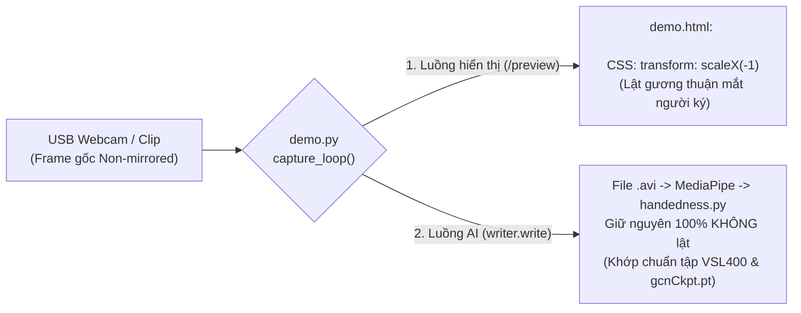

# Cơ Chế Lật Gương (Mirroring) Giữa Giao Diện UI và Pipeline Nhận Dạng SLR

> **Tài liệu ghi chú kỹ thuật — Chốt phương án ngày 15/11/2026.**  
> **Nguyên tắc vàng:** **Lật gương ở UI (`transform: scaleX(-1)`) để người ký thuận mắt soi gương — Tuyệt đối KHÔNG lật frame ở Backend (`demo.py` / MediaPipe / SL-GCN).**

---

## 1. Tổng Quan Vấn Đề (The Mirroring Dilemma)

Khi xây dựng hệ thống nhận dạng ngôn ngữ ký hiệu (SLR) chạy trên Kiosk màn hình cảm ứng đặt đối diện người dùng, xuất hiện sự khác biệt về hướng nhìn giữa **người sử dụng** và **mô hình AI**:

| Góc nhìn | Yêu cầu hướng ảnh | Lý do |
| :--- | :--- | :--- |
| **Người ký đứng trước màn hình (Selfie / Mirror View)** | **Lật ngang (Mirrored)** | Người dùng nhìn màn hình giống như soi gương: khi giơ tay phải lên, chuyển động trên màn hình cũng nằm ở phía tay phải của họ, giúp căn chỉnh hai vai và hai tay dễ dàng. |
| **Pipeline AI VSL400 (`MediaPipe` + `SL-GCN`)** | **Không lật (Non-mirrored)** | Tập dữ liệu huấn luyện VSL400 được thu bằng camera ngoài không lật gương. Mô hình đã học quy luật tọa độ X theo hệ quy chiếu không lật. |

---

## 2. Quy Ước Hệ Tọa Độ Giải Phẫu Trong Backend

Trong mã nguồn trích xuất đặc trưng tại [handedness.py](file:///C:/Users/LAPTOP%20T&T/VIOLETTA/Documents/ChatGPT/PBL6/slr-app/MVP/deployment/feature_extract/src/extraction/handedness.py#L11-L32):

* **Vấn đề mặc định của MediaPipe Hands:** Nhãn `handedness.classification[0].label` mặc định của MediaPipe giả định ảnh đầu vào là **selfie/mirrored**; khi đưa video **non-mirrored** của tập VSL400 vào, MediaPipe có thể gán ngược nhãn trái/phải.
* **Cách xử lý của pipeline Khoa (`assign_hands_pose_proximity`):**
  1. Tập VSL400 quy ước video **không lật gương (non-mirrored)**: phía bên trái của khung ảnh (X nhỏ) tương ứng với **tay phải giải phẫu** của người trong video, còn phía bên phải khung ảnh (X lớn) tương ứng với **tay trái giải phẫu**.
  2. Thay vì tin nhãn mặc định của MediaPipe Hands, hàm `assign_hands_pose_proximity` dùng 2 mốc cổ tay giải phẫu từ **MediaPipe Pose** (landmark `15` = cổ tay trái, `16` = cổ tay phải) làm điểm neo khoảng cách để gán nhãn `left_hand` / `right_hand`.
  3. Tại [normalization.py](file:///C:/Users/LAPTOP%20T&T/VIOLETTA/Documents/ChatGPT/PBL6/slr-app/MVP/deployment/feature_extract/src/extraction/normalization.py#L14-L19), tọa độ cơ thể (`BODY-RELATIVE`) chuẩn hóa theo trung điểm hai vai (`midpoint(left_shoulder, right_shoulder)`) và khoảng cách vai (`distance(left_shoulder, right_shoulder)`), giữ nguyên dấu dương/âm của trục X.
* **Hệ quả nếu dùng `cv2.flip(frame, 1)` ở Backend:** Nếu lật ảnh trước khi ghi video hoặc đưa vào MediaPipe, trục X và tương quan trái/phải sẽ bị phản chiếu ngược so với dữ liệu huấn luyện trong `gcnCkpt.pt`, làm giảm độ chính xác hoặc nhận dạng sai các ký hiệu có hướng trái–phải / tay thuận.

---

## 3. Giải Pháp Kiến Trúc: Tách Biệt Hiển Thị UI và Luồng Xử Lý AI

### Chi tiết thực thi ở 2 tầng
1. **Tầng Backend ([demo.py](file:///C:/Users/LAPTOP%20T&T/VIOLETTA/Documents/ChatGPT/PBL6/slr-app/MVP/desktop_mvp/demo.py#L155-L163)):**
   * Vòng lặp `capture_loop()` đọc `frame` gốc từ camera, ghi nguyên vẹn vào file `.avi` qua `writer.write(frame)` và đưa thẳng vào `ClipRecognizer.recognize(...)`.
   * Ảnh JPEG đẩy ra endpoint `/preview` giữ nguyên frame gốc để Backend xử lý thống nhất, không tốn thêm chi phí CPU để lật frame bằng OpenCV.
2. **Tầng Frontend UI ([demo.html](file:///C:/Users/LAPTOP%20T&T/VIOLETTA/Documents/ChatGPT/PBL6/slr-app/MVP/desktop_mvp/demo.html#L128-L137)):**
   * Chỉ áp dụng CSS `transform: scaleX(-1);` lên phần tử ảnh `.cam-box img` (``).
   * **Lý do đặt trên `.cam-box img` thay vì `.cam-box`:** Trong DOM của `.cam-box`, thẻ trạng thái `#cam-status` (`Webcam · 640×480`, `● Đang quay`) và lớp phủ số đếm ngược khổng lồ `#countdown-number` (`3 → 2 → 1`) là phần tử anh em (sibling) với ``. Nhờ vậy, chỉ có hình ảnh người ký bị lật ngang thành dạng gương, còn **toàn bộ chữ và số đếm ngược vẫn hiển thị xuôi chiều 100%**, đồng thời GPU trình duyệt xử lý CSS transform với chi phí gần như bằng 0.

---

## 4. Tóm Tắt Đối Chiếu Khi Nghiệm Thu / Bảo Vệ

* **Người đứng ký thấy gì?** Thấy hình ảnh như soi gương — giơ tay phải, hình bên phải màn hình di chuyển theo tay phải.
* **Số đếm ngược `3 → 2 → 1` và chữ trạng thái?** Hiển thị xuôi chiều bình thường, không bị lộn ngược.
* **Mô hình AI nhận gì?** Video gốc không lật gương — trùng khớp 100% quy ước `handedness.py` và bộ trọng số `gcnCkpt.pt` của Khoa.
