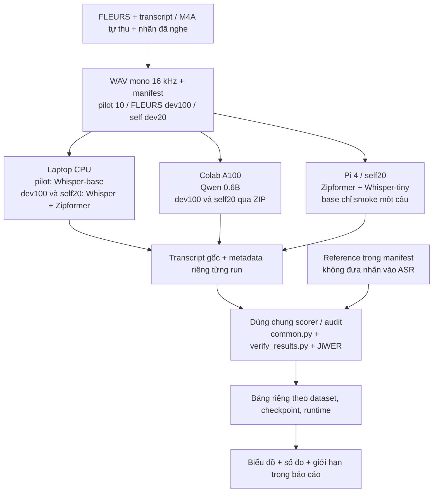
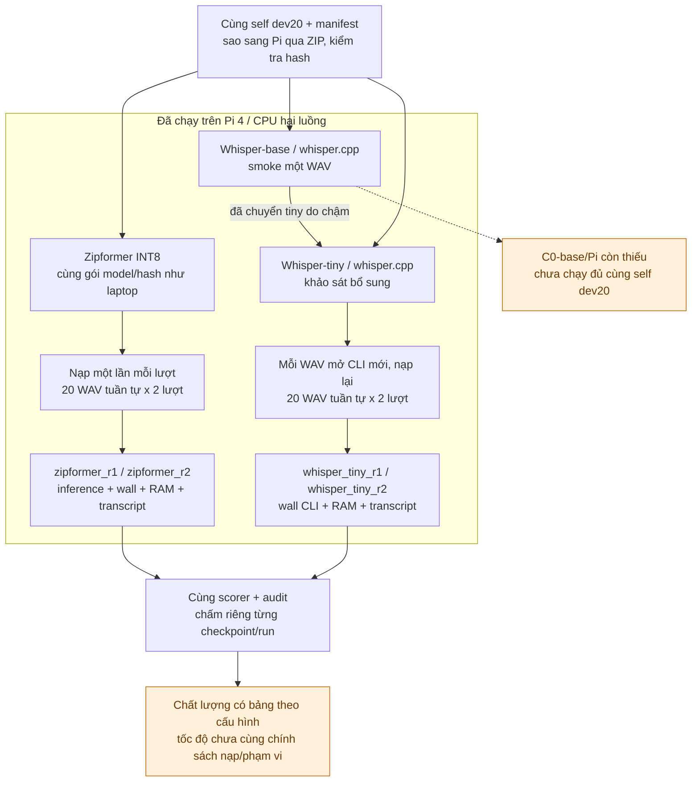
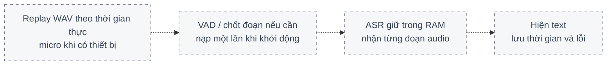

# Từ audio đến ứng viên chạy trên Pi

**DEMO B01–B04 · STT tiếng Việt cho hướng nghiên cứu kính thông minh**

Model có sẵn · Chưa huấn luyện lại · Cập nhật 13/10/2026

> Một đầu ra nhỏ → làm chạy được → lưu bằng chứng → giải thích được.

**Đã có:** transcript, điểm dev, số đo WAV trên Pi.  
**Còn thiếu:** C0-base đầy đủ trên Pi, so tốc độ đồng nhất, pipeline audio liên tục.

---

## Mỗi buổi thêm một điều có thể kiểm tra

| Buổi | Câu hỏi chính | Đầu ra để demo |
|---|---|---|
| B01 | Audio thành chữ và điểm lỗi thế nào? | Một WAV, transcript, bốn lỗi đếm tay |
| B02 | Hai model nhận cùng audio khác nhau ra sao? | Bảng hai baseline trên dev100 |
| B03 | Model mới và audio tự thu có đổi lựa chọn không? | Hai bảng chất lượng ba model |
| B04 | Trên Pi thật, cấu hình chạy ra sao? | WAV → chữ, log thời gian/RAM; đối chiếu chưa hoàn chỉnh |

**Nhịp trình bày:** vì sao → cách làm → kết quả → điều học được → tiếp theo.

---

## Các nhánh khác nhau, dữ liệu và cách chấm dùng chung

**Dùng chung** nghĩa là cùng nội dung/phiên bản đã kiểm tra hash; Colab/Pi nhận **bản sao qua ZIP**, không dùng chung một file vật lý. Mỗi manifest chọn một lượt chạy riêng. Sơ đồ là luồng logic; scorer có trong runner và được audit chấm lại sau đó.

[Chi tiết nguồn, file và nhánh xử lý](PIPELINES_BUOI_01_04.md)

---

## B01 · Một WAV đủ để hiểu cách tính lỗi

**Vì sao:** phải hiểu điểm số trước khi so model.  
**Cách làm:** Whisper-base trên CPU laptop; 10 pilot từ FLEURS train, chỉ inference.  
**Đánh đổi:** kiểm tra luồng nhanh; pilot chưa dùng chọn model.

[▶ Nghe WAV mẫu](../data/derived/stt_b01_b03/train/18182759805207678941.wav)

| | Transcript mẫu đã lưu |
|---|---|
| Reference | Những **cây** này nhìn giống cây **cọ** nhỏ có tán **lá** sắc **nhọn**. |
| Whisper | Những **cái** này nhìn giống cây **cộ** nhỏ có tán **là** sắc **nhỏ**. |

**4 lỗi / 13 đơn vị = WER_ws 30,77%** cho mẫu này.  
Cả pilot 10 câu: WER_ws **36,88%**, CER **20,39%** — phạm vi khác.

**Học được:** dấu tiếng Việt thay đổi nội dung. **Tiếp theo:** so trên cùng tập dev.

---

## B02 · Hai baseline, cùng WAV và cách chấm

**Vì sao:** tìm ứng viên CPU có sẵn.  
**Cách làm:** FLEURS dev100, mono 16 kHz, cùng reference/scorer; chạy CPU laptop.  
**Đánh đổi:** đủ so checkpoint đã chọn; chưa giải thích chênh lệch do riêng kiến trúc.

| Model / runtime | Hoàn tất | WER_ws ↓ | CER ↓ |
|---|---:|---:|---:|
| Whisper-base / openai-whisper | 100/100 | 49,37% | 33,92% |
| Zipformer-30M INT8 / sherpa-onnx | 100/100 | 7,51% | 5,35% |

**Học được:** không lấy điểm pilot thay dev. **Tiếp theo:** thêm Qwen để đối chiếu.

---

## B03 · Qwen không mặc nhiên thắng vì mới hơn

**Vì sao:** đối chiếu với model đa ngôn ngữ mới có sẵn.  
**Cách làm:** Qwen3-ASR-0.6B trên A100/Colab, cùng dev100 và scorer.  
**Đánh đổi:** dùng GPU; hình dưới chỉ so chất lượng, không so tốc độ CPU/GPU.

**Giới hạn:** Zipformer liệt kê FLEURS trong nguồn train; chưa xác minh split/ID trùng. Không gọi là đánh giá chắc chắn trên dữ liệu chưa thấy.

---

## Cùng ba model, chuyển sang audio tự thu

**Vì sao:** kiểm tra lời nói gần bối cảnh đề tài hơn.  
**Cách làm:** cùng 20 câu; Galaxy M15, khoảng 30 cm, nhãn đã nghe xác nhận.  
**Đánh đổi:** một người đọc; 2 phòng ngủ/18 cà phê chưa cô lập tác động tiếng ồn.

**Lựa chọn tạm thời:** Zipformer để thử Pi. Chênh lệch một và hai lỗi trên 181 đơn vị chưa chứng minh ưu thế tổng quát.

---

## Điểm thấp vẫn có lỗi cần nghe

[▶ Nghe câu 20 tự thu](../data/self_recorded/dev/self_20.wav)

| Câu 20 | Transcript gốc |
|---|---|
| Reference | Kết quả trên máy tính chưa phải kết quả trên kính. |
| Whisper | Kết quả trền máy tấn, chưa phải kết quả trền cấn |
| Zipformer | KẾT QUẢ TRÊN MÁY TÍNH CHƯA PHẢI KẾT QUẢ TRÊN KÍNH |
| Qwen | cách quả trên máy tính chưa phải cách quả trên kính |

**Học được:** Qwen sai hai lần “kết” → “cách”. Hoa/thường được xử lý như nhau khi chấm. Một câu không thay điểm cả tập.

**Tiếp theo:** kiểm tra ứng viên trên phần cứng thật.

---

## B04 · Zipformer nhận dạng WAV trên Pi thật

**Vì sao:** số laptop/GPU chưa trả lời tài nguyên trên Pi.  
**Cách làm:** Pi 4B 8 GB, aarch64, CPU hai luồng; một lần nạp/lượt, 20 WAV × hai lượt.  
**Đánh đổi:** mới kiểm tra tệp; chưa đo micro, VAD/chia đoạn hoặc kính.

20/20 mỗi lượt · **84,160 s audio** · WER_ws **0,55%** · CER **0,16%** · Prediction giống laptop 20/20.

| Lượt | Tổng inference | Wall cả runner | Nạp model | RTF inference | Peak RSS |
|---|---:|---:|---:|---:|---:|
| r1 | 10,278 s | 14,644 s | 3,742 s | 0,1221 | 199,06 MiB |
| r2 | 10,226 s | 14,578 s | 3,735 s | 0,1215 | 198,32 MiB |

**Đọc đúng số:** inference bỏ nạp/đọc WAV; wall gồm toàn lần gọi runner. Nạp model đã nằm trong wall. RTF = thời gian xử lý / thời lượng audio. Peak RSS gồm nạp/runtime; hai lượt không phải 40 mẫu độc lập.

[▶ Lệnh demo một WAV trên Pi](../experiments/B04/DEMO.md) · [Nguồn số 14,644 s](../experiments/B04/results/zipformer_r1/measurement.json)

---

## Nhánh Pi chưa dùng cùng chính sách nạp model

**Cần sửa cách kết luận:** tiny là khảo sát bổ sung. Whisper-base chậm vẫn là kết quả cần đo; C0-base còn thiếu lượt đủ self dev20/Pi.

---

## Whisper.cpp · Có output, chưa hoàn tất đối chiếu C0

Base: **một câu smoke**, wall **20,869 s** / audio **5,355 s**. Sau đó đã thử tiny, nhưng tiny không thay kết quả base.

| Checkpoint / lượt | Số WAV | WER_ws / CER | Tổng wall CLI | RTF wall |
|---|---:|---:|---:|---:|
| Tiny · r1 | 20 | 41,99% / 26,36% | 172,807 s | 2,0533 |
| Tiny · r2 | 20 | 41,99% / 26,36% | 171,309 s | 2,0355 |

**Học được:** CLI nạp lại mỗi WAV; thời gian gồm nạp/đọc/ghi. Không chia số này cho inference Zipformer để báo tỷ lệ tăng tốc.

**Nếu tiếp tục so baseline:** giữ base, chạy cùng 20 WAV, nạp một lần và đo cùng phạm vi. Chưa chạy lượt bổ sung này.

[Raw Whisper](../experiments/B04/results/whisper_tiny_r1/measurement.json) · [Quy trình thử ban đầu](../experiments/B04/whisper_protocol.md)

---

## Kết luận vừa với bằng chứng

| Có thể trình bày | Chưa thể kết luận |
|---|---|
| WER_ws/CER ba cấu hình trên hai subset dev | Kiến trúc nào tốt nhất; chất lượng tổng quát |
| Zipformer chạy WAV trên Pi, có log/RAM/thời gian | Độ trễ phụ đề micro/kính hoặc streaming đã đạt |
| Zipformer là ứng viên tạm thời | Hai luồng/runtime tối ưu; tỷ lệ nhanh hơn Whisper |
| C0-base/Pi mới có smoke | Đã đánh giá đầy đủ C0-base trên Pi |

**Cách chấm:** WER_ws tách theo khoảng trắng; CER bỏ khoảng trắng. Cùng NFC/chữ thường/dấu câu, giữ dấu tiếng Việt. Điểm tập = tổng lỗi / tổng đơn vị; không sửa nội dung transcript.

Test cuối chưa chạy · Không lời nói chưa đo → false captions chưa có điểm, không phải 0.

[Những điểm chưa chặt](DIEM_CHUA_CHAT_BUOI_01_04.md) · [Bảng FLEURS](../experiments/B03/results/summary.csv) · [Bảng self dev20](../experiments/B03/results/self_dev20/summary.csv)

---

## Bước tiếp theo · Một pipeline nhỏ giải thích được

**Dự kiến B05, chưa triển khai:**

**Vì sao:** kiểm tra điều đã đo trên WAV có dùng được khi audio đến dần không.  
**Cách làm:** model giữ trong RAM; chỉ đặt lại trạng thái từng đoạn.  
**Đánh đổi:** ASR offline cần chờ chốt đoạn; không gọi là streaming nguyên sinh. Pi chưa có micro, replay chưa thay kiểm tra thu trực tiếp.

**Chưa cần mở rộng:** thêm model, huấn luyện hoặc sửa lỗi văn bản tự động.

---

## Demo 3–5 phút · Cho thấy điều mình giải thích được

| Khoảng thời gian | Thao tác | Điều cần giải thích |
|---|---|---|
| 0:00–0:45 | Phát mẫu B01, chỉ bốn lỗi | Điểm đến từ đâu |
| 0:45–1:45 | Mở bảng B02 và hai biểu đồ B03 | Vì sao chọn ứng viên tạm thời |
| 1:45–2:30 | Nghe câu 20, đọc transcript | Điểm thấp vẫn có lỗi |
| 2:30–4:00 | Chạy một WAV trên Pi, mở bảng B04 | Đã chạy thật, thời gian gồm những gì |
| 4:00–5:00 | Nêu hạn chế và bước tiếp theo | C0/so tốc độ/pipeline còn thiếu gì |

**Không gọi hoàn tất phần mình chưa đo.** Khi cần giải thích dài, mở [hỏi–đáp B01–B04](../mynotes/TONG_QUAN_VA_HOI_DAP_STT_BUOI_01_04.md).
