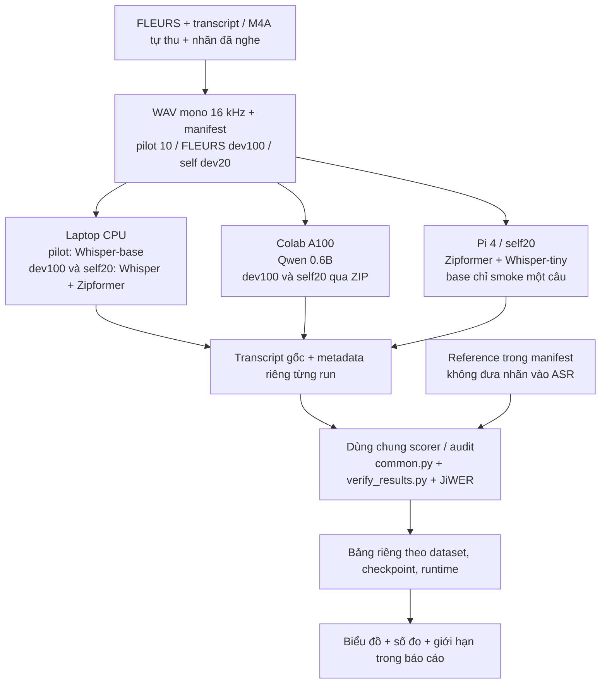
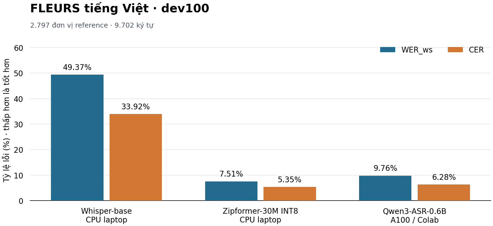
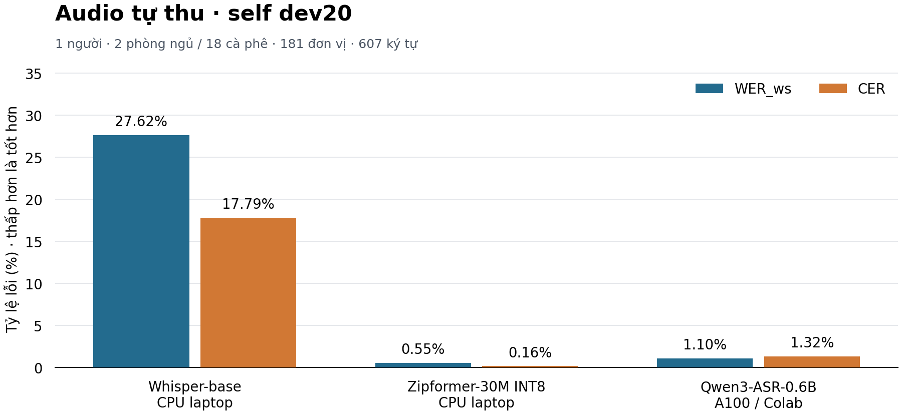
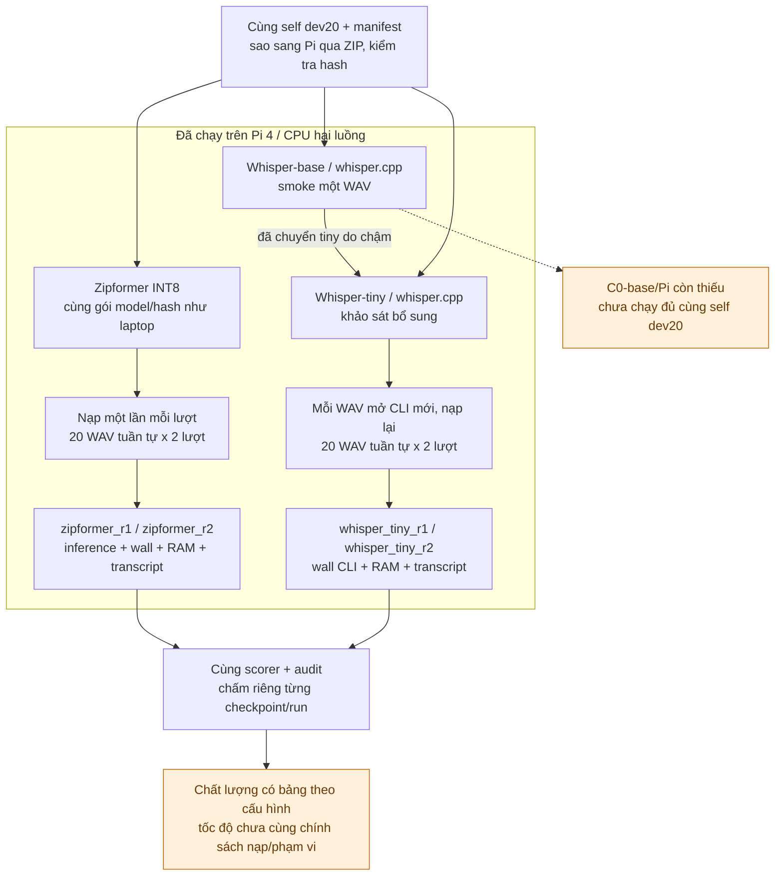
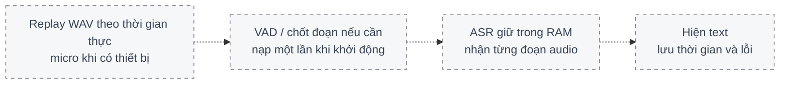
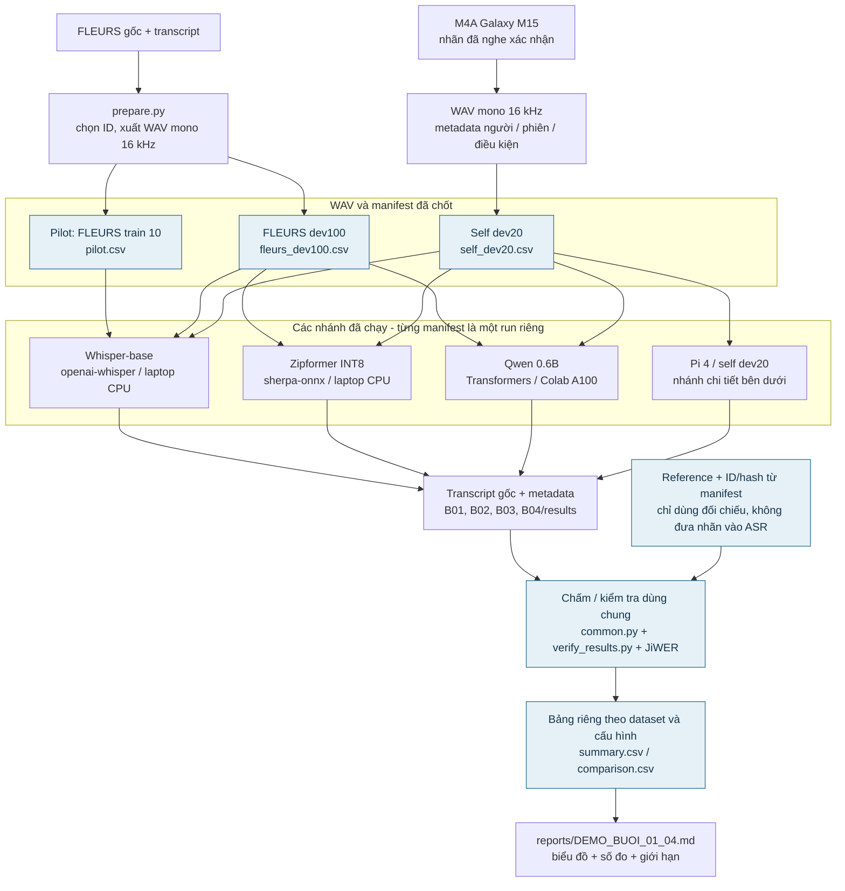

# Từ audio đến ứng viên chạy trên Pi

**DEMO B01–B04 · STT tiếng Việt cho hướng nghiên cứu kính thông minh**

Model có sẵn · Chưa huấn luyện lại · Cập nhật 13/10/2026

> Một đầu ra nhỏ → làm chạy được → lưu bằng chứng → giải thích được.

**Đã có:** transcript, điểm dev, số đo WAV trên Pi.  
**Còn thiếu:** C0-base đầy đủ trên Pi, so tốc độ đồng nhất, pipeline audio liên tục.

---

## Mỗi buổi thêm một điều có thể kiểm tra

| Buổi | Câu hỏi chính | Đầu ra để demo |
|---|---|---|
| B01 | Audio thành chữ và điểm lỗi thế nào? | Một WAV, transcript, bốn lỗi đếm tay |
| B02 | Hai model nhận cùng audio khác nhau ra sao? | Bảng hai baseline trên dev100 |
| B03 | Model mới và audio tự thu có đổi lựa chọn không? | Hai bảng chất lượng ba model |
| B04 | Trên Pi thật, cấu hình chạy ra sao? | WAV → chữ, log thời gian/RAM; đối chiếu chưa hoàn chỉnh |

**Nhịp trình bày:** vì sao → cách làm → kết quả → điều học được → tiếp theo.

---

## Các nhánh khác nhau, dữ liệu và cách chấm dùng chung



**Dùng chung** nghĩa là cùng nội dung/phiên bản đã kiểm tra hash; Colab/Pi nhận **bản sao qua ZIP**, không dùng chung một file vật lý. Mỗi manifest chọn một lượt chạy riêng. Sơ đồ là luồng logic; scorer có trong runner và được audit chấm lại sau đó.

Chi tiết file và nguồn nằm ở phần tra cứu cuối **chính tài liệu này**.

---

## B01 · Một WAV đủ để hiểu cách tính lỗi

**Vì sao:** phải hiểu điểm số trước khi so model.  
**Cách làm:** Whisper-base trên CPU laptop; 10 pilot từ FLEURS train, chỉ inference.  
**Đánh đổi:** kiểm tra luồng nhanh; pilot chưa dùng chọn model.

[▶ Nghe WAV mẫu](../data/derived/stt_b01_b03/train/18182759805207678941.wav)

| | Transcript mẫu đã lưu |
|---|---|
| Reference | Những **cây** này nhìn giống cây **cọ** nhỏ có tán **lá** sắc **nhọn**. |
| Whisper | Những **cái** này nhìn giống cây **cộ** nhỏ có tán **là** sắc **nhỏ**. |

**4 lỗi / 13 đơn vị = WER_ws 30,77%** cho mẫu này.  
Cả pilot 10 câu: WER_ws **36,88%**, CER **20,39%** — phạm vi khác.

**Học được:** dấu tiếng Việt thay đổi nội dung. **Tiếp theo:** so trên cùng tập dev.

---

## B02 · Hai baseline, cùng WAV và cách chấm

**Vì sao:** tìm ứng viên CPU có sẵn.  
**Cách làm:** FLEURS dev100, mono 16 kHz, cùng reference/scorer; chạy CPU laptop.  
**Đánh đổi:** đủ so checkpoint đã chọn; chưa giải thích chênh lệch do riêng kiến trúc.

| Model / runtime | Hoàn tất | WER_ws ↓ | CER ↓ |
|---|---:|---:|---:|
| Whisper-base / openai-whisper | 100/100 | 49,37% | 33,92% |
| Zipformer-30M INT8 / sherpa-onnx | 100/100 | 7,51% | 5,35% |

**Học được:** không lấy điểm pilot thay dev. **Tiếp theo:** thêm Qwen để đối chiếu.

---

## B03 · Qwen không mặc nhiên thắng vì mới hơn

**Vì sao:** đối chiếu với model đa ngôn ngữ mới có sẵn.  
**Cách làm:** Qwen3-ASR-0.6B trên A100/Colab, cùng dev100 và scorer.  
**Đánh đổi:** dùng GPU; hình dưới chỉ so chất lượng, không so tốc độ CPU/GPU.



**Giới hạn:** Zipformer liệt kê FLEURS trong nguồn train; chưa xác minh split/ID trùng. Không gọi là đánh giá chắc chắn trên dữ liệu chưa thấy.

---

## Cùng ba model, chuyển sang audio tự thu

**Vì sao:** kiểm tra lời nói gần bối cảnh đề tài hơn.  
**Cách làm:** cùng 20 câu; Galaxy M15, khoảng 30 cm, nhãn đã nghe xác nhận.  
**Đánh đổi:** một người đọc; 2 phòng ngủ/18 cà phê chưa cô lập tác động tiếng ồn.



**Lựa chọn tạm thời:** Zipformer để thử Pi. Chênh lệch một và hai lỗi trên 181 đơn vị chưa chứng minh ưu thế tổng quát.

---

## Điểm thấp vẫn có lỗi cần nghe

[▶ Nghe câu 20 tự thu](../data/self_recorded/dev/self_20.wav)

| Câu 20 | Transcript gốc |
|---|---|
| Reference | Kết quả trên máy tính chưa phải kết quả trên kính. |
| Whisper | Kết quả trền máy tấn, chưa phải kết quả trền cấn |
| Zipformer | KẾT QUẢ TRÊN MÁY TÍNH CHƯA PHẢI KẾT QUẢ TRÊN KÍNH |
| Qwen | cách quả trên máy tính chưa phải cách quả trên kính |

**Học được:** Qwen sai hai lần “kết” → “cách”. Hoa/thường được xử lý như nhau khi chấm. Một câu không thay điểm cả tập.

**Tiếp theo:** kiểm tra ứng viên trên phần cứng thật.

---

## B04 · Zipformer nhận dạng WAV trên Pi thật

**Vì sao:** số laptop/GPU chưa trả lời tài nguyên trên Pi.  
**Cách làm:** Pi 4B 8 GB, aarch64, CPU hai luồng; một lần nạp/lượt, 20 WAV × hai lượt.  
**Đánh đổi:** mới kiểm tra tệp; chưa đo micro, VAD/chia đoạn hoặc kính.

20/20 mỗi lượt · **84,160 s audio** · WER_ws **0,55%** · CER **0,16%** · Prediction giống laptop 20/20.

| Lượt | Tổng inference | Wall cả runner | Nạp model | RTF inference | Peak RSS |
|---|---:|---:|---:|---:|---:|
| r1 | 10,278 s | 14,644 s | 3,742 s | 0,1221 | 199,06 MiB |
| r2 | 10,226 s | 14,578 s | 3,735 s | 0,1215 | 198,32 MiB |

**Đọc đúng số:** inference bỏ nạp/đọc WAV; wall gồm toàn lần gọi runner. Nạp model đã nằm trong wall. RTF = thời gian xử lý / thời lượng audio. Peak RSS gồm nạp/runtime; hai lượt không phải 40 mẫu độc lập.

[▶ Lệnh demo một WAV trên Pi](../experiments/B04/DEMO.md) · [Nguồn số 14,644 s](../experiments/B04/results/zipformer_r1/measurement.json)

---

## Nhánh Pi chưa dùng cùng chính sách nạp model



**Cần sửa cách kết luận:** tiny là khảo sát bổ sung. Whisper-base chậm vẫn là kết quả cần đo; C0-base còn thiếu lượt đủ self dev20/Pi.

---

## Whisper.cpp · Có output, chưa hoàn tất đối chiếu C0

Base: **một câu smoke**, wall **20,869 s** / audio **5,355 s**. Sau đó đã thử tiny, nhưng tiny không thay kết quả base.

| Checkpoint / lượt | Số WAV | WER_ws / CER | Tổng wall CLI | RTF wall |
|---|---:|---:|---:|---:|
| Tiny · r1 | 20 | 41,99% / 26,36% | 172,807 s | 2,0533 |
| Tiny · r2 | 20 | 41,99% / 26,36% | 171,309 s | 2,0355 |

**Học được:** CLI nạp lại mỗi WAV; thời gian gồm nạp/đọc/ghi. Không chia số này cho inference Zipformer để báo tỷ lệ tăng tốc.

**Nếu tiếp tục so baseline:** giữ base, chạy cùng 20 WAV, nạp một lần và đo cùng phạm vi. Chưa chạy lượt bổ sung này.

[Raw Whisper](../experiments/B04/results/whisper_tiny_r1/measurement.json) · [Quy trình thử ban đầu](../experiments/B04/whisper_protocol.md)

---

## Kết luận vừa với bằng chứng

| Có thể trình bày | Chưa thể kết luận |
|---|---|
| WER_ws/CER ba cấu hình trên hai subset dev | Kiến trúc nào tốt nhất; chất lượng tổng quát |
| Zipformer chạy WAV trên Pi, có log/RAM/thời gian | Độ trễ phụ đề micro/kính hoặc streaming đã đạt |
| Zipformer là ứng viên tạm thời | Hai luồng/runtime tối ưu; tỷ lệ nhanh hơn Whisper |
| C0-base/Pi mới có smoke | Đã đánh giá đầy đủ C0-base trên Pi |

**Cách chấm:** WER_ws tách theo khoảng trắng; CER bỏ khoảng trắng. Cùng NFC/chữ thường/dấu câu, giữ dấu tiếng Việt. Điểm tập = tổng lỗi / tổng đơn vị; không sửa nội dung transcript.

Test cuối chưa chạy · Không lời nói chưa đo → false captions chưa có điểm, không phải 0.

Các điểm chưa chặt được liệt kê ở cuối tài liệu. · [Bảng FLEURS](../experiments/B03/results/summary.csv) · [Bảng self dev20](../experiments/B03/results/self_dev20/summary.csv)

---

## Bước tiếp theo · Một pipeline nhỏ giải thích được

**Dự kiến B05, chưa triển khai:**



**Vì sao:** kiểm tra điều đã đo trên WAV có dùng được khi audio đến dần không.  
**Cách làm:** model giữ trong RAM; chỉ đặt lại trạng thái từng đoạn.  
**Đánh đổi:** ASR offline cần chờ chốt đoạn; không gọi là streaming nguyên sinh. Pi chưa có micro, replay chưa thay kiểm tra thu trực tiếp.

**Chưa cần mở rộng:** thêm model, huấn luyện hoặc sửa lỗi văn bản tự động.

---

## Demo 3–5 phút · Cho thấy điều mình giải thích được

| Khoảng thời gian | Thao tác | Điều cần giải thích |
|---|---|---|
| 0:00–0:45 | Phát mẫu B01, chỉ bốn lỗi | Điểm đến từ đâu |
| 0:45–1:45 | Mở bảng B02 và hai biểu đồ B03 | Vì sao chọn ứng viên tạm thời |
| 1:45–2:30 | Nghe câu 20, đọc transcript | Điểm thấp vẫn có lỗi |
| 2:30–4:00 | Chạy một WAV trên Pi, mở bảng B04 | Đã chạy thật, thời gian gồm những gì |
| 4:00–5:00 | Nêu hạn chế và bước tiếp theo | C0/so tốc độ/pipeline còn thiếu gì |

**Không gọi hoàn tất phần mình chưa đo.** Khi cần giải thích dài, mở [hỏi–đáp B01–B04](../mynotes/TONG_QUAN_VA_HOI_DAP_STT_BUOI_01_04.md).

---

## Tra cứu · File và thành phần dùng chung

Phần dưới để giải thích khi cần, không phải đọc hết trong demo 3–5 phút.



| Thành phần dùng chung | File hoặc thư mục thực tế | Vai trò |
|---|---|---|
| Chuẩn bị FLEURS | [prepare.py](../experiments/prepare.py) | Chọn ID và khôi phục WAV pilot/dev; không huấn luyện |
| FLEURS pilot | [pilot.csv](../experiments/manifests/pilot.csv), data/derived/stt_b01_b03/train | 10 câu train cho B01 |
| FLEURS dev | [fleurs_dev100.csv](../experiments/manifests/fleurs_dev100.csv), data/derived/stt_b01_b03/dev | Cùng 100 WAV cho ba model |
| Self dev20 | [self_dev20.csv](../experiments/manifests/self_dev20.csv), data/self_recorded/dev | Cùng 20 WAV cho B02/B03/B04 |
| Runner laptop/Colab | [run_asr.py](../experiments/run_asr.py) | Nạp backend một lần/run; lần lượt nhận dạng WAV |
| Scorer | [common.py](../experiments/common.py) | NFC/chuẩn hóa và WER_ws/CER, được gọi trong runner |
| Audit | [verify_results.py](../experiments/verify_results.py) | ID/reference/audio hash; chấm lại bằng scorer và JiWER |
| Kết quả tự thu laptop | [B02/results/self_dev20](../experiments/B02/results/self_dev20/summary.csv) | Baseline đã lưu, B03 tái sử dụng; không chạy lại trên Colab |
| Kết quả Qwen/so ba model | [B03/results](../experiments/B03/results/summary.csv), [self_dev20](../experiments/B03/results/self_dev20/summary.csv) | Qwen GPU + bảng hợp nhất cùng dữ liệu |

**WAV dùng chung không có nghĩa cùng đường dẫn vật lý.** ZIP chuyển bản sao qua Drive/Colab/Pi. Receipt/hash kiểm tra nội dung và manifest; các ZIP có thể khác hash vì chứa thêm model/code/metadata khác nhau. Gói Pi chứa model Zipformer; Whisper GGML được tải riêng. Không dùng lại tên checkpoint để thay cho kiểm tra file/hash.

| Nhánh | Mã thực thi | Bằng chứng |
|---|---|---|
| Zipformer Pi | [run_zipformer_pi.py](../experiments/B04/run_zipformer_pi.py) gọi runner chung | [measurement r1](../experiments/B04/results/zipformer_r1/measurement.json) |
| Whisper Pi | [run_whisper_cpp_pi.py](../experiments/B04/run_whisper_cpp_pi.py) gọi CLI upstream | [tiny r1](../experiments/B04/results/whisper_tiny_r1/measurement.json), [base smoke](../experiments/B04/results/whisper_base_smoke/measurement.json) |

Zipformer Pi giữ cùng gói model/hash như laptop. Whisper Pi thay runtime; tiny còn thay checkpoint so với base laptop. Hai lượt lặp không bổ sung người/câu mới. C0-base đầy đủ/Pi và phép đo tốc độ cùng chính sách nạp chưa hoàn tất.

## Tra cứu · Những điểm chưa chặt

Đối chiếu tài liệu hỏi–đáp, mã runner và output đã lưu ngày 13/10/2026. Cần phân biệt lỗi phép so sánh với giới hạn của thí nghiệm; không phải mọi câu hỏi khái niệm đều là mâu thuẫn.

1. **Hai phạm vi thời gian khác nhau.** Zipformer có tổng inference khoảng 10,3 s; Whisper-tiny báo wall khoảng 171–173 s, gồm các việc ngoài inference. Chia hai số để báo “nhanh hơn bao nhiêu lần” không hợp lệ.

2. **Hai chính sách nạp model khác nhau.** Zipformer nạp một lần cho 20 WAV; adapter Whisper.cpp nạp lại tuần tự từng WAV. Đây là khác biệt do cách triển khai phép đo, không phải yêu cầu bắt buộc của Whisper. Dùng CLI cho tiện không làm phép so trở nên đồng nhất.

3. **Baseline Whisper thay cả checkpoint và runtime.** Laptop dùng base/openai-whisper, Pi có base smoke một câu rồi tiny/whisper.cpp trên 20 câu. Không gọi đây là cùng một model đã được đo đầy đủ trên hai thiết bị; C0-base/Pi còn thiếu lượt đủ self dev20. Chậm là kết quả cần ghi khi đánh giá baseline cố định; tiny chỉ là khảo sát bổ sung, không thay kết quả C0-base.

4. **“B04 hoàn tất” trước đó nói quá rộng.** Đã có output và số đo từng cấu hình, nhưng chưa hoàn tất đối chiếu tốc độ cùng điều kiện, chưa có pipeline audio liên tục. Phần tổng quan cũ và các đính chính về sau trong file hỏi–đáp chưa thống nhất cách gọi trạng thái. Tôi đã đánh dấu xong quá sớm so với phạm vi kết luận.

5. **Dễ biến lựa chọn thực dụng thành kết luận về kiến trúc.** Model có sẵn khác nhau ở trọng số, dữ liệu huấn luyện, kích cỡ, giải mã và runtime. Có thể so chất lượng các hệ thống trên cùng dữ liệu; chưa thể quy chênh lệch cho riêng kiến trúc hoặc INT8. Runtime/hai luồng cũng chưa được thử để chứng minh tối ưu.

6. **FLEURS chưa xác minh độc lập với train của checkpoint.** Model card Zipformer liệt kê FLEURS, nhưng chưa xác minh split/ID đã dùng. Đây là điều chưa biết, không phải bằng chứng đã rò rỉ. Đổi sang FLEURS test không tự xóa nghi vấn ấy.

7. **Self dev20 chưa đại diện cho sử dụng kính.** Chỉ một người đọc, 2 câu phòng ngủ/18 câu cà phê; các câu khác nội dung nên chưa cô lập được tác động môi trường. Điểm tốt trên bộ này hỗ trợ chọn ứng viên, chưa chứng minh chất lượng hội thoại nhiều người hoặc micro trên kính.

8. **RTF tệp chưa là độ trễ phụ đề.** WAV đã có đủ và được chia sẵn; chưa đo chờ người nói kết thúc, VAD, hàng đợi hoặc hiển thị. ASR offline có thể ghép vào một pipeline nhận audio liên tục, nhưng không vì thế trở thành streaming ASR nguyên sinh.

9. **“Chưa thử Qwen trên Pi” không đồng nghĩa “không chạy được”.** Qwen được giới hạn GPU theo phạm vi đã chọn. Có đường triển khai ONNX INT8 được ghi trong hỏi–đáp, nhưng chưa chạy/đo trên Pi. Không khẳng định bất khả thi hoặc gán điểm GPU cho bản INT8.

Những việc **không tự tạo lỗi so sánh**: dùng WER_ws thay tách từ nếu ghi đúng tên; chữ hoa/thường khác nhau khi scorer xử lý giống nhau; dùng model pretrained có runtime khác nhau để so các hệ thống thực dụng; giữ dev để lựa chọn và bộ mới để đánh giá dù không huấn luyện lại. Với từng việc, phải nói rõ câu hỏi nghiên cứu và giới hạn.

**Giữ được:** transcript, điểm trên các subset đã chấm, log và số đo riêng từng cấu hình. **Chưa được kết luận:** tỷ lệ tăng tốc trực tiếp, kiến trúc tốt nhất hoặc phụ đề thực tế đã đạt. Không cần bỏ toàn bộ kết quả; cần sửa cách đo hoặc thu hẹp kết luận.

Chưa chạy lại benchmark khi gộp tài liệu. Kế hoạch 7 buổi đã được cập nhật riêng lên bản 3.0; C0-base/Pi và phép so tốc độ đồng nhất vẫn còn thiếu.

## Tra cứu · Nguồn hình và cách sinh lại

Biểu đồ chỉ đọc CSV đã lưu; không chạy lại ASR hoặc sinh dữ liệu benchmark mới. Hai hình có bản PNG/SVG trong figures/; sources.json lưu hash nguồn/script/hình và 12 giá trị phần trăm. Mermaid có nguồn trong diagrams/; các sơ đồ nhúng ngay trong tài liệu này.

```powershell
& data/stt_venv/Scripts/python.exe reports/generate_demo_figures.py
```

Mở file này trong chế độ đọc của Obsidian; đây là Markdown, chưa xuất PowerPoint. Hai PNG đã được xem trực tiếp; số, transcript và thời gian đối chiếu kết quả thật. Mermaid đã kiểm tra nguồn/fence và endpoint, chưa trực tiếp kiểm tra renderer trong Obsidian. Git giữ byte các figure/receipt và LF của nguồn để hash không đổi do EOL Windows.

Các bản Markdown trước khi gộp đã được sao lưu trong thư mục ignored data/document_backups và vẫn có trong lịch sử Git. Sau lần gộp này, reports/ chỉ còn một file Markdown chính; hình, nguồn Mermaid và script là tài nguyên đi kèm, không phải các bản báo cáo khác.
