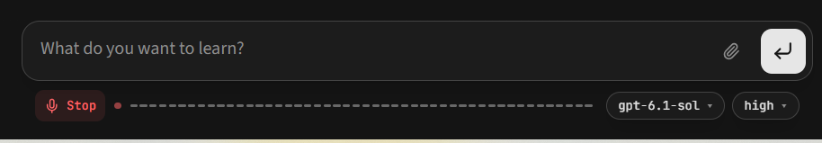

# Khảo sát vùng soạn bằng giọng nói trong Antigravity

**PBL6 · 09/11/2026.** Khảo sát cách ô soạn và con trỏ hoạt động trong lúc thu, để chọn tương tác phù hợp cho thiết bị hỗ trợ giao tiếp trực tiếp dùng một màn hình 7 inch.

## Ảnh tham khảo và hành vi đã đối chiếu

Ảnh do người dùng gửi cho thấy **ô soạn vẫn hiện khi đang thu**. Mã LearnHarness `0.5.0` cho thấy ô nhập vẫn nhận chỉnh sửa và chữ nhận dạng được nối vào cuối nội dung đang soạn. Nút gửi có thể kết thúc lượt thu, đợi phần chữ cuối rồi gửi. [Mã ô soạn](https://github.com/amosblomqvist/learnharness/blob/v0.5.0/components/composer.tsx#L77) · [Mã ghép chữ](https://github.com/amosblomqvist/learnharness/blob/v0.5.0/components/chat.tsx#L709) · [Mã xử lý Gửi](https://github.com/amosblomqvist/learnharness/blob/v0.5.0/components/chat.tsx#L1200)

Google mô tả Antigravity App là ứng dụng desktop kế thừa cách tổ chức Agent Manager của Antigravity IDE. Tài liệu cho biết Antigravity App hiện chữ khi đang nói và dùng phần văn bản quanh con trỏ làm ngữ cảnh nhận dạng. Mã giao diện trong bản Windows `2.29.0` cho thấy cách xử lý từng bước. [Giới thiệu Antigravity 2.0](https://antigravity.google/blog/introducing-google-antigravity-2) · [Tài liệu nhận dạng giọng nói](https://antigravity.google/docs/features#voice-transcription)

**Phân biệt với Antigravity IDE đời trước.** Trong bài ra mắt 2.0, Google đối chiếu tính năng hiện chữ trực tiếp của Antigravity App với cách trước đó là thu một tệp âm thanh gốc để chuyển cho mô hình. Phần đối chiếu bên dưới áp dụng cho App `2.29.0`. Bài giới thiệu xác nhận dạng dữ liệu chuyển cho mô hình, còn thao tác gửi cụ thể của IDE cũ chưa được kiểm tra trực tiếp. [Mô tả thay đổi của Google](https://antigravity.google/blog/introducing-google-antigravity-2)

| Thời điểm | Hành vi trong mã Antigravity App `2.29.0` |
| --- | --- |
| Bắt đầu thu | Ứng dụng đọc chữ quanh con trỏ để cung cấp ngữ cảnh cho bộ nhận dạng. |
| Chữ tạm đầu tiên xuất hiện | Ứng dụng chèn một đoạn chữ mờ tại vị trí con trỏ hiện tại hoặc vị trí gần nhất trình soạn còn giữ. Khi thiếu vị trí, đoạn chữ được chèn ở cuối. |
| Người dùng tiếp tục nói hoặc di chuyển con trỏ | Kết quả mới <strong style="color:#087789;">cập nhật đoạn chữ tạm tại chỗ</strong>. Ô soạn vẫn nhận thao tác. Mã chặn Backspace và Delete nếu chúng tác động vào đoạn chữ tạm. |
| Kết quả cuối về | Đoạn chữ tạm chuyển thành chữ thường ở vị trí đã chèn. |

<strong style="color:#946200;">Giới hạn kiểm chứng.</strong> Hành vi chi tiết dựa trên `main.js` nằm trong gói giao diện của `resources/bin/language_server.exe` thuộc Antigravity App `2.29.0`. Chưa chạy lượt thu thực tế để kiểm tra từng thao tác bằng tay.

## Áp dụng vào thiết bị PBL6

**Hai người dùng chung một màn hình.** Cầm hoặc xoay thiết bị để đưa chữ cho người kia xem là một ví dụ về cách sử dụng, tương tự khi đưa màn hình điện thoại cho người khác đọc. Bố cục chat dùng để tham khảo vùng soạn và cách xem lại câu trước. Phương án đang cân nhắc ưu tiên câu đang trao đổi và các nút cần cho lượt nói, đọc hoặc đáp. [Đặc tả UI/UX](../STT_PRODUCT_UI_UX.md)

<strong style="color:#087A47;">PBL6 dùng quy tắc chèn chữ của Antigravity.</strong> Người dùng vẫn có thể sửa bản nháp và di chuyển con trỏ khi đang thu hoặc chờ kết quả. Chữ đầu tiên được chèn tại vị trí con trỏ lúc hiển thị, hoặc vị trí gần nhất ô soạn còn giữ nếu mất tiêu điểm. Nếu chưa có vị trí, chèn cuối bản nháp.

V1 và V2 áp dụng quy tắc này cho chữ cuối sau khi dừng thu. V3 áp dụng cho chữ tạm đầu tiên. Các lần cập nhật và kết quả cuối dùng chính đoạn chữ tạm đã chèn, kể cả khi con trỏ đã dời sang chỗ khác. [Quy tắc chèn và tiêu chí duyệt của PBL6](../STT_PRODUCT_UI_UX.md#2-thu-sửa-và-gửi-trong-vùng-soạn-chung)
