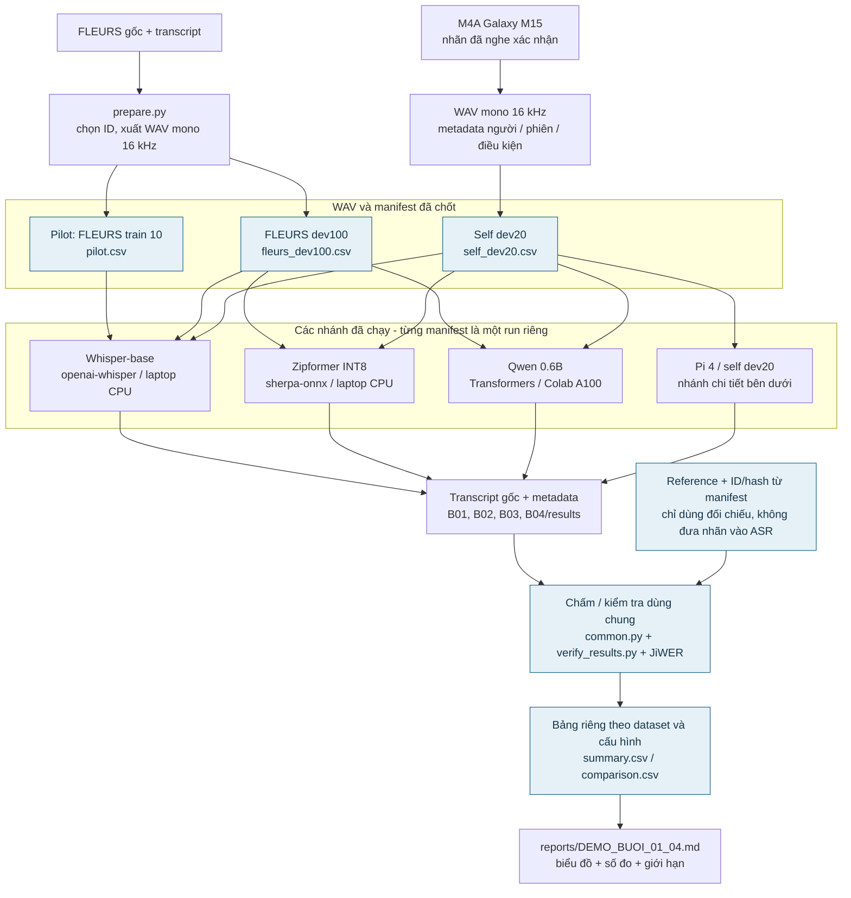
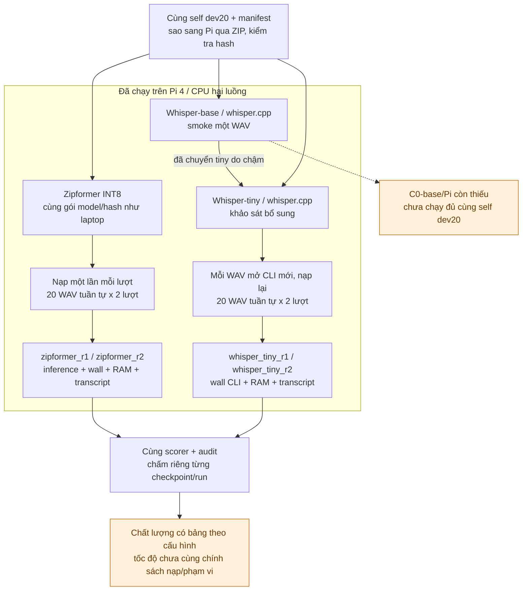
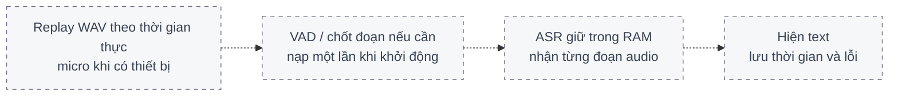

# Bản đồ pipeline B01–B04 và file dùng chung

Sơ đồ luồng logic từ nguồn audio đến báo cáo; không phải mọi node tương ứng một tiến trình độc lập. Mỗi nhánh chạy theo manifest riêng. Reference được đọc để chấm, không truyền làm đầu vào nhận dạng.

## Từ nguồn dữ liệu đến báo cáo

| Thành phần dùng chung | File hoặc thư mục thực tế | Vai trò |
|---|---|---|
| Chuẩn bị FLEURS | [prepare.py](../experiments/prepare.py) | Chọn ID và khôi phục WAV pilot/dev; không huấn luyện |
| FLEURS pilot | [pilot.csv](../experiments/manifests/pilot.csv), data/derived/stt_b01_b03/train | 10 câu train cho B01 |
| FLEURS dev | [fleurs_dev100.csv](../experiments/manifests/fleurs_dev100.csv), data/derived/stt_b01_b03/dev | Cùng 100 WAV cho ba model |
| Self dev20 | [self_dev20.csv](../experiments/manifests/self_dev20.csv), data/self_recorded/dev | Cùng 20 WAV cho B02/B03/B04 |
| Runner laptop/Colab | [run_asr.py](../experiments/run_asr.py) | Nạp backend một lần/run; lần lượt nhận dạng WAV |
| Scorer | [common.py](../experiments/common.py) | NFC/chuẩn hóa và WER_ws/CER, được gọi trong runner |
| Audit | [verify_results.py](../experiments/verify_results.py) | ID/reference/audio hash; chấm lại bằng scorer và JiWER |
| Kết quả tự thu laptop | [B02/results/self_dev20](../experiments/B02/results/self_dev20/summary.csv) | Baseline đã lưu, B03 tái sử dụng; không chạy lại trên Colab |
| Kết quả Qwen/so ba model | [B03/results](../experiments/B03/results/summary.csv), [self_dev20](../experiments/B03/results/self_dev20/summary.csv) | Qwen GPU + bảng hợp nhất cùng dữ liệu |

**WAV dùng chung không có nghĩa cùng đường dẫn vật lý.** ZIP chuyển bản sao qua Drive/Colab/Pi. Receipt/hash kiểm tra nội dung và manifest; các ZIP có thể khác hash vì chứa thêm model/code/metadata khác nhau. Gói Pi chứa model Zipformer; Whisper GGML được tải riêng. Không dùng lại tên checkpoint để thay cho kiểm tra file/hash.

## Nhánh Pi và chỗ phép so chưa đồng nhất

| Nhánh | Mã thực thi | Bằng chứng |
|---|---|---|
| Zipformer Pi | [run_zipformer_pi.py](../experiments/B04/run_zipformer_pi.py) gọi runner chung | [measurement r1](../experiments/B04/results/zipformer_r1/measurement.json) |
| Whisper Pi | [run_whisper_cpp_pi.py](../experiments/B04/run_whisper_cpp_pi.py) gọi CLI upstream | [tiny r1](../experiments/B04/results/whisper_tiny_r1/measurement.json), [base smoke](../experiments/B04/results/whisper_base_smoke/measurement.json) |

Zipformer Pi giữ cùng gói model/hash như laptop. Whisper Pi thay runtime; tiny còn thay checkpoint so với base laptop. Hai lượt lặp không bổ sung người/câu mới. C0-base đầy đủ/Pi và phép đo tốc độ cùng chính sách nạp chưa hoàn tất.

## B05 là kế hoạch, không phải kết quả đã chạy

Nét đứt = dự kiến. Có thể ghép VAD với ASR offline, không đồng nghĩa ASR có streaming nguyên sinh. VAD không phải bước bắt buộc cho mọi backend; chỉ thêm nếu phù hợp cách chốt đoạn đã chọn. Chưa triển khai pipeline này hoặc ghi nhận demo với thầy.
