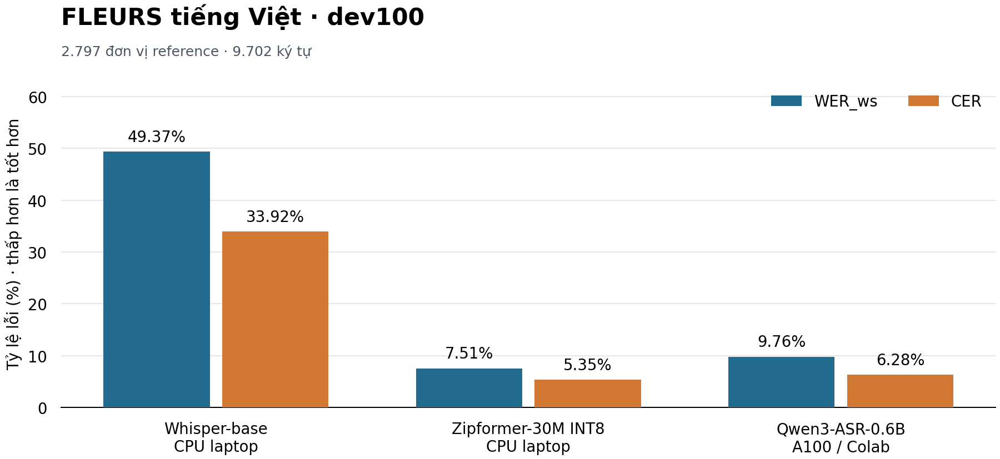
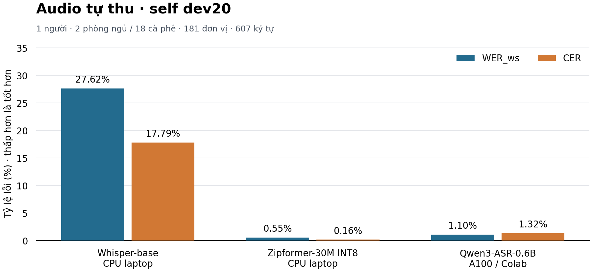

<!-- _class: cover -->

# STT tiếng Việt trên Raspberry Pi 4

**Từ audio thành chữ, hướng đến phụ đề cho kính thông minh**

Tổng kết buổi 01–04

STT / ASR: nhận dạng tiếng nói thành văn bản. Thử model có sẵn, đánh giá rồi tích hợp từng bước.

<!--
Mở đầu: “Em phụ trách phần nhận dạng tiếng nói tiếng Việt cho hướng kính thông minh. Bốn buổi đầu giúp em hiểu đầu ra của model, so các cấu hình có sẵn và thử ứng viên trên Pi thật. Hiện mới chạy được WAV thành chữ; phần audio liên tục và hiển thị còn là bước tiếp theo.”

Phạm vi là đề tài học tập, một người thực hiện. Chưa huấn luyện lại, chưa có bản kính hoàn chỉnh, chưa triển khai cho người dùng. Số liệu trong deck lấy từ kết quả đã lưu ngày 13/10/2026; tạo slide ngày 15/10/2026 không tạo kết quả benchmark mới.

Đây là file trình chiếu mới. reports/DEMO_BUOI_01_04.md vẫn giữ vai trò tài liệu giải thích và tra cứu.
-->

---

## Bốn buổi trả lời bốn câu hỏi nối tiếp

| Buổi | Câu hỏi | Đầu ra đã có |
|---|---|---|
| **B01** | Audio thành chữ và sai ở đâu? | WAV, transcript, lỗi đếm tay |
| **B02** | Baseline CPU nào phù hợp? | Hai model trên cùng 100 câu |
| **B03** | Thêm Qwen và audio tự thu thì sao? | Hai bảng chất lượng ba model |
| **B04** | Ứng viên chạy trên Pi thật thế nào? | Transcript, thời gian, RAM |

**Kết quả hiện tại:** có ứng viên để xây pipeline phụ đề cơ bản.

<!--
Baseline là cấu hình ban đầu để đối chiếu. B01 dùng Whisper-base trên 10 câu pilot từ FLEURS train, chỉ inference, không huấn luyện. B02 so Whisper-base và Zipformer trên FLEURS dev100. B03 thêm Qwen trên cùng dev100, sau đó so cả ba trên self dev20. B04 đo Pi.

Đây là bốn mốc nội dung, không khẳng định đã trình bày đủ bốn buổi với supervisor. B04 có kết quả Zipformer nhưng chưa hoàn tất đối chiếu Whisper-base/Pi. C0 là Whisper-base, C1 là Zipformer trong kế hoạch.
-->

---

<!-- _class: flow -->

## Các nhánh xử lý dùng chung dữ liệu và cách chấm

Cùng WAV và nhãn để đối chiếu. Mỗi cấu hình lưu transcript riêng. Nhãn chuẩn chỉ dùng để chấm, không đưa vào model nhận dạng.

<!--
Giải thích từ trái sang phải: chuẩn bị audio và danh sách mẫu; chạy model trên thiết bị phù hợp; lưu chữ model sinh ra; đối chiếu nhãn chuẩn; tổng hợp kết quả. Nhánh Pi chỉ nhận self dev20, nhánh laptop/Colab nhận dev100 và self20. Pilot riêng ở B01 chỉ dùng Whisper-base.

“Dùng chung” là cùng nội dung/phiên bản đã kiểm tra hash. Colab/Pi nhận bản sao qua ZIP, không dùng chung một đường dẫn vật lý. Manifest chứa ID, đường dẫn, nhãn và metadata. Scorer nằm trong runner, rồi verify_results.py chấm lại bằng JiWER để kiểm tra.

Nguồn sơ đồ Mermaid: diagrams/slides_overview.mmd. Nhúng SVG đã render để slide không phụ thuộc khả năng hiển thị Mermaid của trình xem.
-->

---

<!-- _class: example -->

## B01: điểm lỗi bắt đầu từ một câu nghe được

| | Transcript |
|---|---|
| Nhãn chuẩn | Những **cây** này nhìn giống cây **cọ** nhỏ có tán **lá** sắc **nhọn**. |
| Whisper | Những **cái** này nhìn giống cây **cộ** nhỏ có tán **là** sắc **nhỏ**. |

**4 lỗi / 13 đơn vị = 30,77% WER_ws** cho câu này.

WER_ws: tỷ lệ lỗi theo đơn vị cách nhau bằng khoảng trắng. CER: tỷ lệ lỗi ký tự. Cả hai càng thấp càng tốt.

[Nghe WAV mẫu](../data/derived/stt_b01_b03/train/18182759805207678941.wav)

<!--
Demo: phát đoạn audio, chỉ bốn cặp in đậm rồi giải thích phép chia. Người thực hiện đã nghe và xác nhận nhãn của mẫu này. Không nói đã nghe toàn bộ pilot.

WER_ws = (thay thế + xóa + chèn) / số đơn vị reference. Ở đây có bốn thay thế, không chèn/xóa, reference có 13 đơn vị. Tiếng Việt tách bằng khoảng trắng thường tương ứng “tiếng”, chưa phải từ ghép đã tách từ. CER bỏ khoảng trắng khi chấm.

Cả pilot 10 câu: WER_ws 36,88%, CER 20,39%. Không lấy điểm pilot để thay dev. Chấm toàn tập bằng tổng lỗi / tổng đơn vị, không lấy trung bình đơn giản WER từng câu.

Chuẩn hóa chung: Unicode NFC, chữ thường, dấu câu thành khoảng trắng, gộp khoảng trắng. Giữ dấu tiếng Việt và transcript gốc; không có bước sửa nội dung. Nguồn: ../experiments/B01/results/summary.csv, ../experiments/common.py.
-->

---

<!-- _class: chart -->

## B02–B03: Zipformer có điểm lỗi thấp nhất trên dev100

**Cùng 100 WAV, cùng nhãn và cách chấm.** Qwen chạy A100 trên Colab.

Đây là so chất lượng ba cấu hình đã chọn. Chưa dùng để xếp hạng tốc độ.

<!--
Vì sao chọn ba cấu hình: Whisper-base là baseline đa ngôn ngữ quen thuộc; Zipformer-30M INT8 là ứng viên tiếng Việt nhỏ chạy CPU; Qwen3-ASR-0.6B là hướng model mới để đối chiếu. Dùng model có sẵn giúp tập trung học đánh giá và tích hợp trong thời gian đề tài.

B02 đã chạy hai baseline CPU laptop; B03 dùng lại đúng output ấy, thêm Qwen GPU. Model mới không mặc nhiên tốt hơn trên bộ đang chấm. Các giá trị WER_ws/CER: Whisper 49,37%/33,92%; Zipformer 7,51%/5,35%; Qwen 9,76%/6,28%. Mỗi model 100/100, reference 2.797 đơn vị và 9.702 ký tự.

Cấu hình: Whisper-base multilingual / openai-whisper / CPU laptop; Zipformer-30M RNNT ONNX INT8 / sherpa-onnx / CPU laptop; Qwen3-ASR-0.6B bfloat16 / qwen-asr Transformers / A100 Colab. Khác trọng số, quy mô, dữ liệu train, runtime và giải mã nên chưa cô lập riêng tác động kiến trúc.

Giới hạn cần trả lời nếu hỏi: Zipformer liệt kê FLEURS trong nguồn train; chưa đủ thông tin split/ID để xác nhận có trùng các câu dev. Không gọi đây là phép đánh giá chắc chắn trên dữ liệu chưa thấy. Đổi sang public test cũng không tự chứng minh độc lập với pretraining.

Nguồn: ../experiments/B03/results/summary.csv. Hình đọc CSV đã lưu; receipt: figures/sources.json. Chỉ so chất lượng; không so thời gian GPU với CPU.
-->

---

<!-- _class: chart -->

## Audio tự thu giúp kiểm tra gần bối cảnh đề tài hơn

**20 câu, một người nói.** Galaxy M15, cách khoảng 30 cm.

2 câu phòng ngủ có điều hòa, 18 câu cà phê. Bộ nhỏ để thăm dò; một và hai lỗi chưa đủ chứng minh ưu thế tổng quát.

<!--
Vì sao thêm self dev20: FLEURS là lời đọc từ bộ public; audio tự thu kiểm tra thêm thiết bị và tiếng nền gần điều kiện thực hành. Không gộp điểm hai bộ thành một hoặc suy ra “cà phê dễ hơn FLEURS”, vì nội dung, độ dài và người nói khác nhau.

Nhãn 20 câu đã được người thực hiện nghe xác nhận. 181 đơn vị reference, 607 ký tự. Whisper: 50/181 = WER_ws 27,62%, CER 17,79%. Zipformer: 1/181 = 0,55%, CER 0,16%. Qwen: 2/181 = 1,10%, CER 1,32%. Hai bản cà phê 01–02 đối chiếu thêm không nằm trong bộ chính.

Điểm thấp vẫn có lỗi: câu 20, reference “Kết quả trên máy tính chưa phải kết quả trên kính.”; Qwen sinh “cách quả trên máy tính chưa phải cách quả trên kính”, sai hai lần kết/cách. Zipformer đúng câu này nhưng sai gốc/góc ở câu 14. Nếu cần nghe lỗi, mở ../data/self_recorded/dev/self_20.wav và ../experiments/B03/results/self_dev20/comparison.csv. Chưa ghi nhận người thực hiện đã nghe lỗi Qwen câu 20 riêng.

Chỉ một người đọc, chưa đại diện hội thoại nhiều người. Các câu ở hai môi trường khác nội dung, chưa cô lập tác động nhiễu. Chữ hoa/thường không tạo chênh lệch điểm vì cùng chuẩn hóa khi chấm.

Nguồn: ../experiments/B03/results/self_dev20/summary.csv. Kết quả hỗ trợ chọn ứng viên tạm thời, chưa phải test cuối.
-->

---

## B04: Zipformer đã chạy WAV trên Pi thật

**Raspberry Pi 4B 8 GB**, CPU hai luồng. 20 WAV, tổng **84,160 giây audio**, chạy lặp hai lượt.

| Lượt | Tổng nhận dạng¹ | Cả tiến trình² | RAM cao nhất |
|---|---:|---:|---:|
| r1 | **10,278 s** | 14,644 s | 199,06 MiB |
| r2 | **10,226 s** | 14,578 s | 198,32 MiB |

Transcript **giống laptop 20/20 câu** ở cả hai lượt.

¹ Chỉ thời gian nhận dạng. ² Gồm nạp model và các việc đọc/ghi. Đây là xử lý tệp có sẵn; độ trễ phụ đề trực tiếp còn phải đo.

<!--
Vì sao đo Pi: điểm chất lượng trên laptop/GPU chưa trả lời model có dùng được trên phần cứng mục tiêu hay không. Pi dùng cùng gói Zipformer/hash như laptop, sherpa-onnx 1.13.8, Python 3.13.5, OS aarch64. Nạp model một lần mỗi lượt, xử lý lần lượt 20 WAV. Hai lượt không phải 40 mẫu độc lập.

Thời gian inference bỏ nạp model và đọc WAV. Wall cả runner gồm khởi động, nạp, đọc, chấm trong runner và ghi; không gồm audit JiWER chạy sau. Nạp model 3,742/3,735 s đã nằm trong wall. RTF inference = inference / 84,1599375 s = 0,1221/0,1215, không phải latency từ lúc người nói kết thúc đến khi hiện chữ. Peak RSS gồm runtime và lúc nạp. Cache hệ điều hành có thể ấm. throttled=0x0 trước/sau.

WER_ws 0,55%, CER 0,16%, 20/20 mỗi lượt. Nguồn: ../experiments/B04/results/zipformer_summary.csv và ../experiments/B04/results/zipformer_r1/measurement.json. Lệnh demo một WAV đã có tại ../experiments/B04/DEMO.md. Không chạy lại inference để làm slide.
-->

---

<!-- _class: evidence -->

## Zipformer là ứng viên cho pipeline tiếp theo

| Căn cứ lựa chọn | Phạm vi kết luận |
|---|---|
| Điểm lỗi thấp trên hai bộ dev | Đúng với các mẫu đã chấm |
| Chạy được WAV trên Pi, RAM khoảng 199 MiB | Có cơ sở thử tích hợp trên Pi |
| Dùng model có sẵn | Ưu tiên pipeline trong thời gian còn lại |

**Whisper-base/Pi chưa chạy đủ 20 câu.** Phép so tốc độ với Whisper cần đo lại cùng điều kiện.

Chọn ứng viên tạm thời để làm tiếp. Phụ đề trực tiếp và chất lượng trong sử dụng thực tế vẫn cần kiểm tra.

<!--
Phân biệt hai câu hỏi: chọn cấu hình thực dụng để thử tích hợp và nghiên cứu chỉ khác kiến trúc. Các kết quả hiện tại phục vụ câu hỏi đầu. Chưa chứng minh Zipformer là kiến trúc tốt nhất hoặc INT8 là nguyên nhân điểm tốt.

Giải thích thiếu sót B04 nếu thầy hỏi: Whisper-base trên Pi mới smoke một WAV, wall 20,869 s / audio 5,355 s. Sau đó đã chạy Whisper-tiny/whisper.cpp đủ self20 x hai lượt, WER_ws 41,99%, CER 26,36%, tổng wall 172,807/171,309 s. Tiny thay checkpoint nên chỉ là khảo sát bổ sung, không thay C0-base.

Adapter Whisper mở CLI và nạp lại model mỗi WAV; Zipformer nạp một lần mỗi lượt. Whisper báo wall có nạp/đọc/ghi, còn Zipformer có số inference riêng. Không chia những số khác phạm vi để tuyên bố tỷ lệ tăng tốc. Đây là thiếu sót phép đo, không phải yêu cầu của kiến trúc Whisper. Chậm vẫn là kết quả cần ghi nhận khi giữ baseline.

Kế hoạch v3.0 đã giữ C0-base/Pi đầy đủ và phép so tốc độ đồng nhất ở trạng thái chưa hoàn tất. Nếu tiếp tục so baseline, dùng cùng self20/Pi/hai luồng, nạp một lần và cùng phạm vi timing; lưu lỗi hoặc timeout thay vì âm thầm thay checkpoint.

Chưa đo Qwen trên Pi. Chỉ kết luận bản Qwen đang dùng chạy GPU theo phạm vi đã chọn, không kết luận mọi bản Qwen đều không chạy được trên Pi. Chưa kiểm tra input không lời nói, nên false_captions_per_minute còn trống, không phải 0.
-->

---

<!-- _class: next -->

## Bước tiếp theo là một pipeline phụ đề nhỏ

**B05 dự kiến, chưa triển khai**

Model **nạp một lần**, nhận lần lượt các đoạn nói.

Pi chưa có micro: bắt đầu bằng phát lại WAV theo thời gian thực. Đầu ra cần demo: chữ xuất hiện sau mỗi đoạn nói.

<!--
Vì sao chuyển sang pipeline: WAV đã chia sẵn chưa trả lời audio đến liên tục sẽ cho chữ lúc nào. Replay đưa từng khối audio theo nhịp thời gian thực để kiểm tra luồng; không thay kiểm tra micro thật.

VAD là phát hiện hoạt động giọng nói, giúp tách phần có nói; endpoint là quyết định chốt đoạn. Chỉ thêm khối này khi cần để chốt audio đầu vào cho ASR offline. Giữ model trong RAM, đặt lại trạng thái đoạn theo API. Ghép các khối này chưa biến checkpoint offline thành streaming ASR nguyên sinh.

Tất cả mũi tên nét đứt chỉ phần dự kiến. Chưa có kết quả VAD, replay, độ trễ phụ đề hoặc hiển thị trên kính. Trước mắt hiển thị text trên màn hình để kiểm tra. Chưa cần thêm model, fine-tuning hay bộ sửa lỗi văn bản tự động.

Nguồn sơ đồ Mermaid: diagrams/slides_next.mmd. Nguồn kế hoạch: ../PLAN_DEMO_STT_7_BUOI.md.
-->

---

## Ba buổi tiếp theo hoàn thiện chức năng cơ bản

| Mốc | Phần cần hoàn thành | Đầu ra để demo |
|---|---|---|
| **B05** | Audio đến dần, model giữ trong RAM | Đoạn nói thành phụ đề |
| **B06** | Thử audio mới và đoạn không lời nói | Lỗi, độ trễ, RAM của pipeline |
| **B07** | Tổng hợp và giải thích lựa chọn | Demo từ audio đến chữ, kèm giới hạn |

**Đích đến:** một pipeline nhỏ chạy được trên Pi, có bằng chứng và giải thích được cách lựa chọn.

Minh chứng hôm nay: nghe mẫu B01, xem hai biểu đồ, chạy một WAV trên Pi rồi nêu phần còn thiếu.

<!--
Gợi ý trình bày 3–5 phút: mở mục tiêu và lộ trình thật ngắn, chỉ sơ đồ luồng; phát mẫu B01 khoảng 15–20 giây; giải thích hai biểu đồ và quyết định tạm; nêu kết quả Pi cùng giới hạn; kết thúc bằng đầu ra cụ thể của B05. Nếu chạy Pi trước lớp, dùng lệnh trong ../experiments/B04/DEMO.md sau khi đã tập thử. Đừng biến phần trình bày thành đọc hết các ghi chú.

B06 theo kế hoạch: bộ mới nhỏ khoảng 30–50 câu và khoảng hai phút không lời nói nếu khả thi. Chốt cấu hình trước khi xem bộ mới; đo từ cuối lời nói đến phụ đề cuối, ghi rõ phạm vi và lỗi. Public FLEURS test200 là phần bổ sung, không chặn hoàn thiện pipeline. B04 vẫn còn việc đo C0-base/Pi và phép so đồng nhất; ưu tiên pipeline không xóa việc còn thiếu này.

Tài liệu tra cứu:
- ../reports/DEMO_BUOI_01_04.md: giải thích chi tiết, các pipeline và giới hạn.
- ../mynotes/TONG_QUAN_VA_HOI_DAP_STT_BUOI_01_04.md: hỏi đáp.
- ../PLAN_DEMO_STT_7_BUOI.md: kế hoạch v3.0.
- ../experiments/B04/DEMO.md: thao tác demo Pi.
- ../experiments/B03/results/summary.csv và ../experiments/B03/results/self_dev20/summary.csv: chất lượng.
- ../experiments/B04/results/zipformer_summary.csv và whisper_summary.csv: số đo từng cấu hình Pi.

Cách mở: file Markdown dùng Marp với trang 16:9 và dấu --- để ngắt trang. Bản HTML cùng tên là bản xem trình chiếu, dùng phím mũi tên. Trong Obsidian có thể thử lệnh Start presentation của core plugin Slides; bố cục tùy renderer, chưa xác minh trên Obsidian. HTML là bản đã render để kiểm tra bố cục. Giữ Markdown, HTML và thư mục figures cạnh nhau khi sao chép. Ghi chú nằm trong comment HTML, không xuất hiện trên trang chiếu.
-->
