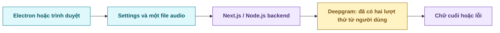
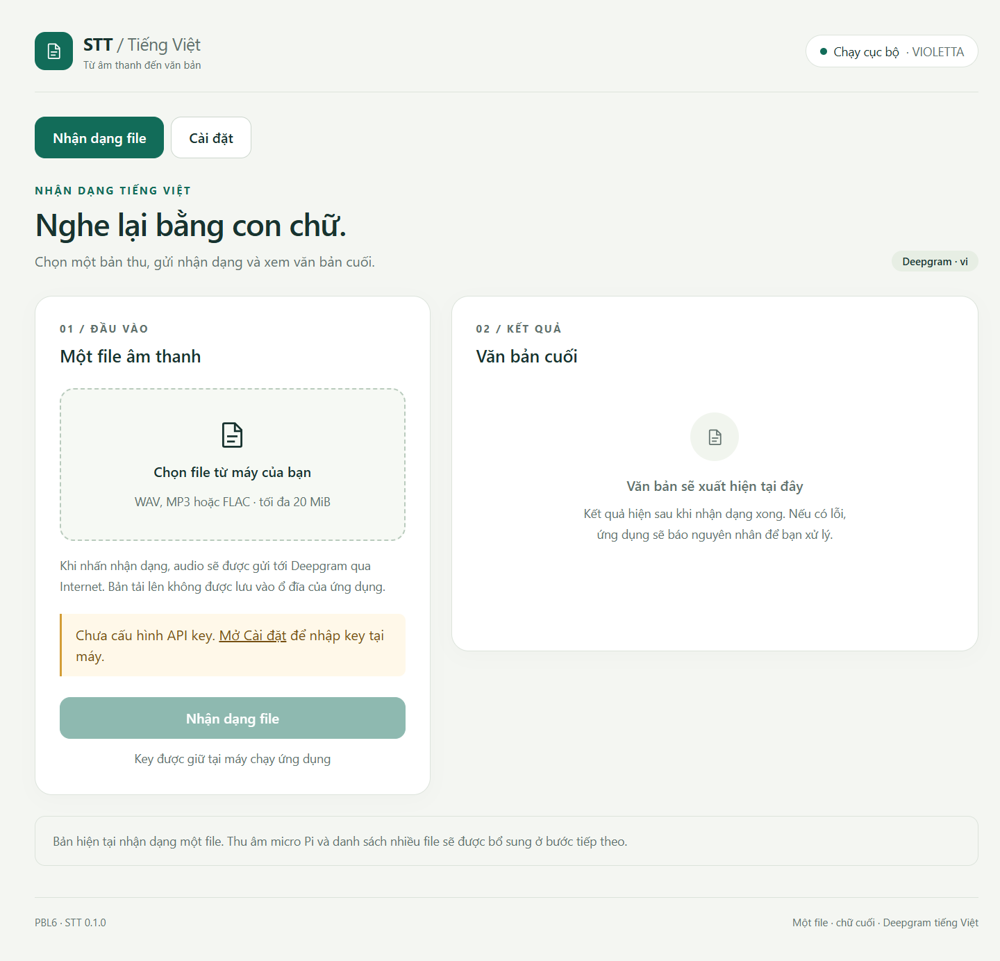

# STT V1 — P1: Settings và nhận dạng một file

Ngày 07/11/2026. **P1** là phần việc đầu tiên của V1, được tách ra để kiểm tra cấu hình và đường nhận dạng file trước khi thêm batch và thu âm Pi. <strong style="color:#087A47;">Ứng dụng đã build và mở được bằng Electron trên Windows; 20 kiểm thử backend và 8 kiểm thử giao diện/tích hợp đều đạt.</strong> <strong style="color:#946200;">Đã có hai lượt nhận dạng file qua API thật do người dùng cung cấp; phone_F1 có lỗi từ nghi ngờ; chưa thu micro Pi và chưa hoàn thành toàn bộ V1.</strong>

## 1. Tổng quan luồng xử lý

Người dùng nhập key trong Cài đặt, chọn một file rồi nhấn nhận dạng. Backend là phần xử lý chạy tại máy: nó đọc cấu hình, kiểm tra file, gửi yêu cầu tới Deepgram và trả chữ cuối hoặc lỗi. Giao diện React/TypeScript/Tailwind dùng chung trong trình duyệt và cửa sổ Electron. Mã ứng dụng ở [stt-app](../../stt-app/README.md), cùng repository hiện tại.

Hình 1 mô tả luồng đã viết trong mã. Các kiểm thử thành công/thất bại của Deepgram dùng **transport mô phỏng**: một hàm thay thế đường truyền mạng, trả phản hồi do bài kiểm thử quy định. Chúng kiểm tra cách ứng dụng xử lý phản hồi, không đo khả năng nhận dạng của dịch vụ thật.



**Hình 1.** Luồng V1-P1 theo thiết kế và mã hiện tại. Đường gọi API đã triển khai và đã có hai lượt hoàn tất do người dùng cung cấp ở mục 3.2; các kiểm thử tự động vẫn dùng mô phỏng.

<strong style="color:#087789;">Điểm có thể dùng thử ngay là nhập/lưu cấu hình, chọn file và giao diện desktop.</strong> Người dùng đã cung cấp bằng chứng hai lượt cloud hoàn tất; phạm vi và giới hạn được ghi ở mục 3.2. Thu âm Pi và batch chưa xuất hiện như chức năng có thể sử dụng; màn hình ghi rõ phạm vi một file.

## 2. Phương pháp triển khai

### 2.1. Các thành phần và phạm vi

Ứng dụng ghim Next.js **16.4.5**, React/React DOM **19.3.1**, Tailwind CSS **4.3.5**, Electron **45.2.3** và TypeScript **5.9.3** trong [package.json](../../stt-app/package.json) và lockfile. Môi trường kiểm tra là Windows với Node **22.22.2**, npm **10.9.7**. Chọn phiên bản và chạy được trên Windows chưa chứng minh tương thích Linux ARM64 trên Pi.

Backend có ba đường: trạng thái ứng dụng, đọc/lưu Settings và nhận dạng một file. Electron chờ backend sẵn sàng rồi tải giao diện cục bộ; renderer, tức phần hiển thị trang trong Electron, không được cấp trực tiếp Node.js. Kiểm thử Electron đã xác nhận giao diện mở được và không có các biến toàn cục `require`/`process` trong trang. Cơ chế tự khởi động hệ điều hành, đóng gói cài đặt và kiosk cảm ứng trên Pi còn chưa kiểm chứng.

### 2.2. Settings và API key

Settings cho phép nhập hoặc xóa key, chọn Nova-3/Nova-2 và thời gian chờ nguyên từ 15–180 giây; ngôn ngữ cố định là `vi`. Để trống ô key khi lưu model/timeout giữ key cũ. Backend chỉ trả trạng thái đã có key, không trả lại key đã lưu. **Lưu cấu hình thành công chưa chứng minh quyền sử dụng API.**

Key nằm ngoài repository: mặc định Windows là `%LOCALAPPDATA%\PBL6-STT\settings.json`. File hiện **chưa mã hóa**; không chia sẻ nó. Backend ghi file tạm rồi thay file hoàn chỉnh, xếp tuần tự các lần cập nhật và báo lỗi nếu cấu hình hỏng thay vì tự ghi đè. Các kiểm thử dùng key giả và thư mục riêng, không đọc key của người dùng.

### 2.3. Audio, yêu cầu cloud và lỗi

Mỗi yêu cầu nhận đúng một WAV, MP3 hoặc FLAC không trống, tối đa **20 MiB**. Ứng dụng kiểm tra phần mở đầu khớp định dạng, giới hạn cả phần tải lên và chỉ giữ audio trong bộ nhớ. Đây chưa phải bộ giải mã kiểm chứng toàn bộ file; file hỏng bên trong vẫn có thể bị Deepgram từ chối.

Backend gửi audio tới endpoint HTTPS chính thức, với `language=vi`, model đã chọn, `smart_format=true` và `punctuate=true`. Nó phân biệt thiếu key, lỗi xác thực/quyền, giới hạn dịch vụ, lỗi mạng, timeout, phản hồi hỏng và transcript rỗng. Nội dung lỗi thô của nhà cung cấp không được đưa về giao diện. Cấu hình được chụp khi bắt đầu yêu cầu; mỗi backend hiện chỉ nhận một yêu cầu nhận dạng đồng thời. Xem [adapter](../../stt-app/src/server/deepgram.ts) và [handler](../../stt-app/src/server/handlers.ts).

Transcript rỗng được báo rõ, không sinh chữ thay thế. Nếu lần gửi mới thất bại, giao diện giữ kết quả đã hoàn tất trước đó cùng tên file, tránh hiểu nó là kết quả của lần lỗi. Transcript chưa xuất chỉ nằm trong bộ nhớ giao diện; hiện chưa có lịch sử phiên bền vững.

<strong style="color:#946200;">Mốc này chỉ mở cục bộ tại 127.0.0.1.</strong> Điều khiển Pi qua LAN cần bước xác thực/tích hợp riêng. Không có yêu cầu lấy micro trình duyệt; đường thu Pi vẫn chưa triển khai. Vì vậy chưa thể chạy Record/Stop theo mục tiêu V1 đầy đủ.

Tài liệu provider đã đối chiếu: [model/ngôn ngữ](https://developers.deepgram.com/docs/models-languages-overview), [API audio ghi sẵn](https://developers.deepgram.com/reference/speech-to-text/listen-pre-recorded). Các nguồn này xác định cách gọi, không thay cho kết quả API thực tế của tài khoản nhóm.

## 3. Thiết lập kiểm thử, kết quả và bước người dùng thực hiện

### 3.1. Kết quả kiểm tra

Backend tests dùng audio tổng hợp tối thiểu, file tạm và phản hồi mô phỏng, không dùng tập đánh giá ASR. UI tests chạy Chrome trên production server riêng ở cổng 3111, cấu hình tách biệt; kiểm thử HTTP thật chỉ lưu/đọc/xóa key giả và xác nhận chặn lỗi cục bộ, không gọi STT. Tóm tắt bằng chứng và các giới hạn nằm trong [validation.json](validation.json).

**Bảng 1.** Các kiểm tra phần mềm đã chạy; số bài đạt không biểu thị độ chính xác nhận dạng.

| Kiểm tra | Kết quả | Phạm vi |
|---|---:|---|
| `npm test` | **20/20 đạt** | Settings, upload, cấu hình yêu cầu, lỗi, timeout, khóa đồng thời |
| `npm run build` | **Đạt** | Build production và sinh route |
| `npm run typecheck` | **Đạt** | Kiểm tra kiểu TypeScript |
| `npm run test:ui` | **8/8 đạt** | Chrome, HTTP cục bộ, Electron và launcher hiện cửa sổ Windows |
| Khởi động launcher production | **Đạt** | Backend sẵn sàng, tiến trình tiếp tục chạy sau khi mở Electron |

<strong style="color:#087A47;">Các kiểm tra trên đã đạt sau khi sửa lỗi phát hiện trong quá trình tích hợp.</strong> Lượt đầu gặp lỗi launcher `.cmd` trên đường dẫn có `&`, hai lỗi kiểu trong test và lỗi so Origin do Next dùng địa chỉ nội bộ khác Host của client. Script nay gọi trực tiếp công cụ qua Node; kiểm tra Origin dùng Host loopback đã xác thực. Lượt UI đầu có 3 đạt/4 lỗi, gồm locator thông báo và thời gian tải binary Electron; lượt cuối đạt 7/7. Đây là lịch sử sửa lỗi phần mềm, không phải thí nghiệm cải thiện ASR.

Một lượt thử bổ sung đã khởi động launcher production với thư mục cấu hình tạm không có key: backend trả trạng thái sẵn sàng và launcher tiếp tục chạy sau khi mở Electron. Sau thử nghiệm, cây tiến trình do lượt thử tạo được kết thúc. Lượt này chưa kiểm chứng đóng cửa sổ/phục hồi lỗi hoặc khởi động kiosk trên Pi.

Hình 2 là giao diện chụp từ Electron thật trên Windows; chưa có key thật hoặc file người dùng được gửi đi.



**Hình 2.** Màn hình một file trong Electron. Nút nhận dạng chưa cho dùng khi chưa có key. Ảnh kiểm tra bố cục hẹp ở [mobile.png](assets/mobile.png) không có cuộn ngang toàn trang. [Ảnh Settings](assets/settings.png) dùng phản hồi mô phỏng đã lưu key; không phải bằng chứng API đã sẵn sàng.

### 3.2. Dùng thử thực tế do người dùng cung cấp — studio_M1

<strong style="color:#087A47;">Người dùng đã cung cấp một lần nhận dạng một file thành công bằng Nova-3, ngôn ngữ vi, trên trình duyệt Chrome tại 127.0.0.1:3100.</strong> [Ảnh kết quả](assets/user-trial-studio_M1.png) hiển thị trạng thái hoàn tất và thời gian yêu cầu **1,92 giây**. [File .txt đã xuất](assets/studio_M1-transcript.txt) chứa đúng chữ hiển thị:

> Anh vẫn có thể làm trọng tài

Đọc header WAV cho thấy file có thời lượng **2,730159 giây**, mono, 44.100 Hz, PCM 16 bit, 240.844 byte. File nguồn nằm trong thư mục dữ liệu XLTN được người dùng chỉ định; không sao chép vào tập đánh giá PBL6 và không sửa audio. Đường dẫn, SHA-256 và thông tin bằng chứng được lưu ở [user_trial_studio_M1.json](user_trial_studio_M1.json).

Lượt này xác nhận theo bằng chứng người dùng gửi rằng đường nhận một file → kết quả → xuất .txt đã chạy qua sử dụng thực tế. Agent không gọi lại API, không đọc key và không tự chạy nhận dạng. **Chưa có reference được người dùng nghe và xác nhận nên chưa chấm đúng/sai, WER hoặc CER.** Thời gian 1,92 giây là số đã làm tròn trên giao diện, gồm đường yêu cầu client/mạng/dịch vụ; không dùng để suy tốc độ local hoặc coi là benchmark. Chưa có raw response/request ID để đối chiếu thêm. Đây cũng không phải kiểm chứng thu âm Pi, batch hoặc Electron trên Pi.

**Lượt phone_F1:** [ảnh người dùng gửi](assets/user-trial-phone_F1.png) hiển thị hoàn tất với Nova-3/vi và thời gian yêu cầu **2,02 giây**. [File .txt đã xuất](assets/phone_F1-transcript.txt) chứa:

> Nhiều nông dân khốn khổ vì bị cắt nước sệt

Người dùng cho rằng cụm đúng có thể là **“nước sạch”**. Đây là reference tạm thời cho một cụm, chưa phải toàn bộ câu đã được nghe xác nhận. <strong style="color:#946200;">Ghi nhận lỗi từ nghi ngờ; chưa xác định nguyên nhân do giọng vùng miền và chưa đủ căn cứ kết luận công nghệ không xử lý được.</strong> Giữ nguyên đầu ra “nước sệt”, không tự sửa thành “nước sạch” hoặc tính WER/CER. Việc request hoàn tất khác với nhận dạng đúng nội dung. [Bằng chứng phone_F1](user_trial_phone_F1.json) ghi riêng các giới hạn; lượt này chưa đọc WAV gốc hoặc gọi lại API.

### 3.3. Khởi động và thử API thật

Dependencies và production build đã có trên máy hiện tại. Mở PowerShell tại máy Windows này và chạy:

```powershell
Set-Location -LiteralPath 'C:\Users\LAPTOP T&T\VIOLETTA\Documents\ChatGPT\PBL6\stt-app'
npm run desktop
```

Nếu cài lại từ Git, chạy thêm `npm ci` rồi `npm run build` trước. Không mở `npm start` cùng lúc với desktop vì chúng dùng chung cổng 3100. Đóng cửa sổ desktop để kết thúc; hướng dẫn đầy đủ và lệnh kiểm thử ở [README](../../stt-app/README.md).

1. Vào **Cài đặt**, nhập key của bạn tại máy; chọn Nova-3, giữ ngôn ngữ vi, nhấn **Lưu cấu hình**. Không gửi key vào chat.
2. Vào **Nhận dạng file**, chọn một bản thu ngắn WAV/MP3/FLAC đã nghe lại và được phép gửi cloud. Nhấn **Nhận dạng file**.
3. Ghi nhận có transcript hay thông báo lỗi, model và định dạng file. Nếu có chữ, nghe đối chiếu rồi thử **Lưu .txt**. Gửi lại các thông tin này, không gửi key hoặc file Settings.
4. Nếu không khởi động được, gửi nguyên lỗi terminal. Nếu lỗi khi nhận dạng, gửi nguyên thông báo trên giao diện. Không cần thao tác Pi ở mốc này.

### 3.4. Căn cứ cho quyết định tiếp theo

<strong style="color:#B22563;">Đề nghị xem xét chuyển sang batch sau khi đọc báo cáo và thử một file với API thật.</strong> Đã có code, kiểm thử và một lượt thành công thực tế do người dùng cung cấp. Hai lượt này kiểm chứng ban đầu đường nhận dạng một file và xuất chữ; không thay cho đánh giá chất lượng tiếng Việt. phone_F1 có lỗi từ nghi ngờ, chưa xác định nguyên nhân. Bước sau batch mới nối micro Pi, Record/Stop, LAN có kiểm soát và kiểm chứng thiết bị. Khi cần Pi, người thực hiện phải đưa lệnh, nơi chạy và đầu ra cần gửi lại.

### 3.5. Sửa lỗi launcher desktop bị ẩn trên Windows

Người dùng cho biết đã chạy đúng `npm run desktop` trong `stt-app` nhưng không thấy cửa sổ desktop. Khi kiểm tra, backend khởi động và Electron có tiến trình nhưng không có tiêu đề cửa sổ chính. Launcher đã truyền `windowsHide: true` cả cho Electron. Sau khi đổi riêng tiến trình Electron sang **`windowsHide: false`**, Windows ghi nhận cửa sổ **“STT · Tiếng Việt”** và một handle khác 0. Tiến trình backend vẫn được chạy ẩn như dịch vụ nền.

<strong style="color:#087A47;">Đã bổ sung kiểm thử hồi quy qua chính launcher production; lượt cuối đạt 8/8 kiểm thử UI/HTTP/Electron và kiểm tra TypeScript đạt.</strong> Kiểm thử mới dùng cổng, cấu hình và profile riêng, xác nhận cửa sổ chính thuộc đúng launcher của bài test. Nó không dùng key thật, không gọi ASR và không dừng ứng dụng người dùng đang mở. Các lượt trước mở Electron trực tiếp và smoke chỉ kiểm tra backend/tiến trình nên chưa phát hiện lỗi ẩn cửa sổ; không coi kiểm tra tiến trình sống là bằng chứng cửa sổ đã xuất hiện.

Bản P1 hiện chưa có bộ cài hay shortcut desktop. Dùng `npm run desktop` trong `stt-app`. Nếu trước đó chạy bản web riêng bằng `npm start` hoặc `npm run dev`, hãy dừng đúng terminal đó trước khi mở desktop vì launcher mặc định dùng cổng 3100. Không tắt hàng loạt tiến trình Node/Electron. `PBL6_STT_PORT` cho phép chỉ định cổng khác (1024–65535); `PBL6_STT_DESKTOP_DATA_DIR` tách profile desktop khi kiểm thử. Bản desktop đã sửa được mở lại tại máy để người dùng kiểm tra.

**N02 vẫn chưa hoàn thành.** P1 không sửa runner/chấm điểm và không chạy lại B01–B04. Thời gian yêu cầu cloud trong giao diện gồm đường client/mạng/dịch vụ, không phải RTF local. Giữ nhiệm vụ thống nhất phạm vi tính giờ, chính sách nạp model, warm-up và các lượt lặp trước khi so tốc độ hoặc chọn local engine dựa trên tốc độ. Không có kết luận benchmark mới từ phần việc này.
