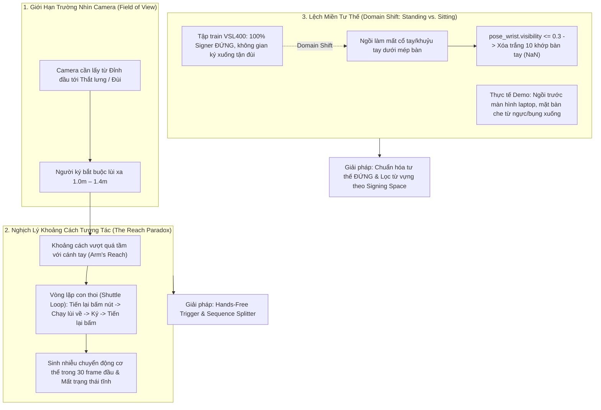
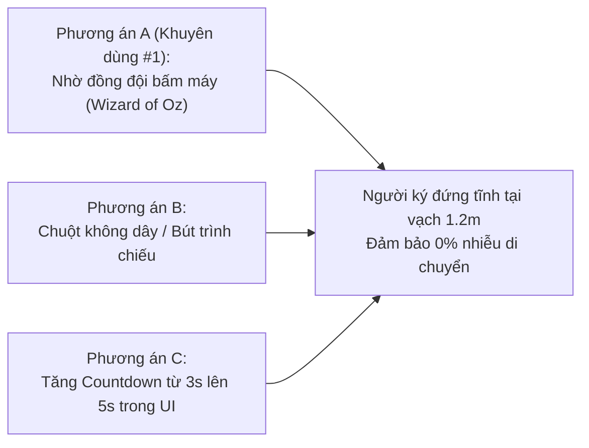

# Kế Hoạch Mô-đun 05: Phân Tích Lệch Miền Tư Thế (Đứng vs. Ngồi), Nghịch Lý Khoảng Cách Tương Tác & Giải Pháp Kích Hoạt Rảnh Tay (Hands-Free Interaction)

## 1. Bản Chất Kỹ Thuật Của Vấn Đề (Problem Formulation)

Trong quá trình triển khai thực nghiệm hệ thống Nhận diện Ngôn ngữ Ký hiệu (SLR Kiosk MVP) trên môi trường thực tế, xuất hiện hai rào cản vật lý và tương tác người - máy (HCI) đồng thời tác động tiêu cực đến chất lượng suy luận và trải nghiệm người dùng:

---

## 2. Phân Tích Lệch Miền Tư Thế: Đứng (Standing) vs. Ngồi (Sitting)

### 2.1. Đặc tính dữ liệu huấn luyện VSL400
- **Tư thế 100% người ký trong dataset**: Toàn bộ video trong tập huấn luyện và tập kiểm toán Test (3,714 clips, 4 người ký độc lập `002, 010, 014, 025`) đều được thu nhận ở tư thế **ĐỨNG (Standing Posture)**.
- **Không gian ký hiệu (Signing Space)**: Trải dài từ đỉnh đầu xuống ngang đùi và mở rộng sang hai bên hông.
- **Các từ có quỹ đạo thấp**: Nhiều lớp từ vựng có giai đoạn tay chuyển động hoặc chạm vào vùng bụng dưới, hông và đùi (ví dụ: `Quần đùi` (idx `270`), `Ba lô` (idx `1`), `Dài` (idx `95`), `Đi` (idx `380`), hoặc các động tác buông tay hồi vị sau khi hoàn tất ký hiệu).

### 2.2. Hậu quả khi người dùng NGỒI trước Laptop
Khi ngồi trước bàn làm việc với camera tích hợp trên màn hình laptop:
1. **Che khuất vật lý (Physical Table Occlusion)**: Mặt bàn cắt ngang tầm bụng hoặc ngực dưới. Khi người ký thực hiện các cử chỉ hạ thấp, bàn tay bị mặt bàn che khuất hoàn toàn.
2. **Kích hoạt cơ chế cách ly lỗi trong bộ trích xuất**:
   - Theo [handedness.py](../deployment/feature_extract/src/extraction/handedness.py#L88-L89) và [slgcn_xy_adapter.py](../deployment/slgcn_feature_trial/vendor/slgcn_xy_adapter.py#L35-L38):
     $$\text{handedness\_valid} = \text{True} \iff (\text{wrist\_vis} > 0.3) \land (\text{wrist\_distance} \le 0.15)$$
   - Khi ngồi, cổ tay và khuỷu tay nằm sát mép dưới khung hình, khiến $\text{wrist\_vis} \le 0.3$, dẫn đến toàn bộ 10 khớp của bàn tay bị gán `NaN` (`missing_after_pct > 50%`).
3. **Biến dạng góc nghiêng camera (Upward Pitch Distortion)**: Màn hình laptop thường ngửa một góc $15^\circ - 25^\circ$, làm phối cảnh camera nhìn từ dưới lên, làm sai lệch tỷ lệ chuẩn hóa $\Delta y / \text{shoulder\_width}$ so với góc quay thẳng ngang ngực trong tập huấn luyện.

### 2.3. Khuyến nghị dứt khoát cho buổi Demo ngày mai

| Kịch bản | Đánh giá kỹ thuật | Yêu cầu bố trí bắt buộc |
| :--- | :--- | :--- |
| **Phương án ƯU TIÊN: ĐỨNG (Standing)** | **Tối ưu 100%** (Loại bỏ triệt để Domain Shift, khớp 100% dữ liệu VSL400). | - Kê cao laptop hoặc đặt camera ngoài ngang tầm ngực ($1.1\text{m} - 1.3\text{m}$ so với mặt sàn). - Người ký đứng cách camera **$1.2\text{m} - 1.4\text{m}$**. - Khung hình lấy từ đỉnh đầu tới ngang xương chậu/đùi trên. |
| **Phương án THAY THẾ: NGỒI (Sitting)** | **Rủi ro cao** (Chỉ dùng khi điều kiện phòng demo bắt buộc phải ngồi). | - **Bắt buộc lùi ghế ra xa bàn** ít nhất $1.0\text{m} - 1.2\text{m}$ để lộ rõ toàn bộ thắt lưng và hai đùi (không để mặt bàn che thân người). - Ghế ngồi không có tay vịn (tránh khuỷu tay chạm tay vịn gây méo dáng). - **Tuyệt đối chỉ chọn từ trong nhóm Platinum/Golden có Signing Space từ ngực lên mặt** (như `Cảm ơn`, `Đồng ý`, `Việt Nam`, `Tham lam`, `Hay (khen)`). Không demo các từ có động tác hạ xuống đùi. |

---

## 3. Nghịch Lý Khoảng Cách Tương Tác & Vòng Lặp Con Thoi (The Interaction-Distance Paradox)

### 3.1. Mô tả xung đột thao tác
- Để thỏa mãn điều kiện trường nhìn ($1.2\text{m} - 1.4\text{m}$), người ký đứng ngoài tầm với của tay tới chuột hoặc bàn phím.
- Khi nhấn nút "Bắt đầu" (Start) trên giao diện Kiosk, hệ thống đếm ngược $3.0\text{ giây}$, sau đó ghi hình $4.0\text{ giây}$.
- Người ký phải:
  $$\text{Chạm nút Laptop} \xrightarrow{\text{chạy lùi } 1.3\text{m}} \text{Vào vị trí đứng} \xrightarrow{\text{ổn định thân người}} \text{Ký hiệu (4s)} \xrightarrow{\text{tiến lại } 1.3\text{m}} \text{Xem kết quả}$$
- **Hệ quả thực nghiệm**:
  1. Trong $3\text{ giây}$ đếm ngược, người ký vừa chạy lùi vừa chỉnh áo/vị trí, làm $20\text{--}30\text{ frames}$ đầu tiên ghi lại chuyển động nhiễu của toàn thân thay vì tư thế chuẩn bị tĩnh.
  2. Tạo cảm giác vội vã, mất tính chuyên nghiệp khi thuyết trình trước hội đồng/giảng viên.

---

## 4. Các Phương Án Giải Quyết Toàn Diện

### 4.1. Giải pháp Tức thì cho buổi Demo Ngày mai (Không làm thay đổi mã nguồn đã đóng băng)

1. **Phương án A — Người hỗ trợ bấm máy (Operator / Wizard of Oz)** *(Khuyên dùng tối đa cho buổi chấm điểm)*:
   - Người ký đứng cố định tại vị trí chuẩn ($1.2\text{m}$ trước camera), hai tay buông nhẹ tự nhiên.
   - Một thành viên khác trong nhóm ngồi cạnh laptop giữ vai trò Kỹ thuật viên (Operator), điều khiển nhấn nút "Bắt đầu" hoặc bấm phím tắt khi người ký đã hoàn toàn sẵn sàng.
   - **Ưu điểm**: Triệt tiêu $100\%$ nhiễu di chuyển bước chân, người ký tập trung $100\%$ vào độ chuẩn xác của ký hiệu.

2. **Phương án B — Điều khiển từ xa bằng Chuột không dây / Bút trình chiếu (Wireless Presenter)**:
   - Sử dụng chuột không dây hoặc bút trình chiếu slide (có nút click chuột trái hoặc phím Space).
   - Người ký cầm thiết bị trong lòng bàn tay trái hoặc túi áo, bấm kích hoạt từ xa khi đã đứng đúng vị trí.

3. **Phương án C — Mở rộng thời gian đếm ngược (Countdown Expansion)**:
   - Trong [demo.html](../desktop_mvp/demo.html), tăng biến đếm ngược từ `3` giây lên `5` giây.
   - Cung cấp đủ $5\text{ giây}$ để người dùng bấm nút, thong thả lùi lại $1.3\text{m}$, hạ tay ổn định trước khi camera bắt đầu thu dữ liệu.

---

### 4.2. Giải pháp Kiến trúc Trung & Dài Hạn (Roadmap Kiosk Tự Động Hóa 100%)

Để xây dựng một trạm dịch Kiosk hoàn chỉnh không cần chạm vào màn hình (Zero-Touch Kiosk), 3 công nghệ sau được tích hợp vào kiến trúc hệ thống:

| Hướng tiếp cận | Cơ chế kỹ thuật | Ưu điểm kiến trúc | Hiện trạng trong codebase |
| :--- | :--- | :--- | :--- |
| **1. Ký chuỗi liên tục & Cắt đoạn tự động (Sequential ISLR via Kinematic Splitting)** | Người dùng đứng yên ở cự ly $1.2\text{m}$ và ký liên tiếp một chuỗi nhiều từ độc lập. Giữa các từ, người ký hạ tay xuống thắt lưng nghỉ $0.5\text{--}1.0\text{s}$. Thuật toán [sequence_splitter.py](../segmentation/sequence_splitter.py) dựa trên $v_t$ và $y_{\text{wrist}}$ tự động phân đoạn video thành $N$ clips con độc lập để suy luận. | - Người dùng không cần bấm nút giữa các từ. - Biến luồng tương tác 1 từ rời rạc thành hội thoại tự nhiên. - Giữ nguyên mô hình SL-GCN 400 lớp đã huấn luyện. | Đã triển khai thuật toán lõi tại [segmentation/boundary_detector.py](../segmentation/boundary_detector.py) và [segmentation/sequence_splitter.py](../segmentation/sequence_splitter.py). |
| **2. Cử chỉ Kích hoạt Rảnh tay (Hands-Free Metasign / Gesture Trigger)** | Sử dụng luồng MediaPipe chạy nền trên webcam. Khi phát hiện cử chỉ điều khiển đặc biệt (ví dụ: Giơ lòng bàn tay mở cao ngang đầu và giữ tĩnh trong $\ge 1.0\text{s}$ — Open Palm Hold), hệ thống phát âm thanh "Beep" và tự động chuyển trạng thái Kiosk từ `IDLE` sang `RECORDING`. | - Không cần phần cứng phụ trợ (chuột, mic, phím). - Tự nhiên và trực quan đối với người câm điếc. - Hoàn toàn rảnh tay ở khoảng cách xa. | Thiết kế thuật toán FSM dựa trên tọa độ khớp cổ tay/ngón tay so với mũi (`nose.y`). |
| **3. Điều khiển bằng Giọng nói (Voice Control / Voice Trigger)** | Tích hợp bộ nhận diện từ khóa giọng nói ngoại tuyến (Offline Keyword Spotting như Vosk hoặc Web Speech API sẵn có trong Chrome). Người đối thoại nói từ khóa ("Bắt đầu", "Dịch") để ra lệnh cho Kiosk. | - Phù hợp cho kịch bản giao tiếp hai chiều: Người nghe nói điều khiển bằng giọng, người khiếm thính trả lời bằng ký hiệu. | Sẵn sàng tích hợp qua giao tiếp WebSocket / REST API tới `demo.py`. |

---

## 5. Quy Trình Chuẩn Bị Cho Buổi Demo Thực Tế Ngày Mai

1. **Vị trí & Góc máy**:
   - Đứng cách camera **$1.2\text{ m} \pm 0.1\text{ m}$**.
   - Camera đặt ngang ngực, vuông góc với người ký (tuyệt đối không để camera laptop ngửa từ dưới lên).
   - Kiểm tra khung hình: Thấy trọn vẹn từ đỉnh đầu tới hông/đùi trên; khi giơ hai tay sang ngang hoặc hạ xuống hông, cổ tay không chạm mép khung hình.
2. **Ánh sáng phòng & Tốc độ khung hình (FPS)**:
   - **Bật đèn sáng trực diện phía trước người ký** (tránh ngược sáng hoặc phòng tối).
   - *Nguyên nhân kỹ thuật*: Khi ánh sáng yếu, webcam tự động kích hoạt phơi sáng dài (Auto-Exposure), làm tốc độ khung hình tụt từ $30\text{ FPS}$ xuống $\approx 15\text{ FPS}$ ($57\text{--}60$ frames/4s). Do pipeline không có cơ chế bù thời gian (No time resampling), cử chỉ bị "tua nhanh" gấp đôi trong không gian tích chập thời gian ($T=150$) của SL-GCN và ngón tay bị nhòe chuyển động (motion blur).
   - *Chỉ số nghiệm thu*: `decoded_frames` trong 4 giây phải đạt **$105\text{--}120$ frames** ($\approx 26\text{--}30\text{ FPS}$).
3. **Hình thức kích hoạt khi Demo**:
   - Áp dụng **Phương án A (Nhờ đồng đội click nút trên laptop)** hoặc **Phương án B (Chuột/Clicker không dây)**.
4. **Danh mục từ vựng ưu tiên biểu diễn**:
   - Ưu tiên 9 từ **Platinum** trong [04_GOLDEN_DEMO_WORDS_AND_CONFUSION_REPORT.md](04_GOLDEN_DEMO_WORDS_AND_CONFUSION_REPORT.md#L39-L50): `Cảm ơn` (`86`), `Đồng ý` (`395`), `Trung Quốc` (`328`), `Tham lam` (`287`), `Hay (khen)` (`128`), `Mềm` (`202`), `Lùn` (`164`), `Cung cấp` (`68`), `Hư` (`137`).
   - Kết hợp 2 từ bàn giao: `Cảm ơn` và `Dài` (`95`).
   - Tuyệt đối không demo các từ trong Blacklist (`Tủ lạnh`, `Thứ ba`, `Thứ tư`, `Bố`, `Bác`, `Nhẹ`).
