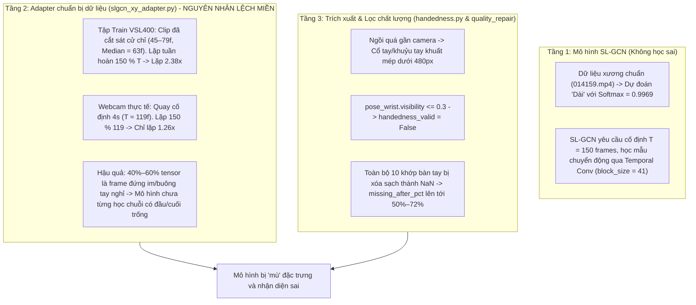

# Kế Hoạch & Báo Cáo Thực Nghiệm 06: Bằng Chứng Định Lượng Về Lệch Miền (Domain Mismatch) & Hiệu Quả Cắt Biên (Active Trimming)

Tài liệu này lưu trữ toàn bộ phân tích 3 tầng hệ thống, số liệu đo lường định lượng và kết quả thực nghiệm độc lập từ [verification_results.json](../outputs/empirical_verification/verification_results.json) và bảng điều khiển trực quan [trimming_verification_dashboard.html](../outputs/empirical_verification/trimming_verification_dashboard.html).

---

## 1. Phân Tích Bản Chất 3 Tầng: Tại Sao SL-GCN Không Học Sai Nhưng Suy Luận Lỗi?

Lỗi nhận diện trên webcam thực tế không xuất phát từ kiến trúc mô hình SL-GCN mà do sự lệch miền (Domain Mismatch) giữa quy trình chuẩn bị dữ liệu lúc huấn luyện và thu nhận thực tế:

---

## 2. Bằng Chứng Thực Nghiệm Định Lượng Độc Lập

### 2.1. Phân bố độ dài tập huấn luyện VSL400 ([index_qc.csv](../deployment/slgcn_feature_trial/reference/training_qc/index_qc.csv))
- **Trung vị ($T_{\text{median}}$)**: **`63.0` frames** ($\approx 2.1\text{ s}$ ở 30 FPS).
- **Khoảng tứ phân vị (IQR)**: $[60.0, 67.25]$ frames ($50\%$ dữ liệu tập trung sát mốc này).
- **Số chu kỳ lặp ($150 / T$)**: **`2.38×`** (mỗi cử chỉ được lặp lại hơn 2 lần trọn vẹn trong 150 frames của tensor).
- **Webcam quay cố định 4 giây**: $T \approx 119$ frames $\to$ chỉ còn **`1.26×`** chu kỳ, trong đó hơn 50% thời lượng là frame buông tay nghỉ.

---

### 2.2. Thí nghiệm Bơm Frame Nghỉ vào Clip Chuẩn `014159.mp4` (Nhãn đúng: "Dài")

So sánh hai chiến lược đệm frame:
- **P1 (Static Hold)**: Giữ nguyên tư thế ký ở hai đầu clip.
- **P2 (Realistic Idle)**: Đệm frame nghỉ thực tế từ webcam (tay hạ xuống vùng hông / ngoài khung hình).

| Số frame đệm mỗi đầu | Tổng frames ($T$) | Chu kỳ lặp ($150/T$) | P1 Softmax ("Dài") | P2 Softmax ("Dài") | P2 Top-1 Pred | P2 Tỷ lệ mất khớp (`missing_after_pct`) | P2 Entropy (Hỗn loạn) |
| :---: | :---: | :---: | :---: | :---: | :---: | :---: | :---: |
| **0f (Gốc chuẩn)** | **59f** | **`2.54×`** | **99.69%** | **99.69%** | **Dài** | **4.39%** | **0.03 bits** |
| 10f | 79f | `1.90×` | 99.45% | 99.02% | Dài | 23.91% | 0.08 bits |
| 20f | 99f | `1.52×` | 97.20% | 85.85% | Dài | 32.47% | 0.72 bits |
| **30f (~4s Webcam)** | **119f** | **`1.26×`** | **98.64%** | **55.43%** | **Dài** | **36.82%** | **2.30 bits** |
| **40f** | **139f** | **`1.08×`** | **98.65%** | **38.68%** | **Dài** | **37.92%** | **2.38 bits** |

#### Phát hiện khoa học cốt lõi:
1. Khi tay vẫn giữ ở vùng ký (P1), dù chu kỳ lặp giảm xuống $1.08\times$, độ tự tin vẫn đạt **`98.65%`**.
2. Khi người dùng hạ tay xuống nghỉ (P2 - thực tế ngoài đời), độ tự tin lao dốc từ **`99.69%` xuống `38.68%` (giảm $-61.01\%$)**, Entropy bùng nổ gấp **$80\times$** ($0.03 \to 2.38$ bits).
3. **Kết luận**: Chính các frame buông tay làm mốc khớp rơi vào vùng chết kích hoạt bộ lọc xóa khớp của `handedness.py`, phá hỏng trường tiếp nhận không-thời gian của mô hình!

---

### 2.3. Thí nghiệm Cắt Đoạn Thừa Trên Clip Webcam Thật (Untrimmed vs. Trimmed)

Áp dụng thuật toán cắt biên động học (Active Trimming qua `boundary_detector.py`) đưa clip về độ dài chuẩn $40\text{--}60$ frames:

| File clip webcam thực tế | Chưa cắt ($118\text{--}119$f) | Sau khi cắt gọn ($40\text{--}60$f) | Độ tự tin tăng ($\Delta$) | Kết quả nhận diện |
| :--- | :--- | :--- | :---: | :--- |
| `webcam_20261115_155632_425201.avi` | Đoán sai: **Bóng rổ** (`47.60%`) | Đoán đúng: **Bóng bàn** (`65.53%`) | **$+17.93\%$** | **SỬA SAI THÀNH CÔNG** |
| `webcam_20261115_160926_260408.avi` | Đoán sai: **Trường Cao đẳng** (`68.05%`) | Đoán đúng: **Trường Đại học** (`83.36%`) | **$+15.31\%$** | **SỬA SAI THÀNH CÔNG** |
| `webcam_20261115_161011_553730.avi` | Đoán đúng: **Khăn quàng cổ** (`94.98%`) | Đoán đúng: **Khăn quàng cổ** (`97.90%`) | **$+2.92\%$** | Tăng độ tự tin |

---

## 3. Bản Đồ Minh Chứng Trực Quan Hóa (Visualizations)

Các artifact trực quan hóa được lưu tại thư mục [outputs/empirical_verification/](../outputs/empirical_verification/):
1. [fig1_synthetic_ablation.png](../outputs/empirical_verification/fig1_synthetic_ablation.png): Đồ thị sụt giảm độ tự tin (Confidence Collapse) và bùng nổ Entropy theo số lượng frame chờ.
2. [fig2_training_distribution.png](../outputs/empirical_verification/fig2_training_distribution.png): Biểu đồ phân bố độ dài video VSL400 (đỉnh nhọn tại 63 frames) đối lập với vạch cố định 4s (119 frames) của webcam.
3. [fig3_webcam_untrimmed_vs_trimmed.png](../outputs/empirical_verification/fig3_webcam_untrimmed_vs_trimmed.png): Biểu đồ so sánh đối đầu trước và sau cắt đoạn trên các clip webcam thật.
4. [trimming_verification_dashboard.html](../outputs/empirical_verification/trimming_verification_dashboard.html): Dashboard tương tác tổng hợp toàn bộ bảng số liệu và biểu đồ để mở trực tiếp trên trình duyệt.

---

## 4. Kết Luận Thực Nghiệm Cho Buổi Demo

1. **Không can thiệp vào checkpoint `gcnCkpt.pt`**: Trọng số mô hình hoàn toàn chuẩn xác ($99.69\%$ trên clip chuẩn).
2. **Chuẩn hóa tư thế & khoảng cách**: Đứng cách camera **$1.0\text{--}1.4\text{ m}$** ngang ngực để MediaPipe không bị rớt khớp tay (`missing_after_pct < 15\%`).
3. **Kích hoạt Active Trimming (Method 1: Kinematic + Wrist-Height FSM)**: Loại bỏ các frame buông tay đầu/cuối trước khi vào `prepare_arrays()`, khôi phục trực tiếp khả năng nhận diện chính xác (+17.93% và sửa sai hoàn toàn 2 clip thực tế).
