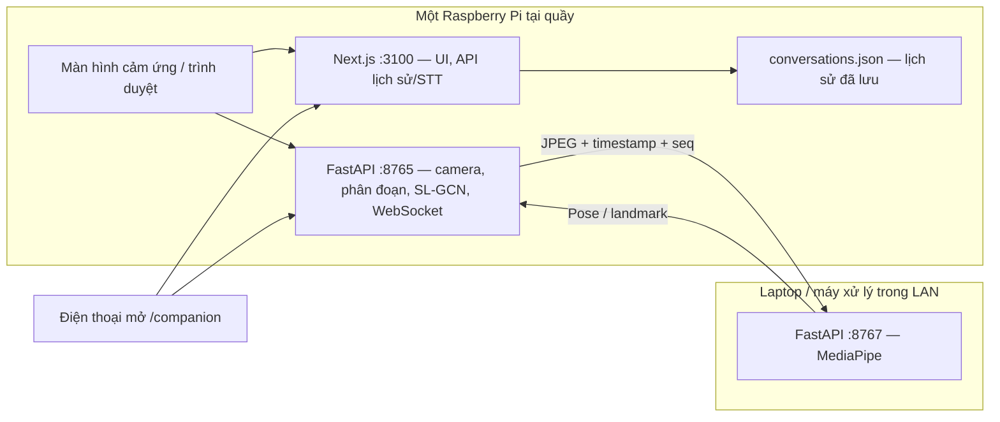

# Khảo sát tài khoản, dữ liệu, dashboard và ghép câu — 22/11/2026

Trạng thái: **đang khảo sát, chưa duyệt thiết kế hoặc triển khai**. Sản phẩm chỉ có **một thiết bị tại quầy** theo xác nhận người dùng. Có nhu cầu quản lý theo tài khoản, database, dashboard, bảo vệ Companion và chức năng chỉnh chuỗi từ thành câu hoàn chỉnh. Không suy ra nhu cầu quản lý nhiều thiết bị từ nhu cầu nhiều tài khoản. Cập nhật: người dùng đã giao việc đề xuất phương án thực tế, yêu cầu phản biện mọi thuật ngữ/giả thuyết và đi từng bước. Bước quyết định đầu tiên nằm trong [10_PIPELINE_DATA_AND_PRODUCT_DESIGN.md](10_PIPELINE_DATA_AND_PRODUCT_DESIGN.md); chưa chốt số backend, nơi đặt database hoặc engine DB.

## Phạm vi lần thiết kế

- Đầu vào: yêu cầu người dùng; mã hiện tại trên `perf/streaming-onnx`, HEAD `cd6d0917`; các quyết định đã có trong `docs/PBL6_DECISION_AND_ARCHITECTURE.md`.
- Đầu ra dự kiến: bản đồ vai trò/quyền, kiến trúc dữ liệu và truy cập, vòng đời dữ liệu, luồng ghép câu, wireframe các màn hình liên quan, lộ trình thực hiện có điểm duyệt.
- File được phép ghi ở khâu này: tài liệu khảo sát này; brief/thiết kế và prototype tách khỏi runtime khi đã rõ yêu cầu. Chưa sửa mã sản phẩm, schema dữ liệu thực, triển khai Pi, trọng số hoặc ngưỡng.
- Kiểm chứng hiện tại: đọc mã và đối chiếu tài liệu chính thức; `git diff --check -- slr-app/MVP/plans/09_PRODUCT_ACCOUNTS_DATA_AND_DASHBOARD_DISCOVERY.md`. Chưa chạy thử tấn công, xác thực hoặc kiểm thử database vì các chức năng mới chưa triển khai.

## 1. Kiến trúc đã xác minh từ mã

Điện thoại không phải backend thứ ba. `/companion` là một route của Web App trên Pi; phía trình duyệt còn kết nối WebSocket/API tới SLR theo URL cấu hình. Đăng nhập ở trang Web App trong tương lai sẽ không tự bảo vệ các cổng SLR/Vision nếu chúng vẫn truy cập trực tiếp.

## 2. Bằng chứng cục bộ

| Nội dung | Nguồn | Kết luận trong phạm vi đã đọc |
|---|---|---|
| Lưu hội thoại | `stt-app/src/server/storage.ts:21,64,89` | Đã có lưu bền bằng `conversations.json`, ghi file tạm rồi rename; chưa phải database quan hệ. Có hội thoại, tin nhắn và metadata ký hiệu. Không phải chưa có lưu dữ liệu. |
| Truy cập Web App | `stt-app/src/server/http.ts:39,59`; `handlers.ts` | Có kiểm tra Host/Origin và giới hạn loopback/LAN tùy endpoint. Chưa phải đăng nhập hoặc phân quyền theo tài khoản. |
| Companion | `stt-app/app/companion/page.tsx` | Đọc lịch sử, nhận live qua WebSocket, điều khiển phiên ký và chọn ứng viên qua SLR client. Không thể coi toàn bộ Companion là chỉ xem. |
| SLR API | `slr-m2/deployment/m2/server.py:259,297,301,325,339,344,354,372` | Cho phép CORS mọi origin; các route trạng thái, điều khiển phiên, chọn ứng viên, video và WebSocket chưa có cơ chế tài khoản/phân quyền trong mã đã đọc. Không kết luận rằng dịch vụ đã bị truy cập trái phép. |
| Vision API | `slr-m2/deployment/m2/vision_backend.py:create_vision_app` | Cho phép CORS mọi origin; cần xét xác thực riêng giữa Pi và backend. CORS không phải cơ chế xác thực thiết bị. |
| Ghép câu | `slr-m2/deployment/m2/pipeline.py:892`; `stt-app/src/lib/slrClient.ts:37` | Có trường `raw_glosses`, `revised_glosses`, `vietnamese_sentence`; hai trường sau hiện được gán `None` khi chốt lượt. Chưa có bằng chứng chức năng LLM ghép câu đã hoạt động. |

## 3. Những quyết định cần làm rõ

1. Tài khoản thuộc admin/nhân viên quầy, người sử dụng cá nhân, hay cả hai? Ai sở hữu lịch sử hội thoại trên thiết bị dùng chung?
2. Điện thoại chỉ truy cập cùng LAN hay cần truy cập từ Internet? Việc này ảnh hưởng chỗ đặt API/database và cách truy cập an toàn.
3. Người dùng sẽ cung cấp các ý tưởng ghép câu cần kiểm chứng. Chưa chọn nhà cung cấp LLM, cách xác nhận câu, quyền sửa, tự động lưu/phát âm hoặc gửi nội dung ra dịch vụ ngoài.
4. Kế hoạch cũ chọn ThingsBoard telemetry tối giản. Yêu cầu dashboard/quản lý dữ liệu mới cần được đối chiếu với lựa chọn đó; chưa coi việc tự xây dashboard nghiệp vụ là quyết định đã duyệt.

## 4. Các lớp dữ liệu cần phân biệt khi thiết kế

| Lớp | Ví dụ cần xét | Câu hỏi thiết kế |
|---|---|---|
| Tài khoản và truy cập | account, role, login session, phiên Companion được cấp quyền | Ai đăng nhập, cấp quyền và thu hồi ở đâu? Một phiên đăng nhập khác một phiên giao tiếp/phiên ký. |
| Nội dung giao tiếp | hội thoại, tin nhắn STT/gõ, lượt ký, từ gốc, người xác nhận ứng viên | Ai được xem/sửa/xóa? Xóa có bao gồm bản sao lưu và nội dung đã đồng bộ không? |
| Ghép câu | đầu vào gốc, câu AI gợi ý, câu người dùng xác nhận, lần sửa, trạng thái lỗi | Giữ nguồn gốc và phân biệt gợi ý với câu được chấp nhận; không gán câu AI là ý người ký đã xác nhận. |
| Vận hành | heartbeat, độ trễ, hàng đợi, lỗi, phiên bản | Không mặc định gửi nội dung hội thoại, hình ảnh hoặc âm thanh trong telemetry. Cần định nghĩa mẫu số trước khi báo tỷ lệ; confidence không phải accuracy. |
| Quản trị | cài đặt thiết bị duy nhất, nhật ký thao tác, chính sách giữ/xóa, bản sao lưu | Không tạo màn hình fleet hoặc CRUD hàng loạt thiết bị nếu không có yêu cầu. Không lưu secret trong dữ liệu demo/báo cáo. |

Các lớp trên là phạm vi khám phá, chưa phải schema đã chốt. Chưa chọn SQLite hay database trên server; cần quyết định nơi sở hữu dữ liệu và đường ghi dữ liệu trước.

## 5. Nguồn kỹ thuật đã đối chiếu

Ngày truy cập: 22/11/2026.

- SQLite, *Appropriate Uses For SQLite*: https://www.sqlite.org/whentouse.html — đối chiếu lưu trữ cục bộ cho ứng dụng/thiết bị với nhu cầu kho dữ liệu client/server. Chưa có benchmark hay quyết định chọn engine cho dự án.
- OWASP, *WebSocket Security Cheat Sheet*: https://cheatsheetseries.owasp.org/cheatsheets/WebSocket_Security_Cheat_Sheet.html — dùng khi thiết kế xác thực kết nối, kiểm tra Origin, phân quyền thông điệp và thu hồi phiên. Chưa thực hiện security audit đầy đủ.
- ThingsBoard CE, *Time-Series Data*: https://thingsboard.io/docs/user-guide/digital-twins/time-series-data/ — xem phạm vi telemetry theo thời gian.
- ThingsBoard CE, *Users*: https://thingsboard.io/docs/user-guide/users/ — tham khảo mô hình tài khoản của nền tảng; không suy ra một tài khoản ThingsBoard tự là tài khoản ứng dụng giao tiếp PBL6.

## 6. Công cụ và giới hạn thực tế

- Pencil `read_skill` và `get_app_state` đều lỗi kết nối desktop (`transport not connected to app: desktop`). Chưa tạo wireframe hoặc file `.pen`.
- Session agy cũ `211bf183-3096-4403-b82b-b3971b3701f5` đã được tìm thấy trong kho Antigravity nhưng CLI trước đó báo `trajectory not found`. Đang hỏi người dùng về việc tạo phiên agy riêng cho công việc thiết kế này theo ràng buộc dùng đúng session trước đây. Chưa chạy nghiên cứu/swarm; không gán kết quả khảo sát này cho agy.
- Đã gửi câu hỏi về đối tượng tài khoản, phạm vi mạng và ý tưởng ghép câu. Chưa có trả lời tại lúc lập khảo sát; chưa viết PRODUCT.md hoặc chốt thiết kế.
