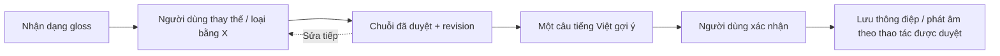

# Thiết kế pipeline và sản phẩm — Bước 1: gloss → câu

Trạng thái: **bản đề xuất để người dùng chọn, chưa triển khai**. Ngày 22/11/2026.

### Quyết định giao diện đã duyệt — 23/11/2026

- Người dùng trả lời “Accept” cho câu hỏi về vị trí câu kết quả ở màn 14: câu nằm trong vùng hội thoại phía trên, camera tiếp tục chạy ở bên trái.
- Wireframe đề xuất nằm ở màn 12–15 trong `reports/ui_ux_20261107/assets/wireframe-hoi-thoai-1024x600.pen`; màn 13 minh họa trạng thái tạo câu trong vùng ký, màn 14 minh họa câu kết quả trong hội thoại. Giữ nguyên màn 01–11 và bỏ qua ba ô thông số OS trong ảnh thực tế.
- Duyệt vị trí hiển thị không đồng nghĩa duyệt triển khai LLM, tự gửi khi còn gloss chưa rõ, ngưỡng nghỉ mới hoặc thay đổi code. Ngày 23/11/2026, người dùng chọn A cho trường hợp hết thời gian nghỉ vẫn còn gloss chưa rõ, như mục 3. Ngưỡng nghỉ và các hành vi khác chưa được duyệt.

Người dùng muốn đi từng bước, được phản biện và có lựa chọn dễ hiểu. Các từ như “backend trung tâm”, “vision backend”, “agent”, “database” là gợi ý để khảo sát, không tự trở thành quyết định kiến trúc. Một thiết bị không tự quyết định số dịch vụ hay loại database. Không có số đo mới chứng minh kiến trúc nào “tối ưu nhất”.

## Phạm vi bước này

- Đầu vào: hành vi sửa/xóa gloss hiện tại và ý tưởng người dùng vừa nêu.
- Đầu ra: trước tiên chốt việc **kết thúc lượt ký có đồng nghĩa với gửi thông điệp hay không**, rồi mới hỏi thời điểm tạo một câu gợi ý. Phân biệt bốn loại dữ liệu trong luồng.
- File được phép sửa ở bước thiết kế: file này và `09_PRODUCT_ACCOUNTS_DATA_AND_DASHBOARD_DISCOVERY.md`. Không sửa runtime, checkpoint, ngưỡng, dữ liệu thật hoặc triển khai Pi.
- Kiểm tra tài liệu: `git diff --check -- slr-app/MVP/plans/10_PIPELINE_DATA_AND_PRODUCT_DESIGN.md slr-app/MVP/plans/09_PRODUCT_ACCOUNTS_DATA_AND_DASHBOARD_DISCOVERY.md`.
- Nguồn code đã đọc; chưa chạy thử nhận dạng, gọi LLM, benchmark, huấn luyện hoặc đánh giá các repository bên ngoài.

## 1. Các khái niệm cần phân biệt

| Loại dữ liệu | Ý nghĩa | Có được âm thầm ghi đè không? |
|---|---|---|
| Kết quả nhận dạng gốc | Gloss/Top 3 ban đầu từ model, kèm thứ tự và ID | Không; giữ riêng trong phạm vi dữ liệu được phép lưu. Việc xóa dữ liệu hội thoại thực sự là thao tác riêng. |
| Chuỗi gloss đã duyệt | Áp dụng lựa chọn thay thế và những gloss bị loại bằng X | Thay đổi có revision và được đồng bộ; đây mới là đầu vào tạo câu. |
| Câu gợi ý | Một cách diễn đạt tiếng Việt từ đúng revision đã duyệt | Chưa phải lời người ký đã xác nhận; sửa gloss phải vô hiệu hóa câu cũ. |
| Thông điệp được chấp nhận | Câu người dùng đồng ý sử dụng; có thể có sửa cách diễn đạt | Phải liên kết được với chuỗi nguồn; không làm thay đổi ngược kết quả nhận dạng. |

“Sửa thủ công câu” nghĩa là gõ sửa cả câu tiếng Việt được đề xuất, khác chọn Top 3 hoặc X để sửa chuỗi gloss. Hiện chưa chốt phải thêm trình sửa cả câu. MVP không cần mặc định cho chọn nhiều câu gợi ý; khi thông tin không đủ, cần báo chưa rõ/hỏi bổ sung thay vì ép ra một câu chắc chắn.

## 2. Luồng đề xuất

Đây là luồng chức năng đề xuất, không phải sơ đồ phân chia máy chủ. Tác vụ tạo câu không được chặn luồng camera/nhận dạng. Không đồng nhất REST 4 giây chốt lượt với việc người dùng đã duyệt đúng toàn bộ gloss.

### Đối chiếu mốc 4 giây với hành vi hiện tại

- `pipeline.py:90–112,412–420`: M2 tích lũy 4 giây REST quan sát được, rồi đưa `utterance_end` vào hàng đợi. Đây không phải bộ đếm dành riêng cho việc chỉnh sửa. Mất dấu/timestamp và tay active ảnh hưởng bộ đếm theo mã hiện tại.
- `pipeline.py:879–898,955–956`: sau khi các segment trước đó được xử lý trong FIFO, worker đánh dấu lượt đã chốt rồi phát `utterance_ready`. Do đó không bảo đảm sự kiện tới giao diện đúng sau 4 giây thời gian thực.
- `slrSettings.ts:9–14,51–53`: `autoSaveOnRest` mặc định `true`, nhưng giá trị từng trình duyệt có thể được lưu khác trong localStorage. Chưa đọc cài đặt trình duyệt đang chạy trên Pi trong lượt khảo sát này.
- `page.tsx:355–370`: khi tự lưu bật, nhận `utterance_ready` sẽ lấy các segment chưa đánh dấu, loại khỏi vùng chỉnh và xếp tác vụ lưu tin nhắn vào hội thoại. Không có điều kiện chờ mọi gloss chưa rõ được xác nhận.
- `page.tsx:458–460` và `pipeline.py:220–221`: khi tự lưu bật, yêu cầu chọn ứng viên không cho sửa lượt đã chốt. Có thể phát sinh tranh chấp giữa thao tác chọn và thời điểm server chốt lượt.
- Lưu dữ liệu là tác vụ bất đồng bộ, không phải lời bảo đảm ghi thành công ngay khi giao diện xóa vùng chỉnh. Chưa có LLM tạo câu hoạt động trong luồng này.

Kết luận: có rủi ro người dùng chưa sửa/xóa xong thì lượt đã được tự chuyển vào hội thoại; chưa có phép thử người dùng để kết luận mọi người đều không kịp trong mọi trường hợp. Câu hỏi cũ chỉ hỏi lúc gọi LLM đã bỏ sót điểm này.

## 3. Quyết định giữ lượt còn gloss chưa rõ — 23/11/2026

Câu hỏi được trả lời trong chat: **hết thời gian nghỉ nhưng vẫn còn gloss chưa rõ thì làm gì?**

- [x] **A — Giữ lại để chỉnh, chưa tự gửi.** Người dùng đã chọn A.
- [ ] **B — Vẫn tạo câu và tự gửi, sau đó mới chỉnh.** Không chọn.

Quyết định áp dụng cho trường hợp còn gloss chưa rõ: hết thời gian nghỉ không được tự chuyển lượt đó thành thông điệp hoặc tự đọc thông điệp cho người đối diện. Giữ các gloss và quyền thay thế/xóa để người dùng tiếp tục chỉnh. Không diễn giải quyết định này thành duyệt thay ngưỡng nghỉ hoặc duyệt triển khai runtime.

**Đã duyệt tiếp — 23/11/2026:** sau khi chỉnh hết gloss chưa rõ, người dùng bấm **“Kết thúc câu”** để tiếp tục. Người dùng chọn A, không tự tiếp tục chỉ vì đã hết nhãn chưa rõ. Nút này tiếp tục xử lý lượt đang chỉnh; không đồng nghĩa dừng camera hoặc kết thúc toàn phiên.

Luồng đã chốt cho trường hợp này: hết thời gian nghỉ → còn gloss chưa rõ → giữ lượt để chỉnh/thay thế/xóa → người dùng bấm “Kết thúc câu” → tiếp tục xử lý câu. Vị trí câu kết quả trong hội thoại đã được duyệt; cơ chế xác nhận câu do LLM tạo ra chưa được quyết định ở lựa chọn này.

**Còn cần chọn:** hành vi với lượt vốn không có gloss chưa rõ; cách nhận lượt mới khi đang chỉnh. Xử lý bản nháp khi kết thúc phiên đã được chốt ở mục màn 20–21 bên dưới. Câu hỏi A/B cũ áp dụng cho mọi lượt đã được thay bằng các quyết định có điều kiện trên; không coi người dùng đã chọn duyệt thủ công mọi lượt. Chưa duyệt triển khai runtime hoặc thay ngưỡng nghỉ.

### Wireframe bổ sung cho các quyết định trên

- Màn 16: hết giờ nghỉ, còn gloss chưa rõ; giữ camera, gloss, X và Top 3. Trạng thái “CHỜ CHỈNH · CHƯA GỬI”. Trong bản vẽ, nút “Kết thúc câu” chưa khả dụng khi vẫn còn gloss cần xác nhận; đây là chi tiết giao diện đề xuất, chưa triển khai.
- Màn 17: đã chỉnh xong, vẫn chờ người dùng bấm “Kết thúc câu”. Không tự tiếp tục chỉ vì chọn xong gợi ý.
- Luồng minh họa: màn 16 → 17 → 13 (xử lý câu) → 14 (câu kết quả trong hội thoại). Màn 01–15 được giữ nguyên trong lượt bổ sung này. Đã kiểm tra hình hiển thị và lưu file Pencil; không xuất PDF, không sửa runtime.
- Cơ chế tự kết thúc theo thời gian và nút “Kết thúc câu” có thể cùng tồn tại, không phải hai lựa chọn loại trừ nhau. Phần phối hợp dành cho lượt không có gloss chưa rõ vẫn là đề xuất, không suy diễn các lời đồng ý về cách trao đổi thành duyệt hành vi này.

### Màn 18 — bước kiểm tra câu gợi ý đã được duyệt

Người dùng phản hồi “OK” trực tiếp cho câu hỏi về bước kiểm tra câu tại quầy. Ghi nhận duyệt bước xem/sửa câu trước khi gửi; chưa triển khai runtime. Chi tiết trình sửa khi bàn phím mở và câu dài còn cần thiết kế.

- Giữ camera và hội thoại ở vị trí hiện tại. Chuỗi gloss nguồn hiển thị ở trên; ô câu tiếng Việt gợi ý có biểu tượng sửa ở dưới. Chạm ô câu là thao tác sửa cả câu, khác sửa từng gloss.
- “Sửa gloss” quay lại chỉnh chuỗi nguồn; thao tác thay/xóa gloss làm câu gợi ý cũ mất hiệu lực. Không âm thầm dùng câu tạo từ chuỗi cũ. “Gửi câu” xác nhận câu hiện tại để đưa vào hội thoại ở màn 14. Nếu bật loa tự động, chỉ đọc sau thao tác gửi; không tự đọc bản gợi ý.
- Luồng có bước kiểm tra câu đã duyệt: 16 → 17 → 13 → **18 (kiểm tra/sửa câu)** → 14. Không tự gửi đầu ra LLM trước thao tác “Gửi câu”.
- Ví dụ “Bố / Đi / Bệnh viện” và “Bố đi bệnh viện.” chỉ minh họa giao diện, không phải bằng chứng chất lượng dịch. Chưa triển khai LLM, trình sửa câu, bàn phím cho màn này hoặc hành vi runtime. Câu dài, bàn phím mở và lỗi tạo câu còn cần thiết kế.
- Đã kiểm tra ảnh màn 18 và lưu vào file Pencil hiện có. Không sửa các màn 01–17 trong bước này.

### Đối chiếu bộ chọn gloss chưa rõ với code

Đã đọc lại `stt-app/src/components/LiveSigningCard.tsx`, phần `LiveGlossPicker`, sau khi người dùng chỉ ra khác biệt. Code dùng gloss cam dạng nút chọn, có viền/ring cho từ đang được chỉnh; gợi ý nằm trong khung cam và có “Bỏ từ này”. Dấu X nằm trên gloss rõ, không nằm trên gloss chưa rõ. Khi không có từ được chọn còn hợp lệ, code tập trung vào gloss chưa rõ cuối cùng, không mặc định từ đầu tiên. Các nút Top 3 và token có thể xuống dòng.

Pencil màn 12/16 trước lượt cập nhật bộ chọn đã đơn giản hóa thành dòng gợi ý không có khung, thêm X trên gloss chưa rõ và chưa thể hiện rõ trạng thái từ đang chọn. Đây là khác biệt thiết kế, không phải bằng chứng code sai. Người dùng yêu cầu không mặc định code là đúng: cả code và bản vẽ đều có thể thay đổi theo thiết kế tốt hơn.

### Bộ chọn gloss đã chốt và cập nhật trong Pencil

Người dùng đồng ý với đề xuất: từ chưa rõ màu cam, từ đang chỉnh có viền nổi bật; chạm từ để chọn bảng gợi ý; giữ nguyên từ đang chỉnh khi có kết quả mới; có “Bỏ từ này”; chọn/bỏ xong chuyển đến từ chưa rõ tiếp theo theo thứ tự câu. Khi hết từ chưa rõ vẫn chờ “Kết thúc câu”. Không tự chuyển bảng gợi ý sang kết quả mới nhất như nhánh fallback hiện có trong code.

- Đã cập nhật màn 12 và 16: viền đậm cho gloss đang chọn, bảng “Đang chỉnh: Đi”, ba gợi ý và nút “Bỏ từ này” cùng hàng. Các nút gợi ý và bỏ từ cao 44 px. Gloss chưa rõ không còn X riêng.
- Đã thêm màn 19 với hai gloss chưa rõ để phân biệt từ đang chỉnh với từ còn chờ. Bản vẽ tĩnh chưa kiểm chứng được hành vi giữ focus hoặc tự chuyển từ; đây là yêu cầu cho triển khai và kiểm thử sau.
- Giữ nguyên camera, điều khiển kết thúc phiên và composer. Trong màn chỉnh gloss, giảm chiều cao thẻ tin nhắn minh họa từ 84 xuống 48 px để dành chỗ cho bảng gợi ý, tổng kích thước vẫn 1024×600. Cần kiểm tra thêm với nhiều tin nhắn, từ dài và gloss xuống dòng; chưa kết luận bố cục phù hợp mọi dữ liệu.
- Đã xem ảnh màn 16 và 19, lưu file Pencil. Không sửa code app, không thay ngưỡng, không commit hoặc deploy.

### Màn 20–21 — kết thúc phiên ký và xử lý bản nháp đã được duyệt

Người dùng trả lời “OK” sau khi làm rõ: một phiên ký có nhiều câu; “Kết thúc câu” không dừng camera; “Kết thúc phiên ký” dừng camera nhưng hội thoại vẫn còn. Màn 20 là trạng thái chuyển tiếp khi còn bản nháp. Chỉ về màn 15 khi không còn bản nháp cần xử lý.

- Khi bấm “Kết thúc ký” lúc còn lượt chưa gửi: dừng camera, không tự gửi hoặc xóa bản nháp. Giữ quyền chỉnh gloss rồi kết thúc câu, kiểm tra câu và gửi theo luồng đã duyệt. Nếu đã có câu gợi ý thì giữ để kiểm tra, không tự phát âm.
- Màn 20 minh họa trạng thái ổn định sau khi dừng: vùng camera báo “Camera đã dừng / Không ghi hình”; thẻ gloss báo “BẢN NHÁP · CHƯA GỬI”. Giữ vị trí các vùng để người dùng không mất chỗ đang chỉnh. Hai điều khiển dừng chuyển thành chỉ báo trạng thái, không phải nút dừng còn hoạt động.
- Vòng đời bản nháp trên đã được người dùng duyệt; chưa sửa code. Nhận dạng còn đang xử lý phải được đánh dấu đang chờ và kết hợp kết quả theo ID/revision, không tự gửi hoặc ghi đè phần đã chỉnh. Màn này chưa minh họa giai đoạn chờ kết quả đó.
- Việc bắt đầu ký lại khi còn bản nháp, bỏ toàn bộ bản nháp và độ bền qua tải lại/mất kết nối còn cần thiết kế; không suy ra đã hỗ trợ lưu bền chỉ từ nhãn “bản nháp”.
- Đã kiểm tra ảnh màn 20 và lưu vào file Pencil hiện có, giữ nguyên màn 01–19 trong lượt bổ sung này.

Lượt cập nhật sau khi duyệt:

- Thống nhất nhãn “Kết thúc phiên ký” ở header và dưới camera trên các màn phiên còn hoạt động. Màn 15 đổi tên thành trạng thái đã kết thúc phiên, không còn bản nháp; vẫn có “Bắt đầu ký” để mở phiên mới trong hội thoại.
- Màn 20 thêm “Bỏ bản nháp”, khác “Bỏ từ này” chỉ xóa một gloss. Không tự bỏ hoặc gửi chỉ vì camera dừng. Bỏ bản nháp không xóa các thông điệp đã gửi.
- Thêm màn 21: camera đã dừng nhưng vẫn có thể kiểm tra/sửa câu, quay lại sửa gloss hoặc “Gửi câu”. Luồng từ màn 20: chỉnh xong → Kết thúc câu → tạo câu → màn 21 → Gửi câu → màn 15 khi không còn nháp. Bỏ bản nháp ở màn 20 hoặc 21 cũng về màn 15 khi không còn nháp.
- Đã kiểm tra ảnh màn 20, 21 và 15, lưu file Pencil. Không sửa code, không commit hoặc deploy. Khả năng lưu bền qua tải lại và bắt đầu ký lại trong lúc còn nháp vẫn chưa được triển khai hoặc chốt chi tiết.

### Màn 22 — bố cục sửa câu khi bàn phím mở đã được duyệt

- Người dùng trả lời “OK” sau khi xem mô tả màn 22, ghi nhận duyệt bố cục: header cao 64 px, vùng camera và sửa câu 278 px, bàn phím minh họa 258 px; tổng 600 px. Tái sử dụng hình bàn phím từ màn 03 để giữ nhất quán, không coi đây là lựa chọn công nghệ bàn phím hoặc duyệt triển khai app.
- Camera thu gọn bên trái, vẫn giữ nút “Kết thúc phiên ký”. Bên phải giữ chuỗi gloss nguồn, ô sửa câu cao 80 px và các nút “Sửa gloss”, “Gửi câu” cao 44 px. Bàn phím không che ô sửa hoặc nút gửi trong bản vẽ.
- Trong trạng thái sửa câu này, tạm ẩn vùng lịch sử tin nhắn và composer thường; không xóa dữ liệu. Bàn phím nhập vào câu gợi ý đang sửa, không nhập vào tin nhắn STT bên dưới. “Ẩn” đóng bàn phím, giữ nội dung đang sửa và khôi phục bố cục màn 18; không tự gửi. “Gửi câu” lấy nội dung đang sửa để xác nhận gửi theo luồng đã duyệt.
- Nội dung gõ sửa câu tách khỏi chuỗi gloss nguồn. Quay lại sửa gloss rồi thay đổi nguồn phải vô hiệu hóa câu gợi ý cũ, không âm thầm dùng lại câu đã mất liên kết revision.
- Đã xem ảnh và kiểm tra kích thước các vùng bằng Pencil, lưu file; giữ nguyên màn 01–21. Chưa sửa runtime, chưa kiểm thử bàn phím OS/Pi, nhập tiếng Việt, câu dài/cuộn văn bản hoặc hành vi focus thật. Chưa kết luận đã giải quyết lỗi bàn phím trên thiết bị thực tế.

### Đối chiếu bố cục dọc và màu cam từ remote

Người dùng lưu ý code pull đã hỗ trợ màn xoay Right thành dọc, và từ chưa rõ dùng màu cam. Đã đọc trực tiếp `Header.tsx`, `SlrDock.tsx`, `LiveSigningCard.tsx` ở commit `cd6d0917`: header hai hàng trên màn hẹp, dock camera toàn chiều ngang ở chế độ dọc; chỉ chuyển thành sidebar 340 px ở `min-[900px]:landscape`. Không ghi nhận đây là tính năng mới do lượt thiết kế này tạo ra.

- Gloss chưa rõ trong code dùng `bg-orange-100`, `text-orange-900`, `border-orange-300`; từ đang chọn dùng `orange-700` và ring `orange-300`. Bảng gợi ý dùng `orange-50`. Không gọi trạng thái này là màu vàng.
- Đã lấy giá trị màu từ Tailwind đang cài và chuyển sang sRGB bằng Chromium: orange-50 `#FFF7ED`, orange-100 `#FFEDD4`, orange-300 `#FFB86A`, orange-700 `#CA3500`, orange-900 `#7E2A0C`.
- Đã sửa màu gloss/bảng gợi ý trên màn 12, 16, 19, 20 trong Pencil, thay bảng màu vàng nâu trước đó. Trạng thái Chưa bật của phần quản trị AI là trạng thái khác, không dùng làm căn cứ màu gloss.
- Thêm màn 24: đề xuất cùng luồng chờ chỉnh ở 600×1024, camera toàn chiều ngang phía trên, header hai hàng, hội thoại/thẻ ký/composer phía dưới. Giữ các quyết định thao tác đã chốt. Đây là bản vẽ bổ sung cho luồng mới, không tuyên bố sao chép chính xác mọi kích thước DOM hiện tại.
- Đã xem ảnh màn ngang và dọc, kiểm tra kích thước và lưu Pencil. Không sửa thêm runtime trong lượt đối chiếu này. Các thay đổi code thử đang giữ các quy tắc responsive trên, nhưng chưa có kiểm thử UI đầy đủ hoặc thử lại xoay Right trên Pi cho bản thử mới.

## 4. Hai điều kiện phải giải quyết trước khi nối LLM

1. `slr-m2/deployment/m2/pipeline.py:892` tạo `raw_glosses` từ Top 1 gốc. Lựa chọn Top 3 mới nằm trong `segments[*].selected_candidate`. Không truyền `raw_glosses` thẳng vào LLM như thể đó là chuỗi đã duyệt.
2. `stt-app/app/page.tsx:474` xử lý X bằng cách loại khỏi giao diện và đánh dấu ID trong bộ nhớ trang. Việc lưu hiện tại trên trang có lọc ID đó, nhưng server/Companion chưa có trạng thái loại gloss dùng chung; tải lại một phiên đang chạy có thể hiện lại gloss. Cần trạng thái được lưu/đồng bộ và revision trước khi coi X là sửa đầu vào chung.

Đây là kết luận đọc mã, chưa sửa lỗi. `storage.ts:160` còn yêu cầu text của tin ký hiệu bằng các nhãn gloss nối lại; không thể thay trường này bằng câu AI mà không thiết kế lại hợp đồng dữ liệu.

## 5. Trả lời các giả thuyết về LLM để làm căn cứ

- VSL không phải tiếng Việt viết bằng tay. Tuy nhiên nếu đầu ra sản phẩm là câu tiếng Việt thì đầu ra dùng ngữ pháp tiếng Việt là phù hợp với nhiệm vụ dịch; tiêu chí là giữ nghĩa, không giữ nguyên thứ tự gloss. Chưa khẳng định ngữ pháp VSL cụ thể hoặc một thứ tự từ áp dụng cho mọi người ký.
- Gloss là nhãn trung gian, không chứa mọi thông tin nét mặt, không gian, ngữ cảnh. Ngay cả từng nhãn đúng vẫn có thể thiếu dữ kiện để suy ra duy nhất một thông điệp. “Giữ nguyên ý” là mục tiêu phải kiểm chứng, không phải lời hứa từ system prompt.
- Đầu vào cần trung thành với thông điệp, không cần được sửa thành ngữ pháp tiếng Việt trước. Không tự loại lặp, đảo thứ tự, bỏ phủ định/số lượng hoặc đổi nhãn để câu nghe hay hơn.
- Agent/tools không tự giải quyết được dữ kiện bị mất. Bước đầu có thể dùng một lời gọi LLM có kiểm tra đầu ra; chỉ thêm tool tra cứu từ điển/ví dụ khi chứng minh có ích. Không đưa agent tự chủ vào đường xử lý frame.
- Danh mục 400 gloss hữu ích để giải nghĩa ID/nhãn và kiểm tra từ hợp lệ. Không cần mặc định gửi toàn bộ video/dữ liệu huấn luyện cho LLM. Những mục và ví dụ liên quan đã được người hiểu VSL thẩm định có thể hữu ích hơn chỉ gửi danh sách 400 tên. Bộ từ đơn lẻ không thay thế corpus cặp chuỗi gloss–câu.
- Cần kiểm chứng bằng cặp đầu vào–ý muốn biểu đạt do người ký xác nhận, gồm trường hợp sạch, thiếu/sai gloss, phủ định, số lượng và câu mơ hồ. Độ trôi chảy không phải bằng chứng dịch đúng. Không gán confidence của classifier thành độ chắc chắn bản dịch.

## 6. Nguồn đã tìm thấy — chưa chạy hoặc chứng minh tương thích

Tra cứu ngày 22/11/2026. Không tuyên bố đã tìm hết mọi engine.

| Nguồn chính | Điều đã xác minh | Giới hạn |
|---|---|---|
| [Gloss2Text — bài EMNLP 2024](https://aclanthology.org/2024.findings-emnlp.947/) và [code tác giả](https://github.com/pooyafayyaz/Gloss2Text) | Có nghiên cứu/code LLM cho gloss → text | Thử trên PHOENIX-2014T tiếng Đức; không phải model VSL400 tiếng Việt dùng ngay. |
| [Parallel-Corpus-Vie-VSL](https://github.com/BichDiep/Parallel-Corpus-Vie-VSL) | Có corpus tiếng Việt/VSL-text và từ điển. Đã đọc thử `VSL10k.txt`, `Vie10k.txt`. | Chưa audit nguồn nhãn, giấy phép sử dụng lại, chất lượng cặp, chuẩn hóa và độ phủ 400 gloss. Corpus không phải engine phục vụ suy luận đã sẵn sàng. |
| [v-sign](https://github.com/martinvalentine/v-sign) | Repo tự mô tả nhận dạng liên tục VSL và LLM rephrasing; README có pipeline recognition/demo. | Chưa xác minh một engine gloss→câu hoàn chỉnh tương thích dự án hoặc chất lượng dịch; không lấy tên repo làm bằng chứng đã chạy tốt. |
| [Vietnamese-Sign-Language-Translation](https://github.com/nguyentheanh822/Vietnamese-Sign-Language-Translation) | README mô tả VSL-GH có gloss và câu tiếng Việt | Chỉ là ứng viên khảo sát; chưa audit annotation/code/checkpoint. Ví dụ README có cặp cần kiểm tra độ khớp nghĩa, nên chưa dùng làm ground truth. |
| [Model transformer-attres-vie-vsl](https://huggingface.co/VyDat/transformer-attres-vie-vsl) | Kết quả tìm kiếm mô tả chiều tiếng Việt → VSL gloss | Chiều ngược nhu cầu hiện tại; trang model không truy cập được trong lượt này. Không coi là model gloss→tiếng Việt. |

Nguồn bổ sung: [SQLite — Appropriate Uses](https://www.sqlite.org/whentouse.html), [PostgreSQL — Architecture](https://www.postgresql.org/docs/current/tutorial-arch.html), [OWASP Authentication](https://cheatsheetseries.owasp.org/cheatsheets/Authentication_Cheat_Sheet.html), [OWASP Password Storage](https://cheatsheetseries.owasp.org/cheatsheets/Password_Storage_Cheat_Sheet.html). Dùng cho các bước thiết kế dữ liệu/tài khoản sau; chưa suy ra một engine DB bắt buộc chỉ từ số thiết bị hoặc tên “backend trung tâm”.

## 7. Các bước sau — chưa thực hiện thay cho bước 1

- Chốt hợp đồng trạng thái gloss và câu, xử lý kết quả cũ, retry và xóa dữ liệu.
- Chọn topology và nơi sở hữu dữ liệu bằng bảng so sánh; giảm truyền/chép frame và tranh tải CPU thay vì chỉ giảm số service.
- Thiết kế dữ liệu/tài khoản/quyền và Companion được cấp quyền; JSON không tự là database hay cơ chế bảo mật. Có thể dùng JSON làm định dạng lưu/truyền hoặc cột trong database.
- Vẽ wireframe giao tiếp/quản trị sau khi rõ luồng; số liệu demo phải được ghi là minh họa.

Hai skill `api-design-principles` và `architecture-patterns` từ `wshobson/agents` đã cài vào `.codex/skills`. Chưa cài runtime/database. Pencil đã kết nối và bổ sung màn đề xuất 12–15 vào file wireframe hiện có; vị trí câu kết quả được duyệt như ghi ở đầu tài liệu. Các lượt đọc code độc lập là subagent Codex, không phải AGY; chưa chạy AGY swarm vì ràng buộc session trước đó chưa được giải quyết.

## 8. Cập nhật giao diện theo ảnh đánh dấu — 23/11/2026

Các yêu cầu dưới đây thay thế mô tả bố cục cũ ở phần đối chiếu màn 24:

- Header chỉ còn một hàng điều khiển, bỏ tên hội thoại cả ngang/dọc. Tên vẫn xuất hiện trong lịch sử để tìm lại.
- Màn dọc: vùng video bên trái và ô trạng thái bên phải có cùng chiều rộng/chiều cao; không đặt nhãn tư thế đè lên video. Màn ngang: ô trạng thái nằm riêng dưới video trong sidebar camera.
- UNKNOWN màu cam, nghỉ/chờ xác nhận màu xanh dương, READY màu xanh lá. READY được backend phát sau khi tư thế nghỉ đã đủ ổn định, vì vậy nghỉ và sẵn sàng là hai thời điểm liên tiếp của cùng thao tác. Không thay ngưỡng tách đoạn hoặc tiền xử lý. CAPTURING và hoàn tất dùng xanh dương; camera đã dừng dùng xám. Đỏ vẫn dành cho nút kết thúc phiên và báo lỗi.
- UNKNOWN có hai hướng dẫn: mất dấu người/tay thì đưa vai và hai tay vào khung; đã thấy hai tay nhưng chưa về tư thế bắt đầu thì yêu cầu buông hai tay. Không nhầm UNKNOWN tư thế với gloss chưa rõ.
- Bỏ nút “Nghe lại” ở thẻ ký; nút “Đọc” nằm ở từng tin nhắn đã gửi. Tự đọc từng gloss/đọc “chưa rõ” là ý tưởng người dùng nêu, chưa triển khai trong thay đổi này. Mã thử đang tự đọc câu sau khi gửi nếu bật loa tự động; khả năng giọng Việt trên Pi còn cần thử thực tế.
- Pencil cập nhật trực tiếp các màn đề xuất, không xuất PDF. Bản thử code ở nhánh codex/gloss-sentence-flow, chưa commit hoặc đưa lên Pi.

Kiểm chứng: build thành công; 15 kiểm thử logic/HTTP tạo câu qua (provider mô phỏng), 7 kiểm thử giao diện qua. Kiểm tra dọc 600×1024 và 768×1024, ngang 1024×600; nút Đọc kiểm tra bằng SpeechSynthesis mô phỏng. Không coi đó là bằng chứng camera/loa/LLM thật đã hoạt động trên Pi. Cảnh báo truy vết cấu hình động của build đã xử lý bằng loại file cấu hình runtime khỏi truy vết bundle.
